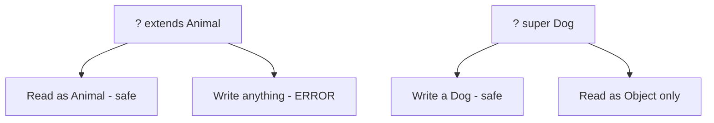

# Wildcards

## 1. Introduction

**Wildcards** (`?`) represent an *unknown* type in generics. Combined with bounds — `? extends T` (upper bound) and `? super T` (lower bound) — they make generic APIs flexible while staying type-safe.

---

## 2. Why This Topic Is Important

- Wildcards let one method accept `List<Dog>`, `List<Cat>`, and `List<Animal>`.
- Interviewers test `? extends` vs `? super` (PECS rule).
- Collections (`Collections.copy`, `sort`) use wildcards heavily.
- Framework method signatures are full of them.

---

## 3. Real-World Analogy

Think of a **bakery**:
- `? extends Item` = a shelf that holds "anything that IS-A Item" — you can read, but can't safely add (you don't know which item).
- `? super Item` = a box that holds "Item or any of its parents" — you can add an Item, but reading returns a generic parent.

The **PECS** rule: Producers `extends`, Consumers `super`.

---

## 4. Theory

### Three Wildcard Forms
| Form | Meaning | Read | Write |
|------|---------|------|-------|
| `?` | Any type | Object only | Not allowed |
| `? extends T` | T or subtype | Safe as T | Not allowed |
| `? super T` | T or supertype | Object only | Safe to add T |

### The PECS Rule
- **P**roducer: produces values for you → `? extends T` (you can read).
- **C**onsumer: consumes values you give → `? super T` (you can write).

### Why `? extends T` blocks writes
```java
List<? extends Animal> list;   // could be List<Dog> or List<Cat>
list.add(new Dog());           // ERROR — might be List<Cat>!
Animal a = list.get(0);        // OK — anything is an Animal
```

---

## 5. Syntax

```java
List<? extends Animal> producers;   // read as Animal
List<? super Dog> consumers;        // write a Dog
```

---

## 6. Flow Explanation



---

## 7. Memory Representation

Wildcards are compile-time only — erased to their bounds at runtime.

---

## 8. Simple Example

```java
import java.util.List;

class Animal { String name() { return "animal"; } }
class Dog extends Animal { @Override String name() { return "dog"; } }
class Cat extends Animal { @Override String name() { return "cat"; } }

public class WildcardDemo {
    static void showNames(List<? extends Animal> animals) {
        for (Animal a : animals) {
            System.out.println(a.name());
        }
    }

    public static void main(String[] args) {
        List<Dog> dogs = List.of(new Dog(), new Dog());
        List<Cat> cats = List.of(new Cat());

        showNames(dogs);     // works: Dog extends Animal
        showNames(cats);     // works: Cat extends Animal
    }
}
```

---

## 9. Intermediate Example — The PECS Distinction

```java
import java.util.List;
import java.util.ArrayList;

public class PecsDemo {
    // Producer: read items as Fruit
    static void printFruits(List<? extends Fruit> fruits) {
        for (Fruit f : fruits) {
            System.out.println(f.sweetness());
        }
    }

    // Consumer: fill a basket with Apples
    static void fillBasket(List<? super Apple> basket) {
        basket.add(new Apple());
        basket.add(new Apple());
    }

    public static void main(String[] args) {
        List<Apple> apples = new ArrayList<>();
        fillBasket(apples);                 // ? super Apple accepts List<Apple>
        printFruits(apples);                // ? extends Fruit accepts List<Apple>

        List<Fruit> fruitBasket = new ArrayList<>();
        fillBasket(fruitBasket);            // List<Fruit> is super of Apple
        printFruits(fruitBasket);
    }
}

class Fruit { String sweetness() { return "sweet"; } }
class Apple extends Fruit { }
```

---

## 10. Advanced Example — Wildcards in Copy (PECS in action)

```java
import java.util.List;
import java.util.ArrayList;
import java.util.Collections;

public class CopyWildcard {
    // src produces (? extends T), dest consumes (? super T)
    static <T> void copyAll(List<? extends T> src, List<? super T> dest) {
        for (T item : src) {
            dest.add(item);
        }
    }

    public static void main(String[] args) {
        List<Dog> dogs = List.of(new Dog(), new Dog());
        List<Animal> animals = new ArrayList<>();

        copyAll(dogs, animals);       // Dog -> Animal works
        System.out.println("Copied " + animals.size() + " animals");

        // Compare: Collections.copy uses the same pattern
        List<String> src = List.of("a", "b");
        List<Object> dst = new ArrayList<>();
        Collections.copy(dst, src);   // hmm - needs same size; see note
        System.out.println(dst);
    }
}
```

> Note: `Collections.copy` requires the destination to be at least as large; the wildcard demo above is the safer pattern for filling.

---

## 11. Output

For the **Simple Example**:

```
dog
dog
cat
```

For the **Intermediate Example**:

```
sweet
sweet
sweet
sweet
```

---

## 12. Common Mistakes

| Mistake | Correction |
|---------|------------|
| Writing into `? extends` | Not allowed — use `? super` for writes |
| Reading `? super` as anything but Object | Only Object guaranteed |
| Using `?` when T works | Prefer named type params for reuse |
| Forgetting PECS | Producers extends, consumers super |
| Mixing unbounded where bounded needed | Bounds communicate what you can read/write |

---

## 13. Best Practices

- Apply **PECS** every time you see a wildcard.
- `? extends` for read-only inputs.
- `? super` for write-only outputs.
- Use unbounded `?` when reading Objects only.
- Document the read/write contract in comments.

---

## 14. Interview Questions

**Q1. What is a wildcard?**
*`?` — an unknown type in generics.*

**Q2. Explain PECS.**
*Producer Extends, Consumer Super: `? extends T` for producing (reading), `? super T` for consuming (writing).*

**Q3. Why can't you add to `List<? extends Animal>`?**
*It could be List<Dog>, List<Cat>, etc. — adding is unsafe.*

**Q4. What can you read from `List<? super Dog>`?**
*Only Object (the actual type is unknown).*

**Q5. When to use `?` vs a type parameter `<T>`?**
*Wildcard when the type appears once; type parameter when reused across the signature.*

---

## 15. Practice Exercises

1. Write a method printing any `List<? extends Number>`.
2. Write a method filling `List<? super Integer>`.
3. Apply PECS to a copy method.
4. Explain why `add` fails on `? extends` (in a comment).

---

## 16. Coding Challenges

1. **Easy:** A `showAll(List<?>)` printing any list.
2. **Medium:** A `copy` util using PECS.
3. **Hard:** A `merge(List<? extends T> a, List<? extends T> b, List<? super T> out)` combining both PECS directions.

---

## 17. Summary

- `?` = unknown type; bounds shape what you can do.
- `? extends T`: read as T (producer).
- `? super T`: write a T (consumer).
- PECS: Producers extends, Consumers super.
- Wildcards are compile-time only.

➡️ Continue to: [Type Erasure](Type-Erasure.md)