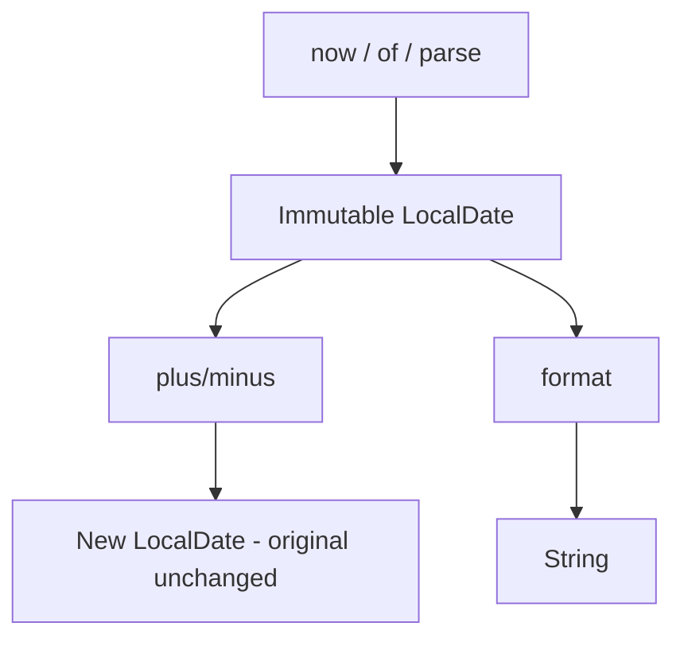

# Date & Time API

## 1. Introduction

The modern **`java.time`** API (Java 8) replaced the broken `Date`/`Calendar` classes. It's immutable, fluent, and thread-safe — built around `LocalDate`, `LocalTime`, `LocalDateTime`, and `Instant`.

---

## 2. Why This Topic Is Important

- Date handling is everywhere: logs, bookings, reports.
- The old API was notoriously buggy (month 0-based, mutable).
- Interviews test LocalDate/LocalDateTime operations.
- JDBC, Spring, and JSON serialization use java.time.

---

## 3. Real-World Analogy

Think of the difference between **analog (old) and digital (new) clocks**. The old API was like a messy analog clock that's hard to read and can be changed accidentally. java.time is a precise digital clock: clear, immutable, reliable.

---

## 4. Theory

### Key Classes
| Class | Represents |
|-------|------------|
| `LocalDate` | Date (no time) |
| `LocalTime` | Time (no date) |
| `LocalDateTime` | Date + time (no zone) |
| `ZonedDateTime` | Date + time + zone |
| `Instant` | Moment on the timeline (UTC) |
| `Duration` | Amount of time |
| `Period` | Amount of calendar days |

### Key Methods (LocalDate)
| Method | Purpose |
|--------|---------|
| `now()` | Today |
| `of(y, m, d)` | Specific date |
| `plusDays/plusMonths/plusYears` | Add |
| `minusDays` | Subtract |
| `isBefore/isAfter` | Compare |
| `getDayOfWeek/getMonth` | Query |
| `parse("2024-01-15")` | From string |

### Formatting
```java
DateTimeFormatter f = DateTimeFormatter.ofPattern("dd-MM-yyyy");
LocalDate date = LocalDate.parse("15-01-2024", f);
String out = date.format(f);
```

---

## 5. Syntax

```java
LocalDate today = LocalDate.now();
LocalDate birthday = LocalDate.of(2000, 1, 15);
LocalDateTime now = LocalDateTime.now();
Instant instant = Instant.now();
```

---

## 6. Flow Explanation



---

## 7. Memory Representation

java.time values are immutable objects; operations return new instances.

---

## 8. Simple Example

```java
import java.time.LocalDate;

public class DateBasics {
    public static void main(String[] args) {
        LocalDate today = LocalDate.now();
        LocalDate birthday = LocalDate.of(2000, 1, 15);

        System.out.println("Today      : " + today);
        System.out.println("Birthday   : " + birthday);
        System.out.println("Day of week: " + birthday.getDayOfWeek());
        System.out.println("Month      : " + birthday.getMonth());

        LocalDate nextWeek = today.plusDays(7);
        System.out.println("Next week  : " + nextWeek);
    }
}
```

---

## 9. Intermediate Example — Calculations & Comparisons

```java
import java.time.LocalDate;
import java.time.Period;

public class DateCalc {
    public static void main(String[] args) {
        LocalDate today = LocalDate.now();
        LocalDate dueDate = today.plusMonths(2).plusDays(10);

        Period gap = Period.between(today, dueDate);
        System.out.println("Due in " + gap.getMonths() + " months and "
                + gap.getDays() + " days");

        System.out.println("Is due in future? " + dueDate.isAfter(today));
        System.out.println("Leap year? " + today.isLeapYear());
    }
}
```

---

## 10. Advanced Example — Parsing, Formatting, Instant

```java
import java.time.*;
import java.time.format.DateTimeFormatter;

public class DateAdvanced {
    public static void main(String[] args) {
        // parse from string
        DateTimeFormatter formatter = DateTimeFormatter.ofPattern("dd/MM/yyyy");
        LocalDate parsed = LocalDate.parse("15/01/2024", formatter);
        System.out.println("Parsed: " + parsed);

        // format to string
        System.out.println("Formatted: " + parsed.format(formatter));

        // local date-time and instant
        LocalDateTime meeting = LocalDateTime.of(2024, 5, 10, 14, 30);
        System.out.println("Meeting: " + meeting);

        Instant now = Instant.now();
        System.out.println("Instant (UTC): " + now);

        // duration between two instants
        Instant start = Instant.now();
        // ... simulated work
        Duration worked = Duration.between(start, Instant.now());
        System.out.println("Worked (ms): " + worked.toMillis());
    }
}
```

---

## 11. Output

For the **Intermediate Example**:

```
Due in 2 months and 10 days
Is due in future? true
Leap year? false
```

For the **Advanced Example**:

```
Parsed: 2024-01-15
Formatted: 15/01/2024
Meeting: 2024-05-10T14:30
Instant (UTC): 2026-08-14T10:00:00.123Z
Worked (ms): 0
```

---

## 12. Common Mistakes

| Mistake | Correction |
|---------|------------|
| Using old Date/Calendar | Use java.time |
| Mutating a LocalDate | It's immutable — reassign the result |
| Mixing LocalDateTime with Instant | Instant is UTC; local has no zone |
| Wrong format pattern | Use `dd/MM/yyyy` style patterns |
| Date arithmetic off-by-one | Months in java.time are 1-based (good!) |

---

## 13. Best Practices

- Use LocalDate/LocalDateTime unless you need zones.
- Use Instant for timestamps/machine time.
- Use Period for days/months, Duration for seconds/nanos.
- Define DateTimeFormatter patterns as constants.
- Store timestamps as Instant (UTC) in databases.

---

## 14. Interview Questions

**Q1. Why was java.time introduced?**
*The old Date/Calendar was mutable, confusing (0-based months), and thread-unsafe.*

**Q2. LocalDate vs LocalDateTime vs Instant?**
*Date-only, date+time (no zone), and UTC moment.*

**Q3. How do you parse/format dates?**
*DateTimeFormatter.ofPattern(...) with parse/format.*

**Q4. Period vs Duration?**
*Period = calendar days/months; Duration = exact time.*

**Q5. Is LocalDate immutable?**
*Yes — operations return new instances.*

---

## 15. Practice Exercises

1. Print today, next week, and your birthday's weekday.
2. Calculate the gap between two dates with Period.
3. Parse and format "31/12/2024".
4. Measure elapsed time with Duration/Instant.

---

## 16. Coding Challenges

1. **Easy:** A countdown display to a fixed date.
2. **Medium:** An age calculator from a birth date.
3. **Hard:** A booking system validating dates and computing duration (days/hours).

---

## 17. Summary

- java.time is immutable, fluent, and correct.
- LocalDate/LocalTime/LocalDateTime for humans; Instant for machines.
- Format with DateTimeFormatter.
- Period for calendar math; Duration for exact time.
- No more Date/Calendar pain.

➡️ Continue to: [Exercises](Exercises.md)