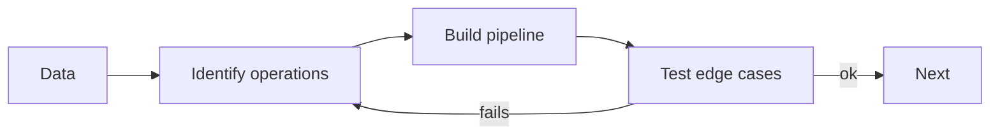

# Exercises — Java 8 Features

## 1. Introduction

Practice lambdas, functional interfaces, streams, Optionals, and the date/time API. These are the tools of modern Java — employers expect fluency.

---

## 2. Why This Topic Is Important

- Java 8 style is the baseline in every codebase.
- Interviews probe streams and Optionals constantly.
- Spring, Hibernate, and REST code rely on these.
- Functional fluency makes code shorter and safer.

---

## 3. Real-World Analogy

Practice is like **learning shorthand**: once you can write and read concise functional code, you communicate (and impress) far more efficiently.

---

## 4. Theory — Toolbox Recap

- Lambda: `(x) -> expr`.
- Functional: Predicate/Function/Consumer/Supplier.
- Streams: filter → map → collect.
- Optional: ofNullable, orElse, map, flatMap.
- Dates: LocalDate, Instant, DateTimeFormatter.

---

## 5. Syntax Reminder

```java
List<Integer> evens = nums.stream()
        .filter(n -> n % 2 == 0)
        .collect(Collectors.toList());

String name = Optional.ofNullable(s).orElse("default");
LocalDate d = LocalDate.parse("2024-01-15");
```

---

## 6. Practice Flow



---

## 7. Memory Representation

Skip — behavior-focused.

---

## 8. Simple Exercises

**Ex 1 — Lambda Sort**
Sort names by length with a lambda; print with forEach.

**Ex 2 — Predicate Filter**
Keep numbers > 10 with a Predicate.

**Ex 3 — Function Map**
Transform a list of strings to their lengths.

---

## 9. Intermediate Exercises

**Ex 4 — Stream Pipeline**
Numbers: filter even, square, sort desc, collect to List.

**Ex 5 — Word Stats**
Count words, find longest, join uppercase unique words via streams.

**Ex 6 — Optional OrElse**
Find a value in a map, return default if absent via Optional.

**Ex 7 — Date Math**
Print today + 30 days and the weekday of your birth date.

---

## 10. Advanced Exercises

**Ex 8 — Grouping**
Group a list of products by category with Collectors.groupingBy.

**Ex 9 — FlatMap**
Flatten a list of lists into a single sorted unique list.

**Ex 10 — Chained Optionals**
User → address → zipcode, each Optional; chain with flatMap; default if missing.

**Ex 11 — Booking Validator**
Validate a booking: date in future, duration positive; use java.time and streams.

---

## 11. Expected Output Samples

**Ex 4 (Stream Pipeline):**
```
[100, 64, 36, 16, 4]
```

**Ex 10 (Chained Optionals):**
```
Zipcode: 600001
```

---

## 12. Common Mistakes

| Mistake | Fix |
|---------|-----|
| No terminal operation | Add collect/count/forEach |
| get() on empty Optional | orElse/orElseGet |
| Old Date/Calendar | java.time |
| Reusing a stream | New stream per pass |
| Complicated lambdas | Extract methods |

---

## 13. Best Practices

- One pipeline, one clear transformation.
- Chain Optional operations.
- Use method references when possible.
- Format dates via DateTimeFormatter constants.
- Verify with edge cases (empty lists, nulls).

---

## 14. Interview Practice Questions

**Q1.** What is a functional interface?
**Q2.** Intermediate vs terminal stream ops?
**Q3.** Optional vs null?
**Q4.** Method reference vs lambda?
**Q5.** Why java.time over Date/Calendar?

---

## 15. Self-Check

- [ ] I write lambdas and method references fluently.
- [ ] I use Predicate/Function/Consumer/Supplier.
- [ ] I build stream pipelines with filter/map/collect.
- [ ] I handle nulls safely with Optional.
- [ ] I work with LocalDate/LocalDateTime/Instant.
- [ ] I can group and reduce with streams.

---

## 16. Next Steps

- Move to [Module 19 — JDBC](../19-JDBC/README.md).
- Later modules (Spring, Hibernate) assume Java 8 fluency.

---

## 17. Summary

- Lambdas + functional interfaces = concise code.
- Streams replace loops with pipelines.
- Optional kills NPEs.
- java.time is the only date API you need.
- Practice every pipeline until it's natural.

➡️ Module complete! Continue to [19 — JDBC](../19-JDBC/README.md).