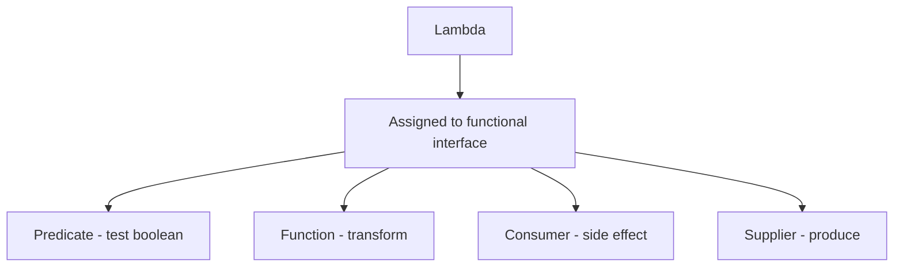

# Functional Interfaces

## 1. Introduction

A **functional interface** has exactly **one abstract method**. Lambdas implement it. Java ships a rich set in `java.util.function`: `Predicate`, `Function`, `Consumer`, `Supplier`, and more.

---

## 2. Why This Topic Is Important

- Lambdas are useless without a target functional interface.
- Interviews test the core four and their usage.
- Streams' filter/map/forEach all take functional interfaces.
- Your own APIs can accept them for flexibility.

---

## 3. Real-World Analogy

Think of **job postings**. Each posting (functional interface) specifies one required skill (abstract method). A candidate (lambda) who has that skill fills the role. Predicate = "can test a value," Function = "can transform a value," etc.

---

## 4. Theory

### The Core Four
| Interface | Abstract Method | Purpose |
|-----------|-----------------|---------|
| `Predicate<T>` | `boolean test(T)` | Test a condition |
| `Function<T, R>` | `R apply(T)` | Transform T → R |
| `Consumer<T>` | `void accept(T)` | Consume, no result |
| `Supplier<T>` | `T get()` | Provide a value |

### Common Variants
| Interface | Method | Notes |
|-----------|--------|-------|
| `BiFunction<T,U,R>` | `R apply(T,U)` | Two inputs |
| `BiPredicate<T,U>` | `boolean test(T,U)` | Two inputs |
| `UnaryOperator<T>` | `T apply(T)` | Function with same type |
| `BinaryOperator<T>` | `T apply(T,T)` | Combine two |
| `IntPredicate`, `LongFunction`... | primitive | Avoid boxing |

### Marking Your Own
```java
@FunctionalInterface
interface Greeter {
    String greet(String name);     // exactly one abstract method
}
```

---

## 5. Syntax

```java
Predicate<Integer> isEven = n -> n % 2 == 0;
Function<String, Integer> len = s -> s.length();
Consumer<String> print = System.out::println;
Supplier<String> name = () -> "Ajay";
```

---

## 6. Flow Explanation



---

## 7. Memory Representation

Lambdas compile to invokedynamic; the functional interface instance is created at runtime.

---

## 8. Simple Example

```java
import java.util.function.*;

public class CoreFour {
    public static void main(String[] args) {
        Predicate<String> nonEmpty = s -> !s.isEmpty();
        Function<String, Integer> length = s -> s.length();
        Consumer<String> shout = s -> System.out.println(s.toUpperCase());
        Supplier<Double> random = Math::random;

        System.out.println("nonEmpty(\"\")? " + nonEmpty.test(""));
        System.out.println("length(\"Java\")? " + length.apply("Java"));

        shout.accept("hello");
        System.out.println("Random: " + random.get());
    }
}
```

---

## 9. Intermediate Example — Passing Functions Around

```java
import java.util.function.Function;

public class FunctionDemo {
    static String transform(String input, Function<String, String> fn) {
        return fn.apply(input);
    }

    public static void main(String[] args) {
        Function<String, String> upper = s -> s.toUpperCase();
        Function<String, String> trim = s -> s.trim();
        Function<String, String> prefix = s -> "[ " + s + " ]";

        System.out.println(transform("  hello  ", upper));
        System.out.println(transform("  hello  ", trim));
        System.out.println(transform("java", prefix));
    }
}
```

---

## 10. Advanced Example — Composing Functions

```java
import java.util.function.Function;
import java.util.function.Predicate;

public class ComposeDemo {
    public static void main(String[] args) {
        Function<Integer, Integer> doubleIt = x -> x * 2;
        Function<Integer, Integer> addTen = x -> x + 10;

        // andThen: double first, then add ten
        Function<Integer, Integer> doubleThenAdd = doubleIt.andThen(addTen);
        System.out.println("doubleThenAdd(5) = " + doubleThenAdd.apply(5));

        // compose: add ten first, then double
        Function<Integer, Integer> addThenDouble = doubleIt.compose(addTen);
        System.out.println("addThenDouble(5) = " + addThenDouble.apply(5));

        // predicate chaining
        Predicate<Integer> positive = n -> n > 0;
        Predicate<Integer> even = n -> n % 2 == 0;
        Predicate<Integer> positiveEven = positive.and(even);

        System.out.println("6 is positive-even? " + positiveEven.test(6));
        System.out.println("9 is positive-even? " + positiveEven.test(9));
    }
}
```

---

## 11. Output

For the **Simple Example**:

```
nonEmpty("")? false
length("Java")? 4
HELLO
Random: 0.732
```

For the **Advanced Example**:

```
doubleThenAdd(5) = 20
addThenDouble(5) = 30
6 is positive-even? true
9 is positive-even? false
```

---

## 12. Common Mistakes

| Mistake | Correction |
|---------|------------|
| Using Consumer to return a value | Consumer returns void — use Function |
| Using Predicate for transformation | Predicate returns boolean only |
| Two abstract methods in "functional" interface | Only one allowed (plus defaults) |
| Forgetting primitive variants | IntPredicate avoids boxing |
| Long multi-statement lambdas | Extract to methods |

---

## 13. Best Practices

- Reach for the core four first.
- Use primitive variants for performance.
- Compose with andThen/compose.
- Mark custom interfaces with `@FunctionalInterface`.
- Keep lambdas single-purpose.

---

## 14. Interview Questions

**Q1. What is a functional interface?**
*An interface with exactly one abstract method (may have default/static).*

**Q2. Name the four main ones.**
*Predicate, Function, Consumer, Supplier.*

**Q3. Predicate vs Function?**
*Predicate returns boolean; Function transforms T to R.*

**Q4. What is @FunctionalInterface?**
*A documentation/compile-check annotation enforcing one abstract method.*

**Q5. What are primitive functional interfaces?**
*IntPredicate, LongFunction etc. — avoid autoboxing.*

---

## 15. Practice Exercises

1. Use all four core interfaces in one program.
2. Write a method that takes a Function and applies it.
3. Compose two Functions and a Predicate.
4. Create your own @FunctionalInterface.

---

## 16. Coding Challenges

1. **Easy:** Filter, transform, print with Predicate/Function/Consumer.
2. **Medium:** A pipeline builder: String → trim → upper → log.
3. **Hard:** A small validation framework using Predicates composed with and/or.

---

## 17. Summary

- Functional interface = one abstract method.
- Core: Predicate, Function, Consumer, Supplier.
- Compose with andThen/compose.
- Primitive variants avoid boxing.
- Your APIs can accept these for flexibility.

➡️ Continue to: [Method References](Method-References.md)