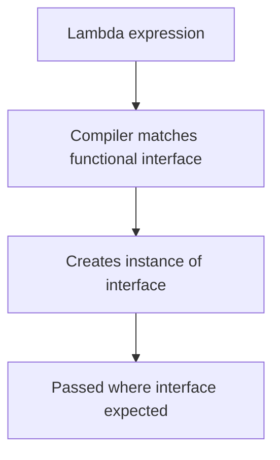

# Lambda Expressions

## 1. Introduction

A **lambda expression** is an anonymous function — a concise block of code passed around like a value. `(x) -> x * 2` is a lambda. They make functional programming possible in Java.

---

## 2. Why This Topic Is Important

- Lambdas replace verbose anonymous classes.
- Streams, Optionals, and collections use them everywhere.
- Interviewers test lambda syntax and effectively-final rules.
- Modern Java code is unreadable without lambdas.

---

## 3. Real-World Analogy

A lambda is like **ordering food by a code** instead of describing the recipe. Instead of writing a full class ("boil water, add pasta..."), you hand a chef a one-line instruction: "pasta" (or `x -> x * 2`). The kitchen (framework) knows what to do.

---

## 4. Theory

### Syntax
```java
// (parameters) -> body
() -> System.out.println("hi");
x -> x * 2;
(x, y) -> x + y;
(String a, String b) -> a.length() - b.length();
```

### Comparison with Anonymous Class
```java
// Old way
Runnable r1 = new Runnable() {
    @Override public void run() { System.out.println("Old"); }
};

// Lambda
Runnable r2 = () -> System.out.println("New");
```

### Rules
| Rule | Detail |
|------|--------|
| Type inference | `(x, y)` — types optional |
| Single param | Parentheses optional: `x -> ...` |
| Multi statements | Use braces + `return`: `(x) -> { ...; return ...; }` |
| Effectively final | Captured variables must not be reassigned |
| Can't be a statement alone | Needs a functional interface target |

---

## 5. Syntax

```java
(parameters) -> expression
(parameters) -> { statements; return value; }
```

---

## 6. Flow Explanation



---

## 7. Memory Representation

A lambda compiles to an invokedynamic call creating an interface instance — no anonymous class file per lambda.

---

## 8. Simple Example

```java
import java.util.function.Predicate;

public class LambdaBasics {
    public static void main(String[] args) {
        // lambda assigned to a functional interface
        Predicate<Integer> isEven = n -> n % 2 == 0;

        System.out.println("4 even? " + isEven.test(4));
        System.out.println("5 even? " + isEven.test(5));
    }
}
```

---

## 9. Intermediate Example — Sorting with Lambda

```java
import java.util.*;

public class LambdaSort {
    public static void main(String[] args) {
        List<String> names = new ArrayList<>(Arrays.asList(
                "Priya", "Ajay", "Ravi", "Zen"));

        names.sort((a, b) -> a.length() - b.length());
        System.out.println("By length: " + names);

        names.sort((a, b) -> b.compareTo(a));
        System.out.println("Reverse: " + names);

        names.forEach(name -> System.out.println("Hello, " + name));
    }
}
```

---

## 10. Advanced Example — Capturing Effectively-Final Variables

```java
import java.util.function.Function;

public class EffectivelyFinal {
    public static void main(String[] args) {
        int base = 10;               // effectively final (never reassigned)

        Function<Integer, Integer> addBase = x -> x + base;   // captured

        System.out.println(addBase.apply(5));   // 15

        // int base = 11; would break — can't reassign a captured var
    }
}
```

---

## 11. Output

For the **Simple Example**:

```
4 even? true
5 even? false
```

For the **Intermediate Example**:

```
By length: [Ajay, Ravi, Zen, Priya]
Reverse: [Zen, Ravi, Priya, Ajay]
Hello, Priya
Hello, Ajay
Hello, Ravi
Hello, Zen
```

---

## 12. Common Mistakes

| Mistake | Correction |
|---------|------------|
| Reassigning captured variables | Lambdas require effectively-final |
| Missing return in multi-statement lambdas | Add `return` inside braces |
| Using `==` on captured refs | Compare values with equals |
| Lambdas without a target type | Assign to a functional interface |
| Over-complicating bodies | Keep lambdas short; extract methods |

---

## 13. Best Practices

- Keep lambdas **short and readable** — one expression ideal.
- Use types sparingly (infer).
- Prefer method references when a method already exists.
- Use meaningful parameter names.
- Extract complex bodies into methods.

---

## 14. Interview Questions

**Q1. What is a lambda expression?**
*An anonymous function; a concise implementation of a functional interface.*

**Q2. What is effectively final?**
*A variable not reassigned after initialization — the only kind lambdas can capture.*

**Q3. Lambda vs anonymous class?**
*Lambdas are shorter, use less boilerplate, and compile to invokedynamic.*

**Q4. When can you omit parentheses?**
*With a single parameter.*

**Q5. What target does a lambda need?**
*A functional interface (one abstract method).*

---

## 15. Practice Exercises

1. Sort a list of names with a lambda.
2. Print squares of 1–5 with forEach + lambda.
3. Use a Predicate to filter a list.
4. Demonstrate the effectively-final rule.

---

## 16. Coding Challenges

1. **Easy:** Greet each name in a list with a lambda.
2. **Medium:** Sort products by price descending using a lambda.
3. **Hard:** Build a `Calculator` using lambdas for add/sub/mul/div.

---

## 17. Summary

- Lambdas = anonymous functions.
- (params) -> body; braces + return for multi-line.
- Capture only effectively-final variables.
- Target = functional interface.
- Keep them short; prefer method references.

➡️ Continue to: [Functional Interfaces](Functional-Interfaces.md)