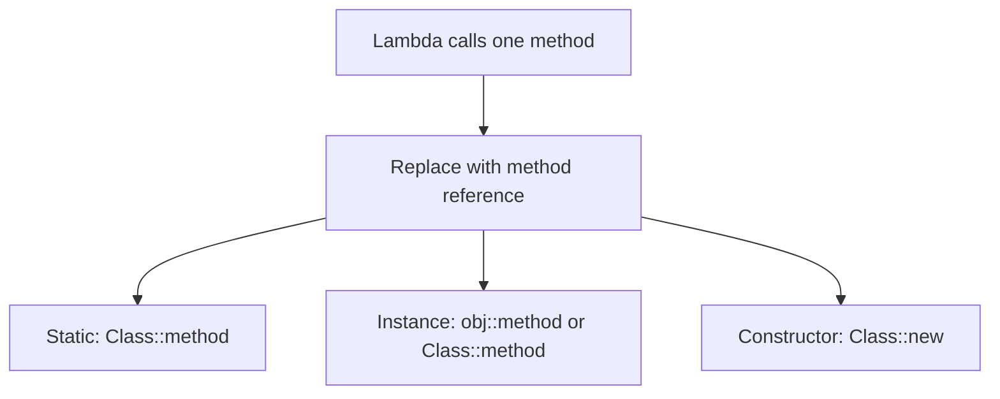

# Method References

## 1. Introduction

A **method reference** is a shorthand for a lambda when the lambda just calls an existing method. `System.out::println` means `s -> System.out.println(s)`.

---

## 2. Why This Topic Is Important

- Cleaner, more readable lambdas.
- Interviews test the four kinds of method references.
- Streams use them constantly (`String::toUpperCase`).
- They signal idiomatic Java 8+ style.

---

## 3. Real-World Analogy

A method reference is like **giving a recipe by name** instead of writing it out. Instead of "take each vegetable and chop it" (lambda), you say "chop" (method reference) — assuming the kitchen already knows that recipe.

---

## 4. Theory

### Four Kinds
| Kind | Syntax | Example | Meaning |
|------|--------|---------|---------|
| Static method | `Class::staticMethod` | `Math::max` | `(a,b) -> Math.max(a,b)` |
| Instance of a specific object | `obj::method` | `System.out::println` | `x -> System.out.println(x)` |
| Instance of an arbitrary object | `Class::instanceMethod` | `String::toUpperCase` | `s -> s.toUpperCase()` |
| Constructor | `Class::new` | `ArrayList::new` | `() -> new ArrayList()` |

### When to Use
- Lambda body is a **single method call**.
- Parameter order matches the method arguments.

### Reference Type Selection
| Situation | Use |
|-----------|-----|
| Static utility | `Math::max` |
| Side-effect print/log | `System.out::println` |
| Transform each element | `String::trim` |
| Build new objects | `ArrayList::new` |

---

## 5. Syntax

```java
// instead of  s -> System.out.println(s)
System.out::println

// instead of  s -> s.toUpperCase()
String::toUpperCase

// instead of  () -> new ArrayList<>()
ArrayList::new
```

---

## 6. Flow Explanation



---

## 7. Memory Representation

Method references compile like lambdas — invokedynamic at runtime.

---

## 8. Simple Example

```java
import java.util.List;
import java.util.function.Consumer;
import java.util.function.Function;

public class MethodRefBasics {
    public static void main(String[] args) {
        Consumer<String> print = System.out::println;
        print.accept("Hello, method reference!");

        Function<String, Integer> len = String::length;
        System.out.println("Length: " + len.apply("Java"));

        List<String> names = List.of("ajay", "priya");
        names.forEach(System.out::println);
    }
}
```

---

## 9. Intermediate Example — Static & Instance References

```java
import java.util.List;
import java.util.function.BiFunction;
import java.util.function.Function;

public class MethodRefTypes {
    static int triple(int n) { return n * 3; }

    public static void main(String[] args) {
        // static method reference
        Function<Integer, Integer> tripler = MethodRefTypes::triple;
        System.out.println("triple(4) = " + tripler.apply(4));

        // arbitrary-object instance reference
        Function<String, String> upper = String::toUpperCase;
        System.out.println(upper.apply("java"));

        // BiFunction static ref (Math.max)
        BiFunction<Integer, Integer, Integer> max = Math::max;
        System.out.println("max(4, 9) = " + max.apply(4, 9));
    }
}
```

---

## 10. Advanced Example — Constructor References & Streams

```java
import java.util.ArrayList;
import java.util.List;
import java.util.function.Supplier;
import java.util.stream.Collectors;

public class ConstructorRef {
    public static void main(String[] args) {
        // constructor reference
        Supplier<List<String>> listFactory = ArrayList::new;
        List<String> list = listFactory.get();
        list.add("created via constructor ref");
        System.out.println(list);

        // chained with streams
        List<String> names = List.of(" ajay ", " priya ", " ravi ");
        List<String> cleaned = names.stream()
                .map(String::trim)              // instance ref
                .map(String::toUpperCase)       // instance ref
                .collect(Collectors.toCollection(ArrayList::new));  // ctor ref
        System.out.println(cleaned);
    }
}
```

---

## 11. Output

For the **Intermediate Example**:

```
triple(4) = 12
JAVA
max(4, 9) = 9
```

For the **Advanced Example**:

```
[created via constructor ref]
[AJAY, PRIYA, RAVI]
```

---

## 12. Common Mistakes

| Mistake | Correction |
|---------|------------|
| Using refs for multi-step bodies | Only single method calls qualify |
| `Class::method` for a specific instance | Use `obj::method` |
| Confusing the two instance kinds | `obj::m` vs `Class::m` (arbitrary element) |
| Constructor refs with arguments | Only when the target provides them |
| Forgetting method visibility | Ref must be accessible |

---

## 13. Best Practices

- Prefer method references when they read clearly.
- Keep lambdas when logic is custom.
- Use `System.out::println` for printing.
- Use constructor refs with Collectors.
- Choose refs over lambdas when a method already exists.

---

## 14. Interview Questions

**Q1. What is a method reference?**
*A shorthand for a lambda that calls an existing method.*

**Q2. Name the four kinds.**
*Static, instance-of-object, instance-of-arbitrary-object, constructor.*

**Q3. `String::toUpperCase` vs `str -> str.toUpperCase()`?**
*Identical — the reference is just cleaner.*

**Q4. When can't you use one?**
*When the lambda has custom logic beyond a single call.*

**Q5. Constructor reference syntax?**
*`ClassName::new`.*

---

## 15. Practice Exercises

1. Replace a print lambda with a method reference.
2. Use `Math::max` and `Math::sqrt`.
3. Trim + upper a list using references.
4. Build a list with `ArrayList::new`.

---

## 16. Coding Challenges

1. **Easy:** Sort and print a list with method references.
2. **Medium:** A stream cleaning pipeline using only references.
3. **Hard:** A map-values transformation using static + instance references.

---

## 17. Summary

- Method refs = shorthand for single-call lambdas.
- Static, instance, arbitrary-instance, constructor.
- Cleaner with streams and collectors.
- Prefer when readable; lambdas for custom logic.

➡️ Continue to: [Streams](Streams.md)