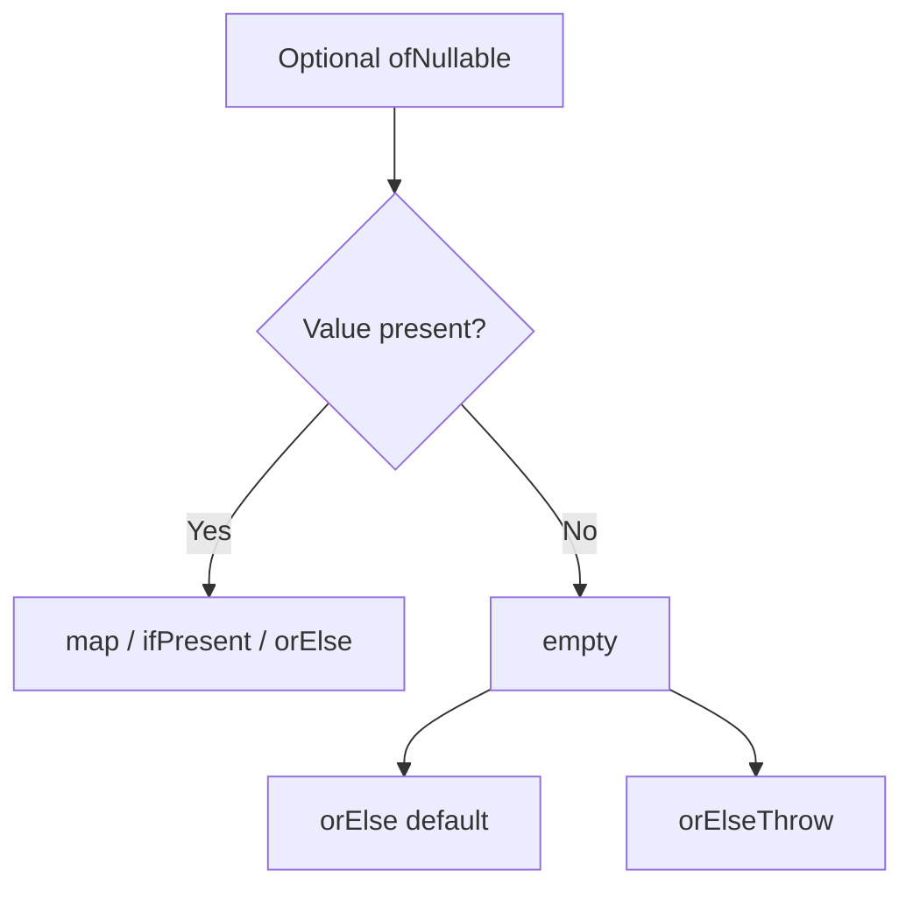

# Optional

## 1. Introduction

**`Optional<T>`** is a container that may or may not hold a value. It makes "no result" **explicit** and encourages handling absence safely instead of relying on null checks scattered everywhere.

---

## 2. Why This Topic Is Important

- NullPointerException is the #1 Java bug.
- Optional documents "may be absent" in method signatures.
- Interviews test creating, mapping, and using Optionals.
- Streams' findFirst, Spring Data, and JPA return Optionals.

---

## 3. Real-World Analogy

An Optional is like a **locker with a status indicator**. Instead of handing you an empty box (null) that crashes when you look inside, you get a labeled locker: "Empty" or "Contains X." You check the label first — no surprises.

---

## 4. Theory

### Creating Optionals
| Factory | Behavior |
|---------|----------|
| `Optional.of(v)` | v must not be null (else NPE) |
| `Optional.ofNullable(v)` | Allows null → empty |
| `Optional.empty()` | Empty optional |

### Reading Values
| Method | Behavior |
|--------|----------|
| `isPresent()` | Has value? |
| `isEmpty()` | Empty? (Java 11+) |
| `get()` | Value (throws if empty — avoid!) |
| `orElse(default)` | Value or default |
| `orElseGet(supplier)` | Value or computed |
| `orElseThrow(...)` | Value or throw |

### Transforming
| Method | Purpose |
|--------|---------|
| `map(Function)` | Transform if present |
| `flatMap(Function)` | Chain Optionals |
| `filter(Predicate)` | Conditionally keep |
| `ifPresent(Consumer)` | Side effect if present |

---

## 5. Syntax

```java
Optional<String> opt = Optional.ofNullable(maybeNull);
opt.map(String::toUpperCase)
   .ifPresent(System.out::println);
```

---

## 6. Flow Explanation



---

## 7. Memory Representation

Optional is a small heap object wrapping (or not wrapping) the value.

---

## 8. Simple Example

```java
import java.util.Optional;

public class OptionalBasics {
    public static void main(String[] args) {
        Optional<String> present = Optional.of("hello");
        Optional<String> absent = Optional.empty();

        System.out.println("present: " + present.orElse("n/a"));
        System.out.println("absent : " + absent.orElse("n/a"));

        absent.ifPresent(s -> System.out.println("won't print"));
        present.ifPresent(s -> System.out.println("Has: " + s));
    }
}
```

---

## 9. Intermediate Example — Map, Filter, orElseGet

```java
import java.util.Optional;

public class OptionalTransform {
    public static void main(String[] args) {
        Optional<String> name = Optional.of("  ajay  ");

        String cleaned = name.map(String::trim)
                .map(String::toUpperCase)
                .orElse("UNKNOWN");
        System.out.println("Cleaned: " + cleaned);

        Optional<Integer> len = name.map(String::trim).map(String::length);
        System.out.println("Length: " + len.orElse(0));

        Optional<String> filtered = name.filter(s -> s.contains("jay"));
        System.out.println("Contains jay? " + filtered.isPresent());
    }
}
```

---

## 10. Advanced Example — Chaining with flatMap

```java
import java.util.Optional;

public class FlatMapDemo {
    static Optional<String> findNickname(String user) {
        if (user.equals("ajay")) return Optional.of("AJ");
        return Optional.empty();
    }

    public static void main(String[] args) {
        Optional<String> user = Optional.of("ajay");

        // map would wrap Optional<Optional<String>>; flatMap flattens
        Optional<String> nick = user.flatMap(FlatMapDemo::findNickname);

        System.out.println("Nickname: " + nick.orElse("none"));

        // orElseThrow pattern
        try {
            Optional.empty().orElseThrow(() -> new IllegalStateException("missing"));
        } catch (IllegalStateException e) {
            System.out.println("Threw: " + e.getMessage());
        }
    }
}
```

---

## 11. Output

For the **Intermediate Example**:

```
Cleaned: AJAY
Length: 4
Contains jay? true
```

For the **Advanced Example**:

```
Nickname: AJ
Threw: missing
```

---

## 12. Common Mistakes

| Mistake | Correction |
|---------|------------|
| Calling `get()` on empty | Throws NoSuchElementException — use orElse |
| Returning null from a method | Return `Optional` instead |
| Using Optional for fields/parameters | Intended for return types |
| Overusing isPresent + get | Use map/ifPresent/orElse |
| Optional.of(null) | Use ofNullable |

---

## 13. Best Practices

- Return Optional from methods that may lack a result.
- Don't use Optional for fields, params, or collections.
- Prefer orElseGet over orElse when default is costly.
- Chain map/flatMap instead of isPresent+get.
- Keep it in stream contexts (findFirst, reduce).

---

## 14. Interview Questions

**Q1. What is Optional?**
*A container explicitly modeling the presence/absence of a value, avoiding null.*

**Q2. of vs ofNullable?**
*of throws on null; ofNullable returns empty for null.*

**Q3. orElse vs orElseGet?**
*orElse takes a fixed value; orElseGet lazily computes via a Supplier.*

**Q4. Why is get() discouraged?**
*It throws if empty — safer alternatives exist.*

**Q5. Can Optional be serialized?**
*Not reliably — avoid in fields/entities.*

---

## 15. Practice Exercises

1. Create Optional with of, ofNullable, empty.
2. Use orElse and orElseGet.
3. Chain map/filter on an Optional.
4. Chain flatMap between two methods returning Optional.

---

## 16. Coding Challenges

1. **Easy:** A `findById` returning Optional with orElse default.
2. **Medium:** Transform an Optional string pipeline.
3. **Hard:** A user service where lookup, nickname, and address all return Optionals and are chained with flatMap.

---

## 17. Summary

- Optional makes absence explicit and safe.
- of/ofNullable/empty to create; orElse/orElseGet to read.
- map/filter/flatMap transform safely.
- Avoid get(); chain instead.
- Return Optionals; don't store them in fields.

➡️ Continue to: [Date & Time API](Date-Time-API.md)