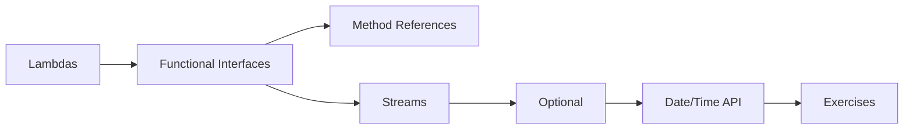

# 16 — Java 8 Features

> **Experience level: 🟠 Intermediate (1 – 2 years)**

Java 8 changed how Java is written: **lambdas**, **functional interfaces**, **Streams**, **Optional**, and the **Date/Time API**. This module is essential for any modern Java job.

---

## 📂 Files in This Module

| File | What You'll Learn |
|------|-------------------|
| [Lambda-Expressions.md](Lambda-Expressions.md) | Anonymous functions in one line |
| [Functional-Interfaces.md](Functional-Interfaces.md) | Predicate, Function, Consumer, Supplier |
| [Method-References.md](Method-References.md) | Cleaner lambdas with :: |
| [Streams.md](Streams.md) | Declarative data processing pipelines |
| [Optional.md](Optional.md) | Handling null safely |
| [Date-Time-API.md](Date-Time-API.md) | The modern java.time package |
| [Exercises.md](Exercises.md) | Practice tasks for this module |

---

## 🎯 Learning Objectives

By the end of this module, you will be able to:

1. ✅ Write lambda expressions fluently.
2. ✅ Use built-in functional interfaces.
3. ✅ Build Stream pipelines (filter/map/collect).
4. ✅ Handle nulls safely with Optional.
5. ✅ Use java.time for dates and times.

---

## 🧭 Module Map



---

## 📌 Quick Preview

```java
import java.util.List;
import java.util.stream.Collectors;

List<Integer> evens = List.of(1, 2, 3, 4, 5, 6).stream()
        .filter(n -> n % 2 == 0)
        .collect(Collectors.toList());
System.out.println(evens);
```

---

## Next Module

➡️ [19 — JDBC](../19-JDBC/README.md) — connect Java to databases.