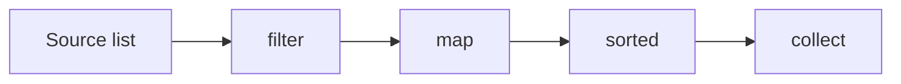

# Streams

## 1. Introduction

**Streams** let you process collections **declaratively**: chain operations like `filter`, `map`, and `reduce` into a pipeline. A stream doesn't store data — it *flows* data through operations.

---

## 2. Why This Topic Is Important

- Streams replace most manual for-loops with readable pipelines.
- Interviews at 1+ years test stream operations heavily.
- They work with lambdas, method refs, and functional interfaces.
- Parallel streams tap multi-core performance.

---

## 3. Real-World Analogy

A stream is like a **factory assembly line**. Items enter a conveyor: they're *filtered* (bad ones removed), *transformed* (packaged), *sorted* (ordered), and finally *collected* into boxes. Each station does one job; the items flow through.

---

## 4. Theory

### Pipeline Structure
```java
list.stream()          // source
    .filter(...)       // intermediate (lazy)
    .map(...)          // intermediate
    .sorted()          // intermediate
    .collect(...)      // terminal (eager)
```

### Intermediate Operations (lazy)
| Operation | Purpose |
|-----------|---------|
| `filter(Predicate)` | Keep matching |
| `map(Function)` | Transform each |
| `flatMap(Function)` | Flatten nested streams |
| `distinct()` | Remove duplicates |
| `sorted()` | Sort |
| `limit(n)` / `skip(n)` | Take/skip |
| `peek(Consumer)` | Inspect (debugging) |

### Terminal Operations (eager)
| Operation | Result |
|-----------|--------|
| `collect(...)` | Collect to List/Set/Map |
| `forEach(Consumer)` | Side effects |
| `count()` | Long count |
| `reduce(...)` | Combine to one value |
| `min/max/sum/average` | Numeric results |
| `anyMatch/allMatch/noneMatch` | Boolean checks |
| `findFirst/findAny` | Optional element |

### Key Facts
| Fact | Detail |
|------|--------|
| Lazy intermediates | Only run when a terminal exists |
| Single-use | A stream can't be reused |
| Don't modify source | Streams read the source |
| Parallel | `.parallelStream()` for cores |

---

## 5. Syntax

```java
list.stream()
    .filter(x -> cond)
    .map(x -> transformed)
    .collect(Collectors.toList());
```

---

## 6. Flow Explanation



---

## 7. Memory Representation

Streams are lazy and don't copy collections; intermediate ops produce streams, and only the terminal op triggers computation.

---

## 8. Simple Example

```java
import java.util.List;
import java.util.stream.Collectors;

public class StreamBasics {
    public static void main(String[] args) {
        List<Integer> numbers = List.of(1, 2, 3, 4, 5, 6, 7, 8, 9, 10);

        List<Integer> evenSquares = numbers.stream()
                .filter(n -> n % 2 == 0)              // keep evens
                .map(n -> n * n)                      // square them
                .collect(Collectors.toList());

        System.out.println("Even squares: " + evenSquares);

        long count = numbers.stream().filter(n -> n > 5).count();
        System.out.println("Numbers > 5: " + count);
    }
}
```

---

## 9. Intermediate Example — Strings & Sorting

```java
import java.util.List;
import java.util.stream.Collectors;

public class StreamStrings {
    public static void main(String[] args) {
        List<String> names = List.of("priya", "Ajay", "ravi", "Zara", "ajay");

        List<String> result = names.stream()
                .filter(n -> n.length() >= 4)
                .map(String::toUpperCase)
                .distinct()
                .sorted()
                .collect(Collectors.toList());

        System.out.println(result);
    }
}
```

---

## 10. Advanced Example — reduce, grouping, and findFirst

```java
import java.util.List;
import java.util.Map;
import java.util.stream.Collectors;

public class StreamAdvanced {
    public static void main(String[] args) {
        List<Integer> nums = List.of(3, 7, 2, 9, 4);

        // reduce to a sum
        int sum = nums.stream().reduce(0, Integer::sum);
        System.out.println("Sum: " + sum);

        // grouping by parity
        Map<String, List<Integer>> byParity = nums.stream()
                .collect(Collectors.groupingBy(n -> n % 2 == 0 ? "even" : "odd"));
        System.out.println("Grouped: " + byParity);

        // findFirst
        nums.stream().filter(n -> n > 5).findFirst()
                .ifPresent(n -> System.out.println("First > 5: " + n));

        // joining strings
        String joined = nums.stream()
                .map(String::valueOf)
                .collect(Collectors.joining(", ", "[", "]"));
        System.out.println("Joined: " + joined);
    }
}
```

---

## 11. Output

For the **Simple Example**:

```
Even squares: [4, 16, 36, 64, 100]
Numbers > 5: 5
```

For the **Advanced Example**:

```
Sum: 25
Grouped: {even=[2, 4], odd=[3, 7, 9]}
First > 5: 7
Joined: [3, 7, 2, 9, 4]
```

---

## 12. Common Mistakes

| Mistake | Correction |
|---------|------------|
| No terminal operation | Pipeline never runs |
| Reusing a stream | Create a new stream from source |
| Modifying the source while streaming | ConcurrentModificationException |
| Heavy logic in lambdas | Keep pipelines readable |
| Forgetting collect() | Intermediates return streams, not lists |

---

## 13. Best Practices

- One pipeline = one clear transformation story.
- Prefer `collect(toList())` over forEach for results.
- Use `reduce` for aggregation, not side effects.
- Use `flatMap` for nested structures.
- Reach for parallelStream only when profiling justifies it.

---

## 14. Interview Questions

**Q1. What is a Stream?**
*A lazy sequence of elements supporting declarative pipelines (filter/map/reduce), not a data store.*

**Q2. Intermediate vs terminal operations?**
*Intermediate: lazy, return streams. Terminal: eager, produce results.*

**Q3. Can a stream be reused?**
*No — single-use.*

**Q4. Stream vs collection?**
*Collection stores data; stream flows data through operations.*

**Q5. What does reduce do?**
*Combines all elements into a single value via an accumulator.*

---

## 15. Practice Exercises

1. Filter even numbers and square them.
2. Get unique uppercase sorted names.
3. Sum all numbers with reduce.
4. Group words by first letter.

---

## 16. Coding Challenges

1. **Easy:** Max of a list using streams.
2. **Medium:** A pipeline: names → filter → map → sort → join.
3. **Hard:** Group employees by department and compute each department's average salary.

---

## 17. Summary

- Streams = declarative pipelines (filter → map → collect).
- Intermediates lazy; terminal triggers.
- reduce/grouping/joining are powerful terminals.
- Single-use; read the source.
- Readability beats manual loops.

➡️ Continue to: [Optional](Optional.md)