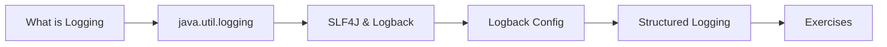

# 17 — Logging

> **Experience level: 🟣 Advanced (2 – 4 years)**

Real applications cannot be debugged with `System.out.println`. Logging is how production systems record what they did, when, and why — the first thing you reach for when something breaks at 3 a.m. This module covers the standard `java.util.logging` API, the industry-standard SLF4J + Logback stack, and modern structured logging.

---

## 📂 Files in This Module

| File | What You'll Learn |
|------|-------------------|
| [What-is-Logging.md](What-is-Logging.md) | Log levels, loggers, and why not to use println |
| [java-util-Logging.md](java-util-Logging.md) | The built-in JUL API and handlers |
| [SLF4J-and-Logback.md](SLF4J-and-Logback.md) | The standard SLF4J API + Logback backend |
| [Logback-Configuration.md](Logback-Configuration.md) | logback.xml, appenders, patterns, rolling |
| [Structured-Logging.md](Structured-Logging.md) | JSON logs, MDC, correlation IDs |
| [Exercises.md](Exercises.md) | Practice tasks for this module |

---

## 🎯 Learning Objectives

By the end of this module, you will be able to:

1. ✅ Choose the right log level for a message.
2. ✅ Use JUL without external dependencies.
3. ✅ Set up SLF4J with Logback in a Maven project.
4. ✅ Configure appenders, patterns, and rolling files.
5. ✅ Add structured fields and correlation IDs to logs.

---

## 🧭 Module Map



---

## 📌 Quick Preview

```java
import org.slf4j.Logger;
import org.slf4j.LoggerFactory;

public class App {
    private static final Logger log = LoggerFactory.getLogger(App.class);

    public static void main(String[] args) {
        log.info("Application starting with {} arg(s)", args.length);
        log.error("Something failed", new RuntimeException("demo"));
    }
}
```

---

## Next Module

➡️ [18 — SQL & Databases](../18-SQL-and-Databases/README.md) — the language of data.