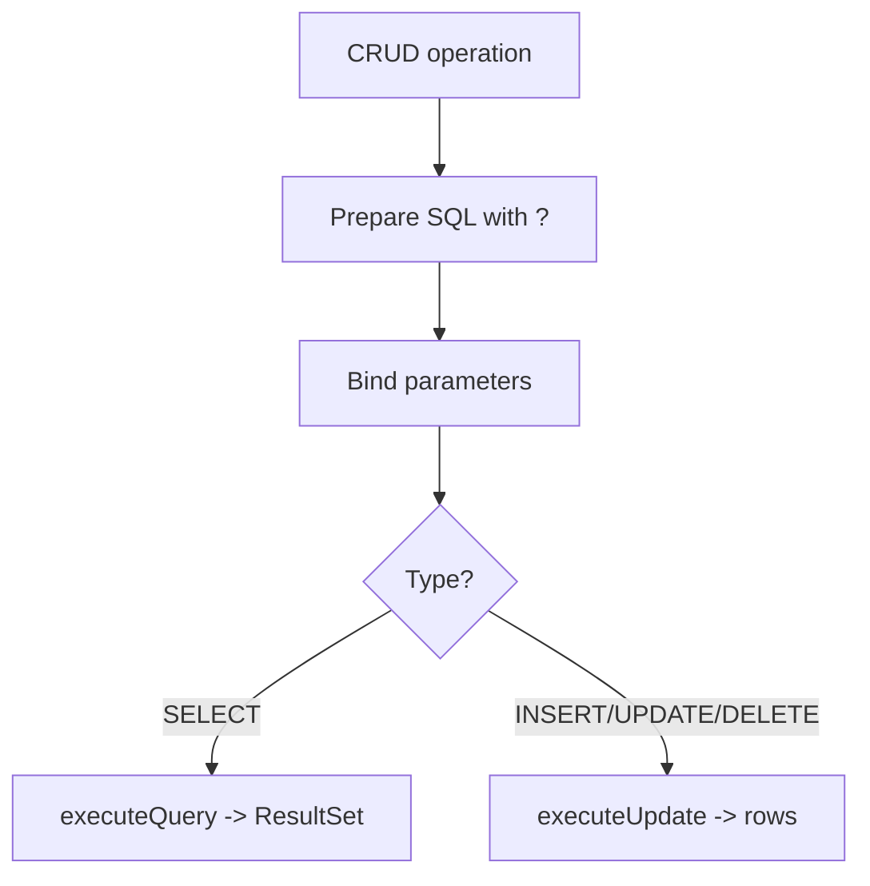

# CRUD Operations

## 1. Introduction

**CRUD** — Create, Read, Update, Delete — is the four basic database operations every application performs. In JDBC these map to `INSERT`, `SELECT`, `UPDATE`, and `DELETE`.

---

## 2. Why This Topic Is Important

- CRUD is 90% of application database work.
- Interviewers ask you to write CRUD code on a whiteboard.
- A clean CRUD layer is the backbone of any app.
- ORMs automate it — but you must understand the SQL.

---

## 3. Real-World Analogy

CRUD is like a **library system**:
- Create = adding a new book to the catalog.
- Read = looking up a book.
- Update = fixing a typo on a book's record.
- Delete = removing a withdrawn book.
Librarians (your code) do these four tasks all day.

---

## 4. Theory

### The Four Operations
| Operation | SQL | JDBC Method |
|-----------|-----|-------------|
| Create | `INSERT INTO ...` | `executeUpdate()` |
| Read | `SELECT ...` | `executeQuery()` → ResultSet |
| Update | `UPDATE ... SET ...` | `executeUpdate()` |
| Delete | `DELETE FROM ...` | `executeUpdate()` |

### Return Values
- `executeUpdate` returns **rows affected** (create/update/delete).
- `executeQuery` returns a **ResultSet** (read).

---

## 5. Syntax

```java
// Create
ps = conn.prepareStatement("INSERT INTO emp(name, salary) VALUES(?,?)");

// Read
ps = conn.prepareStatement("SELECT * FROM emp WHERE id = ?");

// Update
ps = conn.prepareStatement("UPDATE emp SET salary = ? WHERE id = ?");

// Delete
ps = conn.prepareStatement("DELETE FROM emp WHERE id = ?");
```

---

## 6. Flow Explanation



---

## 7. Memory Representation

None special — data flows between Java objects and DB rows via parameters and ResultSets.

---

## 8. Simple Example — Create & Read

```java
import java.sql.*;

public class CreateRead {
    public static void main(String[] args) throws Exception {
        try (Connection conn = DriverManager.getConnection("jdbc:h2:mem:crud")) {

            try (Statement st = conn.createStatement()) {
                st.execute("CREATE TABLE emp (id INT AUTO_INCREMENT, name VARCHAR(50), salary INT)");
            }

            // CREATE
            try (PreparedStatement ps = conn.prepareStatement(
                    "INSERT INTO emp(name, salary) VALUES(?, ?)")) {
                ps.setString(1, "Ajay");
                ps.setInt(2, 90000);
                int created = ps.executeUpdate();
                System.out.println("Created rows: " + created);
            }

            // READ all
            try (Statement st = conn.createStatement();
                 ResultSet rs = st.executeQuery("SELECT * FROM emp")) {
                while (rs.next()) {
                    System.out.println(rs.getInt("id") + " "
                            + rs.getString("name") + " "
                            + rs.getInt("salary"));
                }
            }
        }
    }
}
```

---

## 9. Intermediate Example — Update & Delete

```java
import java.sql.*;

public class UpdateDelete {
    public static void main(String[] args) throws Exception {
        try (Connection conn = DriverManager.getConnection("jdbc:h2:mem:emp2")) {

            try (Statement st = conn.createStatement()) {
                st.execute("CREATE TABLE emp (id INT AUTO_INCREMENT, name VARCHAR(50), salary INT)");
                st.executeUpdate("INSERT INTO emp(name, salary) VALUES('Ajay', 90000)");
                st.executeUpdate("INSERT INTO emp(name, salary) VALUES('Priya', 70000)");
            }

            // UPDATE
            try (PreparedStatement ps = conn.prepareStatement(
                    "UPDATE emp SET salary = ? WHERE name = ?")) {
                ps.setInt(1, 95000);
                ps.setString(2, "Ajay");
                System.out.println("Updated rows: " + ps.executeUpdate());
            }

            // DELETE
            try (PreparedStatement ps = conn.prepareStatement(
                    "DELETE FROM emp WHERE name = ?")) {
                ps.setString(1, "Priya");
                System.out.println("Deleted rows: " + ps.executeUpdate());
            }

            // READ remaining
            try (Statement st = conn.createStatement();
                 ResultSet rs = st.executeQuery("SELECT name, salary FROM emp")) {
                while (rs.next()) {
                    System.out.println("Remaining: " + rs.getString("name")
                            + " " + rs.getInt("salary"));
                }
            }
        }
    }
}
```

---

## 10. Advanced Example — A DAO-Style Class

```java
import java.sql.*;

class EmployeeDAO {
    private final Connection conn;

    EmployeeDAO(Connection conn) { this.conn = conn; }

    void create(String name, int salary) throws SQLException {
        try (PreparedStatement ps = conn.prepareStatement(
                "INSERT INTO emp(name, salary) VALUES(?, ?)")) {
            ps.setString(1, name);
            ps.setInt(2, salary);
            ps.executeUpdate();
        }
    }

    String find(int id) throws SQLException {
        try (PreparedStatement ps = conn.prepareStatement(
                "SELECT name FROM emp WHERE id = ?")) {
            ps.setInt(1, id);
            try (ResultSet rs = ps.executeQuery()) {
                return rs.next() ? rs.getString("name") : null;
            }
        }
    }
}

public class DAODemo {
    public static void main(String[] args) throws Exception {
        try (Connection conn = DriverManager.getConnection("jdbc:h2:mem:dao")) {
            try (Statement st = conn.createStatement()) {
                st.execute("CREATE TABLE emp (id INT AUTO_INCREMENT, name VARCHAR(50), salary INT)");
            }

            EmployeeDAO dao = new EmployeeDAO(conn);
            dao.create("Ajay", 90000);
            System.out.println("Found: " + dao.find(1));
            System.out.println("Missing: " + dao.find(99));
        }
    }
}
```

---

## 11. Output

For the **Intermediate Example**:

```
Updated rows: 1
Deleted rows: 1
Remaining: Ajay 95000
```

For the **Advanced Example**:

```
Found: Ajay
Missing: null
```

---

## 12. Common Mistakes

| Mistake | Correction |
|---------|------------|
| Concatenating input in SQL | Parameterize everything |
| Forgetting rows-affected check | Verify executeUpdate's return |
| Not closing ResultSet | try-with-resources |
| Ignoring the WHERE clause | UPDATE/DELETE without WHERE hits everything |
| Mixing SQL types | setInt for INT, setString for VARCHAR |

---

## 13. Best Practices

- Organize CRUD into a DAO class per entity.
- Parameterize every statement.
- Return `null`/`Optional` for not-found reads.
- Use AUTO_INCREMENT/generated keys.
- Test all four operations.

---

## 14. Interview Questions

**Q1. What does CRUD stand for?**
*Create, Read, Update, Delete — the four basic DB operations.*

**Q2. How do you know a create worked?**
*executeUpdate returns rows affected (1).*

**Q3. How do you read a single row?**
*PreparedStatement + executeQuery + rs.next().*

**Q4. What's a DAO?**
*Data Access Object — a class encapsulating CRUD for one entity.*

**Q5. Why is a missing WHERE dangerous?**
*UPDATE/DELETE without WHERE affects all rows.*

---

## 15. Practice Exercises

1. Build CREATE + READ-all for a `users` table.
2. Add UPDATE (change email by id).
3. Add DELETE (remove by id).
4. Wrap it all in an `UserDAO`.

---

## 16. Coding Challenges

1. **Easy:** Product CRUD with name/price.
2. **Medium:** A `UserDAO` with findByEmail and updatePassword.
3. **Hard:** A mini library CRUD app (books add/remove/search) with a clean DAO layer.

---

## 17. Summary

- CRUD = INSERT/SELECT/UPDATE/DELETE.
- Parameterized SQL everywhere.
- executeUpdate for DML; executeQuery for reads.
- DAO classes encapsulate one entity's CRUD.
- Verify rows affected; handle not-found.

➡️ Continue to: [ResultSet](ResultSet.md)