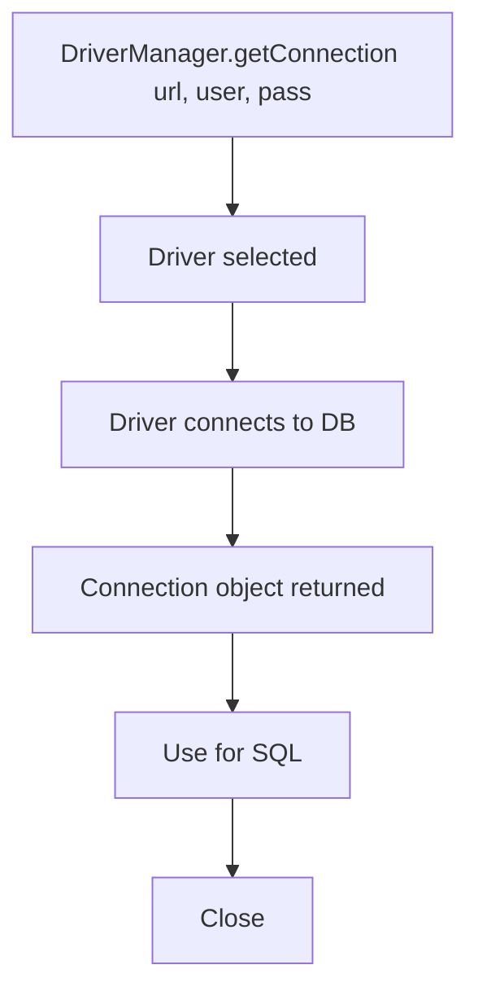

# Connecting to a Database

## 1. Introduction

Every JDBC session starts with a **connection**. You provide a JDBC URL, username, and password to `DriverManager`, and it hands you a `Connection` object — your live session with the database.

---

## 2. Why This Topic Is Important

- Connections are the gateway to all DB work.
- URLs differ by database — get them right.
- Connection handling (close, pool) affects stability.
- Every JDBC/ORM tutorial starts here.

---

## 3. Real-World Analogy

Connecting is like **signing into a building** with your ID badge. The badge (URL + credentials) proves who you are; the door grants you a session (Connection). While signed in, you can use the facilities (execute SQL); when you leave, you must sign out (close) so the next person can use the door.

---

## 4. Theory

### The Connection URL Parts
```
jdbc:<subprotocol>:<database-specific>
      |_______________________|
                driver        server/db info
```

### Creating a Connection
```java
Connection conn = DriverManager.getConnection(url, user, password);
```

### Adding a JDBC Driver
| Database | Driver (Maven artifact) |
|----------|-------------------------|
| MySQL | `com.mysql:mysql-connector-j` |
| PostgreSQL | `org.postgresql:postgresql` |
| H2 | `com.h2database:h2` |
| Oracle | `com.oracle.database.jdbc:ojdbc11` |

Modern JDBC drivers **auto-register** via `META-INF/services` — no `Class.forName` needed.

### Connection Properties
| Property | Meaning |
|----------|---------|
| `autoCommit` | true = each statement commits |
| `isolationLevel` | Transaction isolation |
| `timeout` | Query/connect timeouts |

---

## 5. Syntax

```java
String url = "jdbc:h2:mem:demo";
try (Connection conn = DriverManager.getConnection(url)) {
    System.out.println(conn.isClosed());   // false
}
```

---

## 6. Flow Explanation



---

## 7. Memory Representation

A Connection wraps a network/OS handle to the DB server — heavyweight. Close or pool it.

---

## 8. Simple Example

```java
import java.sql.Connection;
import java.sql.DriverManager;

public class ConnectSimple {
    public static void main(String[] args) {
        String url = "jdbc:h2:mem:app";

        try (Connection conn = DriverManager.getConnection(url)) {
            System.out.println("Is closed? " + conn.isClosed());
            System.out.println("Auto commit: " + conn.getAutoCommit());
        } catch (Exception e) {
            System.out.println("Connection failed: " + e.getMessage());
        }
    }
}
```

---

## 9. Intermediate Example — With Credentials

```java
import java.sql.Connection;
import java.sql.DriverManager;
import java.util.Properties;

public class CredentialsDemo {
    public static void main(String[] args) throws Exception {
        String url = "jdbc:h2:~/testdb";

        // Option 1: inline credentials
        Connection c1 = DriverManager.getConnection(url, "sa", "");

        // Option 2: Properties object
        Properties props = new Properties();
        props.setProperty("user", "sa");
        props.setProperty("password", "");
        Connection c2 = DriverManager.getConnection(url, props);

        System.out.println("Connections alive: "
                + !c1.isClosed() + ", " + !c2.isClosed());
        c1.close();
        c2.close();
    }
}
```

---

## 10. Advanced Example — Connection Timeouts & Isolation

```java
import java.sql.Connection;
import java.sql.DriverManager;

public class ConnectionSettings {
    public static void main(String[] args) throws Exception {
        String url = "jdbc:h2:mem:settings";
        String user = "sa";
        String pass = "";

        try (Connection conn = DriverManager.getConnection(url, user, pass)) {
            conn.setAutoCommit(false);
            conn.setTransactionIsolation(
                    Connection.TRANSACTION_READ_COMMITTED);

            System.out.println("Auto commit  : " + conn.getAutoCommit());
            System.out.println("Isolation    : "
                    + conn.getTransactionIsolation());
            System.out.println("Product      : "
                    + conn.getMetaData().getDatabaseProductName());
        }
    }
}
```

---

## 11. Output

For the **Simple Example**:

```
Is closed? false
Auto commit: true
```

For the **Advanced Example**:

```
Auto commit  : false
Isolation    : 2
Product      : H2
```

---

## 12. Common Mistakes

| Mistake | Correction |
|---------|------------|
| Forgetting the driver dependency | Add the Maven/Gradle artifact |
| Wrong URL format | Check your database's JDBC URL |
| Leaving connections open | Close or pool them |
| Hard-coding passwords | Read from env/config |
| Creating a connection per query | Reuse or pool |

---

## 13. Best Practices

- Keep URLs/credentials in configuration.
- Use connection pools (HikariCP) in production.
- Always close connections (try-with-resources).
- Add driver as a dependency, not Class.forName.
- Validate connectivity before heavy work.

---

## 14. Interview Questions

**Q1. How do you connect to a database?**
*DriverManager.getConnection(url, user, password).*

**Q2. What's in a JDBC URL?**
*`jdbc:<subprotocol>:<db-specific info>`.*

**Q3. Why connection pooling?**
*Connections are expensive; pools reuse them.*

**Q4. Do you still need Class.forName?**
*No — drivers auto-register via service loading.*

**Q5. What is autoCommit?**
*Whether each statement commits immediately (true) or waits for commit().*

---

## 15. Practice Exercises

1. Connect to H2 in-memory and print metadata.
2. Connect with a Properties object.
3. Change isolation level and print it.
4. Verify the connection closes.

---

## 16. Coding Challenges

1. **Easy:** A URL builder for your favorite DB.
2. **Medium:** A reusable `DbUtil` with a getConnection helper.
3. **Hard:** A mini connection-pool (or integrate HikariCP) and use it for queries.

---

## 17. Summary

- DriverManager + URL + credentials → Connection.
- URLs are database-specific.
- Drivers auto-register (no Class.forName).
- Close/pool connections; keep credentials in config.
- autoCommit and isolation control transactions.

➡️ Continue to: [Statement & PreparedStatement](Statement-and-PreparedStatement.md)