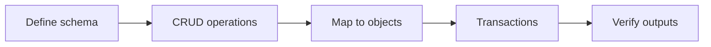

# Exercises — JDBC

## 1. Introduction

Practice connecting to a database, running CRUD, mapping results, and controlling transactions. Use H2 in-memory (no setup needed) and the driver from your build tool.

---

## 2. Why This Topic Is Important

- Every backend job touches databases.
- JDBC is the raw layer under all ORMs.
- Interviews test CRUD and transaction knowledge.
- Your DAO skills carry into Spring Data.

---

## 3. Real-World Analogy

Practice is like **learning to drive a delivery truck** — connecting (starting the engine), CRUD (making deliveries), transactions (handling accidents without losing cargo). Master the basics and you can drive anything.

---

## 4. Theory — Setup Reminder

```xml
<!-- Maven dependency for H2 -->
<dependency>
    <groupId>com.h2database</groupId>
    <artifactId>h2</artifactId>
    <version>2.2.224</version>
</dependency>
```
Or Gradle: `implementation 'com.h2database:h2:2.2.224'`

---

## 5. Syntax Reminder

```java
try (Connection conn = DriverManager.getConnection("jdbc:h2:mem:db");
     PreparedStatement ps = conn.prepareStatement("... ?")) {
    ps.setString(1, value);
    try (ResultSet rs = ps.executeQuery()) { while (rs.next()) { ... } }
}
```

---

## 6. Practice Flow



---

## 7. Memory Representation

Skip — behavior-focused.

---

## 8. Simple Exercises

**Ex 1 — Connect & Metadata**
Connect to H2, print product name and version.

**Ex 2 — Create & Read**
`users` table; insert 3 users; print all.

**Ex 3 — Safe Insert**
Insert a user with PreparedStatement parameters.

---

## 9. Intermediate Exercises

**Ex 4 — User DAO**
`UserDAO`: create, findById, updateEmail, delete. Test all.

**Ex 5 — Search**
`SELECT name FROM users WHERE email LIKE ?` with a `%` parameter.

**Ex 6 — Batch Insert**
Insert 100 rows via executeBatch; verify count.

---

## 10. Advanced Exercises

**Ex 7 — Mapping to Objects**
Map query rows into `User` objects; return a `List<User>`.

**Ex 8 — Bank Transfer (Transaction)**
Transfer 500 between two accounts atomically; verify balances.

**Ex 9 — Rollback Test**
Force a failing statement after an update; verify rollback keeps original data.

**Ex 10 — Mini Order System**
Create order + deduct stock in one transaction; if stock insufficient, rollback and report.

---

## 11. Expected Output Samples

**Ex 4 (User DAO):**
```
Created: Ajay
Found: Ajay
Email updated
Deleted: true
```

**Ex 8 (Bank Transfer):**
```
Account 1: 500
Account 2: 1500
```

---

## 12. Common Mistakes

| Mistake | Fix |
|---------|-----|
| SQL injection | PreparedStatement |
| Not closing resources | try-with-resources |
| Reading before next() | rs.next() first |
| No rollback path | try/catch + rollback |
| Hard-coded credentials | Config/env |

---

## 13. Best Practices

- Parameterize everything.
- DAO per entity.
- Commit on success; rollback on failure.
- Close all resources.
- Test both success and failure paths.

---

## 14. Interview Practice Questions

**Q1.** What is JDBC and what are its core interfaces?
**Q2.** Why PreparedStatement over Statement?
**Q3.** How does a ResultSet cursor work?
**Q4.** What is ACID and how do transactions apply?
**Q5.** What is a connection pool and why use one?

---

## 15. Self-Check

- [ ] I can connect to a database.
- [ ] I use PreparedStatement safely.
- [ ] I can do full CRUD.
- [ ] I map ResultSets to objects.
- [ ] I manage transactions with commit/rollback.
- [ ] I close all resources correctly.

---

## 16. Next Steps

- Move to [Module 20 — Maven](../20-Maven/README.md) — manage dependencies properly.
- JPA/Hibernate (Module 30) will build on these DAO concepts.

---

## 17. Summary

- JDBC = connect → CRUD → map → transaction.
- PreparedStatement prevents injection.
- ResultSet maps rows to objects.
- Transactions guarantee atomicity.
- DAO patterns prepare you for ORMs.

➡️ Module complete! Continue to [20 — Maven](../20-Maven/README.md).