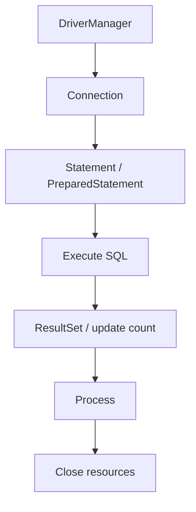

# JDBC Overview

## 1. Introduction

**JDBC** is Java's standard API for talking to databases. It provides drivers, connections, statements, and result sets so you can execute SQL and handle the results from any relational database.

---

## 2. Why This Topic Is Important

- JDBC is the base layer under Hibernate/JPA and Spring Data.
- Interviewers at 2+ years test JDBC fundamentals.
- Understanding JDBC explains what ORMs automate.
- Even with frameworks, raw JDBC appears in legacy code.

---

## 3. Real-World Analogy

Think of JDBC as the **universal power adapter** between your laptop (Java) and the wall socket (database). Different countries (databases: MySQL, PostgreSQL, Oracle) have different sockets — but an adapter (JDBC driver) makes them all work.

---

## 4. Theory

### The JDBC Architecture


### Components
| Component | Role |
|-----------|------|
| `DriverManager` | Loads drivers, gives connections |
| `Connection` | Session with the database |
| `Statement` | Executes SQL |
| `PreparedStatement` | Precompiled, parameterized SQL |
| `ResultSet` | Holds query results (cursor) |
| `SQLException` | Database errors |

### Steps of JDBC Usage
1. Load the driver (auto-loaded in modern JDBC).
2. `DriverManager.getConnection(url, user, pass)`.
3. Create a `Statement`/`PreparedStatement`.
4. Execute (`executeQuery` for SELECT, `executeUpdate` for DML).
5. Process the `ResultSet`.
6. Close everything (try-with-resources).

### Common JDBC URLs
| Database | URL |
|----------|-----|
| MySQL | `jdbc:mysql://localhost:3306/dbname` |
| PostgreSQL | `jdbc:postgresql://localhost:5432/dbname` |
| H2 (embedded) | `jdbc:h2:mem:test` |
| Oracle | `jdbc:oracle:thin:@localhost:1521:dbname` |

---

## 5. Syntax

```java
try (Connection conn = DriverManager.getConnection(url, user, pass);
     Statement st = conn.createStatement()) {
    // work
}
```

---

## 6. Flow Explanation



---

## 7. Memory Representation

Connections are heavyweight (keep a pool); Statements and ResultSets hold server-side state until closed.

---

## 8. Simple Example — Driver Load & Connection

```java
import java.sql.Connection;
import java.sql.DriverManager;

public class ConnectDemo {
    public static void main(String[] args) throws Exception {
        String url = "jdbc:h2:mem:demo";     // in-memory H2
        try (Connection conn = DriverManager.getConnection(url)) {
            System.out.println("Connected: " + conn.isClosed() == false);
            System.out.println("Database: " + conn.getMetaData().getDatabaseProductName());
        }
    }
}
```

---

## 9. Intermediate Example — Table + Insert + Select

```java
import java.sql.*;

public class BasicFlow {
    public static void main(String[] args) throws Exception {
        String url = "jdbc:h2:mem:shop";

        try (Connection conn = DriverManager.getConnection(url);
             Statement st = conn.createStatement()) {

            st.execute("CREATE TABLE products (id INT, name VARCHAR(50))");
            st.executeUpdate("INSERT INTO products VALUES (1, 'Laptop')");
            st.executeUpdate("INSERT INTO products VALUES (2, 'Phone')");

            try (ResultSet rs = st.executeQuery("SELECT * FROM products")) {
                while (rs.next()) {
                    System.out.println(rs.getInt("id") + " -> "
                            + rs.getString("name"));
                }
            }
        }
    }
}
```

---

## 10. Advanced Example — Multiple Resources, Auto-Commit Note

```java
import java.sql.*;

public class CleanFlow {
    public static void main(String[] args) throws Exception {
        String url = "jdbc:h2:mem:clean";

        try (Connection conn = DriverManager.getConnection(url)) {
            conn.setAutoCommit(false);      // transaction control

            try (Statement st = conn.createStatement()) {
                st.execute("CREATE TABLE users (id INT, name VARCHAR(50))");
                st.executeUpdate("INSERT INTO users VALUES (1, 'Ajay')");
                conn.commit();              // save
                System.out.println("Committed.");
            } catch (SQLException e) {
                conn.rollback();            // undo
                throw e;
            }
        }
    }
}
```

---

## 11. Output

For the **Intermediate Example**:

```
1 -> Laptop
2 -> Phone
```

For the **Advanced Example**:

```
Committed.
```

---

## 12. Common Mistakes

| Mistake | Correction |
|---------|------------|
| SQL injection via Statement | Use PreparedStatement |
| Leaking connections | Try-with-resources / pool |
| Reading ResultSet before next() | Call rs.next() first |
| Ignoring SQLException | Handle/translate properly |
| Hard-coding credentials | Use env/config, not code |

---

## 13. Best Practices

- Always close Connection/Statement/ResultSet.
- Use PreparedStatement for parameters.
- Use connection pools (HikariCP) in production.
- Handle SQLException with context.
- Keep passwords out of source code.

---

## 14. Interview Questions

**Q1. What is JDBC?**
*Java's standard API for database access — drivers, connections, statements, result sets.*

**Q2. What are the core interfaces?**
*Driver, Connection, Statement, PreparedStatement, ResultSet.*

**Q3. Why PreparedStatement?**
*Prevents SQL injection and is precompiled/faster.*

**Q4. What does a ResultSet represent?**
*A cursor over query result rows.*

**Q5. How do you get a connection?**
*DriverManager.getConnection(url, user, password).*

---

## 15. Practice Exercises

1. Connect to H2 in-memory.
2. Create a table and insert rows.
3. Query and print all rows.
4. Close resources properly with try-with-resources.

---

## 16. Coding Challenges

1. **Easy:** A connection checker printing DB name/version.
2. **Medium:** A products table with full CRUD (next topics).
3. **Hard:** A clean-flow program with transactions and rollback on error.

---

## 17. Summary

- JDBC = driver + connection + statement + result set.
- Flow: connect → execute → process → close.
- Use PreparedStatement (security + speed).
- Close everything; pool connections.
- Foundation for JPA/Hibernate.

➡️ Continue to: [Connecting to a Database](Connecting-to-Database.md)