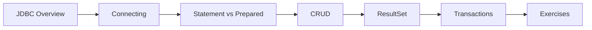

# 19 — JDBC

> **Experience level: 🟣 Advanced (2 – 4 years)**

**JDBC (Java Database Connectivity)** is the API that connects Java to relational databases — execute SQL, read results, and manage transactions. It's the foundation beneath JPA/Hibernate.

---

## 📂 Files in This Module

| File | What You'll Learn |
|------|-------------------|
| [JDBC-Overview.md](JDBC-Overview.md) | Drivers, connections, and the flow |
| [Connecting-to-Database.md](Connecting-to-Database.md) | DriverManager, URLs, connection setup |
| [Statement-and-PreparedStatement.md](Statement-and-PreparedStatement.md) | Executing queries safely |
| [CRUD-Operations.md](CRUD-Operations.md) | Create, read, update, delete |
| [ResultSet.md](ResultSet.md) | Reading query results |
| [Transactions.md](Transactions.md) | Commit, rollback, ACID |
| [Exercises.md](Exercises.md) | Practice tasks for this module |

---

## 🎯 Learning Objectives

By the end of this module, you will be able to:

1. ✅ Set up a JDBC driver and connection.
2. ✅ Execute SQL with Statement and PreparedStatement.
3. ✅ Perform full CRUD operations.
4. ✅ Read data safely with ResultSet.
5. ✅ Manage transactions with commit/rollback.

---

## 🧭 Module Map



---

## 📌 Quick Preview

```java
try (Connection conn = DriverManager.getConnection(
        "jdbc:mysql://localhost:3306/shop", "root", "password");
     PreparedStatement ps = conn.prepareStatement(
         "SELECT name FROM products WHERE price > ?")) {
    ps.setDouble(1, 100);
    try (ResultSet rs = ps.executeQuery()) {
        while (rs.next()) System.out.println(rs.getString("name"));
    }
}
```

---

## Next Module

➡️ [20 — Maven](../20-Maven/README.md) — build and manage your projects.