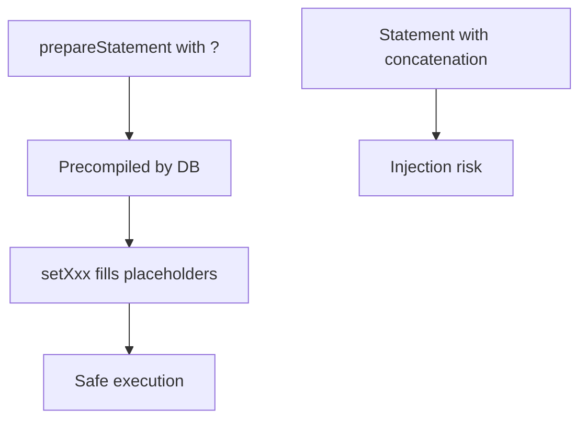

# Statement & PreparedStatement

## 1. Introduction

**`Statement`** executes static SQL. **`PreparedStatement`** executes precompiled, **parameterized** SQL with `?` placeholders — safer and faster. For any user input, always use PreparedStatement.

---

## 2. Why This Topic Is Important

- SQL injection is a top security risk — PreparedStatement prevents it.
- Interviews always ask "why PreparedStatement?"
- PreparedStatements are precompiled → faster for repeated use.
- Spring JdbcTemplate and Hibernate wrap this concept.

---

## 3. Real-World Analogy

A Statement is like reading a **script word-for-word** — if a guest whispers something (user input), you repeat it dangerously. A PreparedStatement is like a **mad-lib form with blanks**: the form is fixed, and you only fill in the blanks with safe values — the guest's words can't rewrite the script.

---

## 4. Theory

### Statement
```java
Statement st = conn.createStatement();
st.executeQuery("SELECT * FROM products WHERE id = " + id);   // risky!
```

### PreparedStatement (safe)
```java
PreparedStatement ps = conn.prepareStatement(
        "SELECT * FROM products WHERE id = ?");
ps.setInt(1, id);
ResultSet rs = ps.executeQuery();
```

### setXxx Methods
| Method | For |
|--------|-----|
| `setString(i, s)` | Strings |
| `setInt(i, n)` | ints |
| `setLong(i, n)` | longs |
| `setDouble(i, d)` | doubles |
| `setDate(i, date)` | java.sql.Date |
| `setBoolean(i, b)` | booleans |

### Execution Methods
| Method | Use |
|--------|-----|
| `executeQuery()` | SELECT → ResultSet |
| `executeUpdate()` | INSERT/UPDATE/DELETE → int rows |
| `execute()` | Any → boolean |

### SQL Injection Example (why not Statement)
```java
String input = "1 OR 1=1";
// SELECT * FROM products WHERE id = 1 OR 1=1   -> returns everything!
```

---

## 5. Syntax

```java
try (PreparedStatement ps = conn.prepareStatement("UPDATE x SET y=? WHERE id=?")) {
    ps.setString(1, name);
    ps.setInt(2, id);
    int rows = ps.executeUpdate();
}
```

---

## 6. Flow Explanation



---

## 7. Memory Representation

PreparedStatement is precompiled and reused; parameters are bound per execution — no string concatenation.

---

## 8. Simple Example

```java
import java.sql.*;

public class StatementDemo {
    public static void main(String[] args) throws Exception {
        try (Connection conn = DriverManager.getConnection("jdbc:h2:mem:demo");
             Statement st = conn.createStatement()) {

            st.execute("CREATE TABLE emp (id INT, name VARCHAR(50), salary INT)");

            // executeUpdate returns rows affected
            int rows = st.executeUpdate(
                    "INSERT INTO emp VALUES (1, 'Ajay', 90000)");
            System.out.println("Rows inserted: " + rows);
        }
    }
}
```

---

## 9. Intermediate Example — PreparedStatement CRUD

```java
import java.sql.*;

public class PreparedDemo {
    public static void main(String[] args) throws Exception {
        try (Connection conn = DriverManager.getConnection("jdbc:h2:mem:emp")) {

            try (Statement st = conn.createStatement()) {
                st.execute("CREATE TABLE emp (id INT, name VARCHAR(50), salary INT)");
            }

            // INSERT with parameters
            try (PreparedStatement ps = conn.prepareStatement(
                    "INSERT INTO emp VALUES (?, ?, ?)")) {
                ps.setInt(1, 1);
                ps.setString(2, "Ajay");
                ps.setInt(3, 90000);
                ps.executeUpdate();

                ps.setInt(1, 2);
                ps.setString(2, "Priya");
                ps.setInt(3, 70000);
                ps.executeUpdate();
            }

            // SELECT with parameter
            try (PreparedStatement ps = conn.prepareStatement(
                    "SELECT name FROM emp WHERE salary > ?")) {
                ps.setInt(1, 75000);
                try (ResultSet rs = ps.executeQuery()) {
                    while (rs.next()) {
                        System.out.println("High earner: " + rs.getString("name"));
                    }
                }
            }
        }
    }
}
```

---

## 10. Advanced Example — Batch Updates

```java
import java.sql.*;

public class BatchDemo {
    public static void main(String[] args) throws Exception {
        try (Connection conn = DriverManager.getConnection("jdbc:h2:mem:batch")) {

            try (Statement st = conn.createStatement()) {
                st.execute("CREATE TABLE emp (id INT, name VARCHAR(50))");
            }

            try (PreparedStatement ps = conn.prepareStatement(
                    "INSERT INTO emp VALUES (?, ?)")) {

                String[][] data = {{"1", "A"}, {"2", "B"}, {"3", "C"}};
                for (String[] row : data) {
                    ps.setInt(1, Integer.parseInt(row[0]));
                    ps.setString(2, row[1]);
                    ps.addBatch();               // queue
                }
                int[] results = ps.executeBatch();   // send all at once
                System.out.println("Batch results: " + results.length + " rows");
            }
        }
    }
}
```

---

## 11. Output

For the **Intermediate Example**:

```
High earner: Ajay
```

For the **Advanced Example**:

```
Batch results: 3 rows
```

---

## 12. Common Mistakes

| Mistake | Correction |
|---------|------------|
| String-concatenating user input | PreparedStatement + setXxx |
| Wrong parameter index | Parameters are 1-based |
| Using executeQuery for UPDATE | executeUpdate returns rows, not ResultSet |
| Not closing ResultSet | Close via try-with-resources |
| Reusing a PS with stale values | setXxx every time before execute |

---

## 13. Best Practices

- **Always** use PreparedStatement with user input.
- Set every parameter before executing.
- Use executeBatch for bulk inserts.
- Close ResultSet, Statement, Connection.
- Let Spring's JdbcTemplate handle the boilerplate later.

---

## 14. Interview Questions

**Q1. Statement vs PreparedStatement?**
*PreparedStatement is precompiled, parameterized, and prevents SQL injection.*

**Q2. What is SQL injection?**
*Crafting input that changes SQL logic — e.g., `1 OR 1=1`.*

**Q3. How do you bind parameters?**
*setString/setInt/setDouble with the 1-based index.*

**Q4. executeQuery vs executeUpdate?**
*Query returns ResultSet; Update returns affected rows.*

**Q5. What is a batch?**
*Grouping statements sent to the DB in one round-trip.*

---

## 15. Practice Exercises

1. Insert a user with PreparedStatement.
2. Query by an id parameter.
3. Update a row with SET ... = ?.
4. Run a batch insert of 5 rows.

---

## 16. Coding Challenges

1. **Easy:** A safe login check (username/password parameters).
2. **Medium:** A product search by price range with parameters.
3. **Hard:** A bulk importer reading a CSV and inserting via batches.

---

## 17. Summary

- Statement: static SQL; PreparedStatement: parameterized + safe.
- SQL injection → always PreparedStatement.
- setXxx binds 1-based placeholders.
- executeQuery for SELECT; executeUpdate for DML.
- Batch for bulk operations.

➡️ Continue to: [CRUD Operations](CRUD-Operations.md)