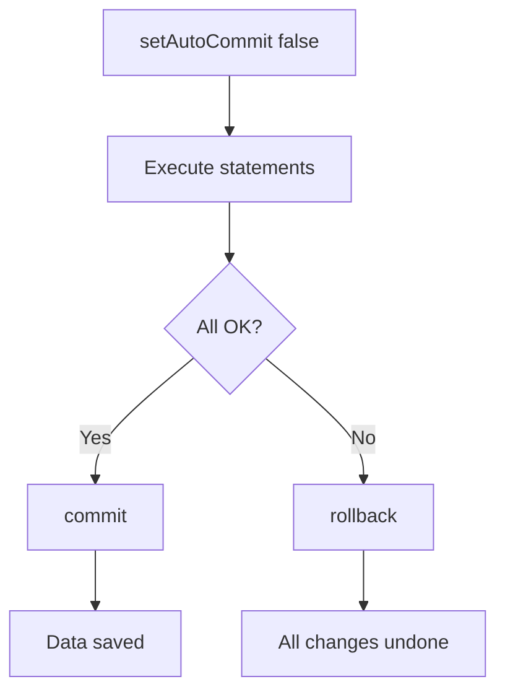

# Transactions

## 1. Introduction

A **transaction** groups multiple database operations into one atomic unit: either **all succeed** (commit) or **all roll back**. JDBC transactions are controlled with `setAutoCommit(false)`, `commit()`, and `rollback()`.

---

## 2. Why This Topic Is Important

- Money transfers, orders, and inventory must be atomic.
- Interviews test ACID and commit/rollback.
- Spring's `@Transactional` builds on these concepts.
- Half-committed data corrupts business systems.

---

## 3. Real-World Analogy

Think of **moving money between accounts**: debit Account A, credit Account B. If the credit fails after the debit, money vanishes. A transaction is like a **single switch**: flip it and both actions happen together, or neither does — never halfway.

---

## 4. Theory

### ACID Properties
| Letter | Property | Meaning |
|--------|----------|---------|
| A | Atomicity | All-or-nothing |
| C | Consistency | Valid state before/after |
| I | Isolation | Transactions don't interfere |
| D | Durability | Committed data survives |

### JDBC Transaction Flow
```java
conn.setAutoCommit(false);     // start transaction
// ... statements ...
conn.commit();                 // save everything
// on error:
conn.rollback();               // undo everything
```

### Savepoints (advanced)
```java
Savepoint sp = conn.setSavepoint("mid");
conn.rollback(sp);             // roll back only to savepoint
```

### Isolation Levels
| Level | Issue Prevented |
|-------|-----------------|
| READ_UNCOMMITTED | Nothing (dirty reads possible) |
| READ_COMMITTED | Dirty reads |
| REPEATABLE_READ | Non-repeatable reads |
| SERIALIZABLE | Phantom reads (full isolation) |

---

## 5. Syntax

```java
conn.setAutoCommit(false);
try {
    // work
    conn.commit();
} catch (SQLException e) {
    conn.rollback();
    throw e;
}
```

---

## 6. Flow Explanation



---

## 7. Memory Representation

The DB holds transaction state (undo logs) until commit/rollback; the connection tracks the open transaction.

---

## 8. Simple Example

```java
import java.sql.*;

public class TransactionDemo {
    public static void main(String[] args) throws Exception {
        try (Connection conn = DriverManager.getConnection("jdbc:h2:mem:tx")) {

            try (Statement st = conn.createStatement()) {
                st.execute("CREATE TABLE accounts (id INT, balance INT)");
                st.executeUpdate("INSERT INTO accounts VALUES (1, 1000)");
                st.executeUpdate("INSERT INTO accounts VALUES (2, 1000)");
            }

            conn.setAutoCommit(false);

            try (PreparedStatement ps = conn.prepareStatement(
                    "UPDATE accounts SET balance = balance + ? WHERE id = ?")) {
                ps.setInt(1, -200);
                ps.setInt(2, 1);
                ps.executeUpdate();

                ps.setInt(1, 200);
                ps.setInt(2, 2);
                ps.executeUpdate();
            }

            conn.commit();
            System.out.println("Transfer committed.");

            try (Statement st = conn.createStatement();
                 ResultSet rs = st.executeQuery("SELECT * FROM accounts")) {
                while (rs.next()) {
                    System.out.println("Account " + rs.getInt("id")
                            + ": " + rs.getInt("balance"));
                }
            }
        }
    }
}
```

---

## 9. Intermediate Example — Rollback on Error

```java
import java.sql.*;

public class RollbackDemo {
    public static void main(String[] args) {
        try (Connection conn = DriverManager.getConnection("jdbc:h2:mem:rb")) {

            try (Statement st = conn.createStatement()) {
                st.execute("CREATE TABLE accounts (id INT, balance INT)");
                st.executeUpdate("INSERT INTO accounts VALUES (1, 500)");
            }

            conn.setAutoCommit(false);
            try {
                try (Statement st = conn.createStatement()) {
                    st.executeUpdate("UPDATE accounts SET balance = balance - 500 WHERE id = 1");
                    // force a failure AFTER the update
                    st.execute("SELECT * FROM no_such_table");
                }
                conn.commit();
            } catch (SQLException e) {
                conn.rollback();
                System.out.println("Rolled back: " + e.getMessage());
            }

            try (Statement st = conn.createStatement();
                 ResultSet rs = st.executeQuery("SELECT balance FROM accounts WHERE id = 1")) {
                rs.next();
                System.out.println("Balance after rollback: " + rs.getInt(1));
            }
        } catch (SQLException e) {
            e.printStackTrace();
        }
    }
}
```

---

## 10. Advanced Example — Savepoints

```java
import java.sql.*;

public class SavepointDemo {
    public static void main(String[] args) throws Exception {
        try (Connection conn = DriverManager.getConnection("jdbc:h2:mem:sp")) {

            try (Statement st = conn.createStatement()) {
                st.execute("CREATE TABLE t (id INT, val VARCHAR(20))");
            }

            conn.setAutoCommit(false);
            Savepoint sp = null;
            try (Statement st = conn.createStatement()) {
                st.executeUpdate("INSERT INTO t VALUES (1, 'kept')");
                sp = conn.setSavepoint("afterFirst");

                st.executeUpdate("INSERT INTO t VALUES (2, 'rolled-back')");
                conn.rollback(sp);              // undo ONLY the second insert

                conn.commit();
            }

            try (Statement st = conn.createStatement();
                 ResultSet rs = st.executeQuery("SELECT * FROM t")) {
                while (rs.next()) {
                    System.out.println(rs.getInt("id") + ": " + rs.getString("val"));
                }
            }
        }
    }
}
```

---

## 11. Output

For the **Simple Example**:

```
Transfer committed.
Account 1: 800
Account 2: 1200
```

For the **Intermediate Example**:

```
Rolled back: Table "NO_SUCH_TABLE" not found
Balance after rollback: 500
```

For the **Advanced Example**:

```
1: kept
```

---

## 12. Common Mistakes

| Mistake | Correction |
|---------|------------|
| Forgetting setAutoCommit(false) | Statements commit individually |
| No try/catch around commit | A failure must trigger rollback |
| Calling rollback outside catch | Only roll back on failure |
| Ignoring isolation needs | Set the appropriate level |
| Long transactions | Keep them short to avoid locks |

---

## 13. Best Practices

- Wrap multi-statement work in transactions.
- `commit()` on success; `rollback()` in catch.
- Keep transactions short.
- Use savepoints for partial rollbacks.
- Let Spring `@Transactional` manage this in framework code.

---

## 14. Interview Questions

**Q1. What is a transaction?**
*An atomic unit of work that commits all changes or rolls them all back.*

**Q2. What is ACID?**
*Atomicity, Consistency, Isolation, Durability.*

**Q3. How do you control transactions in JDBC?**
*setAutoCommit(false), commit(), rollback().*

**Q4. What is a savepoint?**
*A marker allowing partial rollback.*

**Q5. Why keep transactions short?**
*Long transactions hold locks and hurt concurrency.*

---

## 15. Practice Exercises

1. Transfer money between two accounts atomically.
2. Force a failure and verify rollback.
3. Use a savepoint to keep partial work.
4. Print balances before and after.

---

## 16. Coding Challenges

1. **Easy:** A two-row atomic insert.
2. **Medium:** A bank transfer with balance checks inside the transaction.
3. **Hard:** A multi-step order flow (deduct stock + create order) that rolls back completely on any failure.

---

## 17. Summary

- Transactions = atomic all-or-nothing.
- setAutoCommit(false) → commit/rollback.
- ACID guarantees correctness.
- Savepoints for partial rollbacks.
- Spring @Transactional automates this later.

➡️ Continue to: [Exercises](Exercises.md)