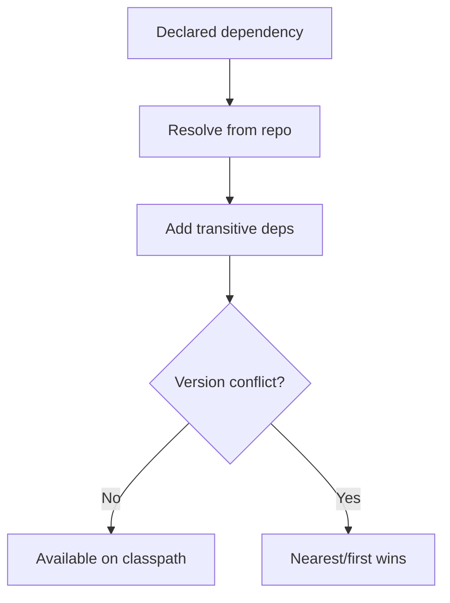

# Dependency Management

## 1. Introduction

**Dependencies** are external libraries your project uses. Maven resolves them from repositories (Maven Central), handles **transitive dependencies**, and manages **scopes** — automatically.

---

## 2. Why This Topic Is Important

- Modern Java is ~90% libraries; managing them is essential.
- Interviewers test scopes and transitive dependency rules.
- Spring Boot "starters" are just dependency bundles.
- Version conflicts cause subtle bugs — know how to fix them.

---

## 3. Real-World Analogy

Think of **packing for a trip**: you pack clothes (direct deps). But clothes also need a suitcase, and the suitcase needs wheels (transitive deps). Maven packs everything, tags each item for the right use (scope), and warns you if two items conflict.

---

## 4. Theory

### Declaring a Dependency
```xml
<dependency>
    <groupId>com.h2database</groupId>
    <artifactId>h2</artifactId>
    <version>2.2.224</version>
    <scope>runtime</scope>
</dependency>
```

### Scopes
| Scope | Compile | Runtime | Transitive? | Use For |
|-------|---------|---------|-------------|---------|
| `compile` | ✅ | ✅ | Yes | Main code |
| `provided` | ✅ | ❌ (server) | No | Servlet API |
| `runtime` | ❌ | ✅ | Yes | JDBC drivers |
| `test` | ✅ (tests) | ✅ (tests) | No | JUnit |
| `system` | — | — | No | System path (avoid) |

### Transitive Dependencies
- A depends on B; B depends on C → A gets C too.
- **Nearest wins**: closest to your pom in the tree.
- **First declaration wins** (same depth).
- `exclusions` remove unwanted transitive deps.

### Version Conflicts
```xml
<dependency>
    <groupId>x</groupId>
    <artifactId>y</artifactId>
    <version>1.0</version>
    <exclusions>
        <exclusion>
            <groupId>old</groupId>
            <artifactId>lib</artifactId>
        </exclusion>
    </exclusions>
</dependency>
```

### Dependency Management (parent)
```xml
<dependencyManagement>
    <dependencies>
        <dependency>
            <groupId>org.springframework.boot</groupId>
            <artifactId>spring-boot-dependencies</artifactId>
            <version>3.2.0</version>
            <type>pom</type>
            <scope>import</scope>
        </dependency>
    </dependencies>
</dependencyManagement>
```
Locks versions centrally; children don't specify versions.

---

## 5. Syntax

```xml
<dependencies>
    <dependency>
        <groupId>g</groupId>
        <artifactId>a</artifactId>
        <version>v</version>
        <scope>scope</scope>
    </dependency>
</dependencies>
```

---

## 6. Flow Explanation



---

## 7. Memory Representation

Resolved jars cache in `~/.m2/repository`; the classpath includes compile-scope jars at build/test time.

---

## 8. Simple Example — Direct Deps

```xml
<dependencies>
    <dependency>
        <groupId>org.junit.jupiter</groupId>
        <artifactId>junit-jupiter</artifactId>
        <version>5.10.2</version>
        <scope>test</scope>
    </dependency>
    <dependency>
        <groupId>com.h2database</groupId>
        <artifactId>h2</artifactId>
        <version>2.2.224</version>
        <scope>runtime</scope>
    </dependency>
</dependencies>
```

---

## 9. Intermediate Example — Inspecting the Tree

```bash
mvn dependency:tree
```
```
[INFO] com.example:shop:jar:1.0.0
[INFO] +- com.h2database:h2:jar:2.2.224:runtime
[INFO] \- org.junit.jupiter:junit-jupiter:jar:5.10.2:test
[INFO]    \- org.junit.jupiter:junit-jupiter-api:jar:5.10.2:test
```

---

## 10. Advanced Example — Exclusions

```xml
<dependency>
    <groupId>org.springframework.boot</groupId>
    <artifactId>spring-boot-starter-web</artifactId>
    <exclusions>
        <exclusion>
            <groupId>org.springframework.boot</groupId>
            <artifactId>spring-boot-starter-tomcat</artifactId>
        </exclusion>
    </exclusions>
</dependency>
```
(Common when switching to Jetty or Undertow.)

---

## 11. Output

Running `mvn dependency:tree` after adding deps:

```
[INFO] --- maven-dependency-plugin ---
[INFO] com.example:shop:jar:1.0.0
[INFO] +- com.h2database:h2:jar:2.2.224:runtime
[INFO] \- org.junit.jupiter:junit-jupiter:jar:5.10.2:test
[INFO] BUILD SUCCESS
```

---

## 12. Common Mistakes

| Mistake | Correction |
|---------|------------|
| Wrong scope | Choose compile/test/runtime/provided deliberately |
| Version conflicts ignored | Use `mvn dependency:tree` and exclusions |
| Not using dependencyManagement | Centralize versions in parent |
| Old cached versions | `mvn -U` |
| Huge dependency bloat | Audit with `dependency:analyze` |

---

## 13. Best Practices

- Use **dependencyManagement** for version control.
- Choose scopes deliberately.
- Exclude unnecessary transitives.
- Audit with `dependency:analyze` and `dependency:tree`.
- Prefer starters (Spring) over raw dependencies.

---

## 14. Interview Questions

**Q1. What are scopes in Maven?**
*compile, provided, runtime, test — controlling availability and transitiveness.*

**Q2. What are transitive dependencies?**
*Dependencies of your dependencies, resolved automatically.*

**Q3. How does Maven resolve version conflicts?**
*Nearest-to-the-pom wins; then first-declared.*

**Q4. How do you remove a transitive dependency?**
*With an `<exclusion>`.*

**Q5. What is dependencyManagement?**
*A section locking versions centrally, without adding them to the classpath.*

---

## 15. Practice Exercises

1. Add three dependencies with different scopes.
2. Run `mvn dependency:tree` and read it.
3. Exclude a transitive dependency.
4. Set up a parent with dependencyManagement.

---

## 16. Coding Challenges

1. **Easy:** Add JUnit (test scope) and run tests.
2. **Medium:** Add H2 (runtime) and run a JDBC program.
3. **Hard:** Resolve a real version conflict using exclusions and the tree.

---

## 17. Summary

- Dependencies = external libraries from repositories.
- Scopes control compile/runtime/test visibility.
- Transitives resolve automatically; nearest wins.
- Exclusions prune unwanted jars.
- dependencyManagement centralizes versions.

➡️ Continue to: [Exercises](Exercises.md)