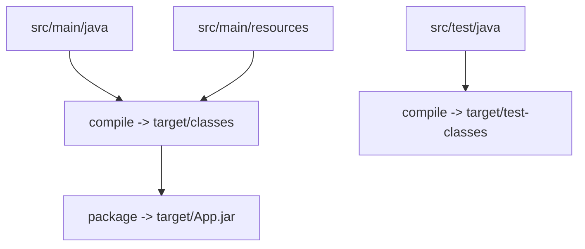

# Directory Structure

## 1. Introduction

Maven enforces a **standard directory layout**. Follow it and Maven finds your code, resources, and tests automatically — no configuration needed.

---

## 2. Why This Topic Is Important

- Deviating from the layout breaks builds.
- Interviewers ask about the default layout.
- Every Maven/Gradle project looks the same — easy onboarding.
- IDE (IntelliJ/Eclipse) imports Maven projects via this layout.

---

## 3. Real-World Analogy

Think of a **well-organized office**: desks (code) in one room, archives (resources) in another, testing labs in a third. Everyone knows where everything goes. Maven's layout is the office blueprint — follow it and nothing gets lost.

---

## 4. Theory

### The Standard Layout
```
my-project/
├── pom.xml
├── src/
│   ├── main/
│   │   ├── java/          (production code, packages as folders)
│   │   │   └── com/example/App.java
│   │   └── resources/     (config, properties, templates)
│   │       └── application.properties
│   └── test/
│       ├── java/          (test code)
│       │   └── com/example/AppTest.java
│       └── resources/     (test data)
└── target/                (build output - generated)
```

### What Each Folder Holds
| Folder | Contents |
|--------|----------|
| `src/main/java` | Production source |
| `src/main/resources` | Production resources (on classpath) |
| `src/test/java` | Test source |
| `src/test/resources` | Test resources |
| `target/` | Compiled classes, JAR, reports (generated) |

### Rules
| Rule | Detail |
|------|--------|
| Packages map to folders | `com.example` → `src/main/java/com/example/` |
| Resources copied to classpath | At `target/classes` |
| Test classes | Compiled to `target/test-classes` |
| Never commit `target/` | Add to `.gitignore` |

---

## 5. Syntax (file placement)

```bash
src/main/java/com/example/App.java
src/main/resources/application.properties
src/test/java/com/example/AppTest.java
```

---

## 6. Flow Explanation



---

## 7. Memory Representation

The build copies source to `target/`; resources land on the classpath so code reads them at runtime.

---

## 8. Simple Example

Create:
- `pom.xml`
- `src/main/java/com/example/Greet.java`
- `src/main/resources/greeting.txt`

`src/main/java/com/example/Greet.java`:
```java
package com.example;

import java.nio.file.Files;
import java.nio.file.Path;

public class Greet {
    public static void main(String[] args) throws Exception {
        String msg = Files.readString(Path.of(
                Greet.class.getResource("/greeting.txt").toURI()));
        System.out.println(msg);
    }
}
```

`src/main/resources/greeting.txt`:
```
Hello from resources!
```

Build & run:
```bash
mvn compile
mvn exec:java -Dexec.mainClass=com.example.Greet
```

---

## 9. Intermediate Example — Test Folder

`src/test/java/com/example/GreetTest.java`:
```java
package com.example;

import org.junit.jupiter.api.Test;
import static org.junit.jupiter.api.Assertions.*;

class GreetTest {
    @Test
    void resourcesLoad() {
        assertTrue(Greet.class.getResource("/greeting.txt") != null);
    }
}
```

Run: `mvn test`

---

## 10. Advanced Example — Gitignore for target

`.gitignore`:
```
target/
*.class
.idea/
*.iml
```

---

## 11. Output

For the **Simple Example**:

```
Hello from resources!
```

For `mvn test`:

```
Tests run: 1, Failures: 0, Errors: 0
```

---

## 12. Common Mistakes

| Mistake | Correction |
|---------|------------|
| Putting Java files in `src/` directly | Must be `src/main/java/...` |
| Resources in the wrong folder | `src/main/resources` |
| Committing `target/` | Add to .gitignore |
| Package/folder mismatch | Folders must mirror packages |
| Test code in main | Use `src/test/java` |

---

## 13. Best Practices

- Follow the layout exactly.
- Keep resources out of code.
- Never commit build output.
- Let the IDE generate the skeleton.
- Put tests next to their classes logically.

---

## 14. Interview Questions

**Q1. What is the standard Maven layout?**
*src/main/java, src/main/resources, src/test/java, target/.*

**Q2. Where do resources go?**
*src/main/resources — they end up on the classpath.*

**Q3. Where are tests?**
*src/test/java.*

**Q4. What is target/?**
*Generated build output — compiled classes and artifacts.*

**Q5. Why can't you commit target/?**
*It's derived output; it changes on every build.*

---

## 15. Practice Exercises

1. Create the full layout by hand.
2. Put a resource file and read it.
3. Add a test in the test folder.
4. Add target/ to .gitignore.

---

## 16. Coding Challenges

1. **Easy:** Build a hello project in the correct layout.
2. **Medium:** A resource-driven config reader.
3. **Hard:** A multi-package project matching the layout with tests.

---

## 17. Summary

- Standard layout = zero-config builds.
- main/java, main/resources, test/java, target.
- Packages map to folders.
- Resources land on the classpath.
- Never commit build output.

➡️ Continue to: [Maven Commands](Maven-Commands.md)