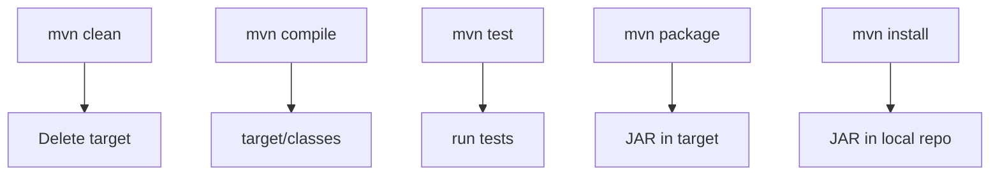

# Maven Commands

## 1. Introduction

Maven commands invoke **phases and goals**. You'll live with a handful: `clean`, `compile`, `test`, `package`, `install`, and `dependency:tree`.

---

## 2. Why This Topic Is Important

- The command line is where builds actually happen.
- Interviews ask what each command does.
- CI/CD pipelines (GitHub Actions, Jenkins) run these commands.
- Knowing phases prevents confusion ("why isn't my test running?").

---

## 3. Real-World Analogy

Maven commands are like **ATM options**: check balance (validate), deposit (compile), withdraw (package), transfer (install). Each command triggers a precise, ordered sequence — you never skip steps by hand.

---

## 4. Theory

### The Commands You Need
| Command | What It Does |
|---------|--------------|
| `mvn clean` | Delete `target/` |
| `mvn compile` | Compile main sources → `target/classes` |
| `mvn test` | Compile + run tests |
| `mvn package` | Build JAR/WAR into `target/` |
| `mvn install` | Package + copy to local repo (`~/.m2`) |
| `mvn deploy` | Upload to remote repository |
| `mvn dependency:tree` | Print dependency tree |
| `mvn help:effective-pom` | Show merged POM |

### Phase Chains
Running `mvn package` **also runs** validate → compile → test → package. Phases before it always run.

### Common Options
| Option | Effect |
|--------|--------|
| `-DskipTests` | Compile tests but skip running |
| `-Dmaven.test.skip=true` | Skip compiling AND running tests |
| `-U` | Force update snapshots |
| `-o` | Offline mode |
| `-f pom.xml` | Use a specific POM |
| `-q` | Quiet output |
| `-pl module -am` | Build selected module + deps |

---

## 5. Syntax

```bash
mvn [options] [phase|goal]
mvn clean install -DskipTests
mvn dependency:tree -Dverbose
```

---

## 6. Flow Explanation



---

## 7. Memory Representation

Build state lives in `target/`; installed artifacts live in `~/.m2/repository`.

---

## 8. Simple Example — Lifecycle Run

```bash
mvn clean compile
```
Output (abridged):
```
[INFO] --- maven-clean-plugin ---
[INFO] Deleting .../target
[INFO] --- maven-compiler-plugin ---
[INFO] Changes detected - recompiling the module
[INFO] BUILD SUCCESS
```

---

## 9. Intermediate Example — Package & Inspect

```bash
mvn clean package
ls target/
# hello-app-1.0.0.jar
mvn dependency:tree
```
Output:
```
[INFO] com.example:hello-app:jar:1.0.0
[INFO] \- org.junit.jupiter:junit-jupiter:jar:5.10.2:test
```

---

## 10. Advanced Example — CI-Style Build

```bash
mvn clean verify -DskipTests=false --batch-mode
```
- `verify`: includes integration tests.
- `--batch-mode`: no progress bars (CI-friendly).

---

## 11. Output

For **`mvn package`** success:

```
[INFO] --- maven-jar-plugin:3.3.0:jar ---
[INFO] Building jar: .../target/hello-app-1.0.0.jar
[INFO] BUILD SUCCESS
```

---

## 12. Common Mistakes

| Mistake | Correction |
|---------|------------|
| `mvn run` — doesn't exist | Use `mvn exec:java` or `java -cp ...` |
| Skipping phases | `mvn package` runs earlier phases too |
| `-DskipTests` in production CI | Only when intentional |
| Not knowing the local repo | `~/.m2/repository` |
| Mixing phases and goals | Goals run via plugin:goal syntax |

---

## 13. Best Practices

- Use `mvn clean install` for full local builds.
- Use `mvn test` frequently while developing.
- `dependency:tree` to debug dependency issues.
- Use `--batch-mode` in CI.
- Verify with `mvn verify`, not just package.

---

## 14. Interview Questions

**Q1. What does `mvn package` do?**
*Compiles, tests, and packages into a JAR/WAR in target/.*

**Q2. compile vs install?**
*compile builds classes; install packages and copies the artifact to the local repo.*

**Q3. What does `-DskipTests` do?**
*Compiles tests but skips running them.*

**Q4. What is the difference between a phase and a goal?**
*A phase is a lifecycle step; a goal is a plugin task (plugin:goal).*

**Q5. How do you see dependencies?**
*mvn dependency:tree.*

---

## 15. Practice Exercises

1. Run `mvn clean compile` on a project.
2. Run `mvn package` and inspect `target/`.
3. Run `mvn test` and read the summary.
4. Run `mvn dependency:tree`.

---

## 16. Coding Challenges

1. **Easy:** Full lifecycle run + verify the JAR.
2. **Medium:** Build with `-DskipTests` then without; compare.
3. **Hard:** Reproduce a CI pipeline's commands on your machine.

---

## 17. Summary

- Phases: clean → compile → test → package → install.
- Goals run via `plugin:goal` (dependency:tree).
- Options: -DskipTests, -U, -o, --batch-mode.
- Inspect target/ and ~/.m2 to verify.
- These commands run your CI.

➡️ Continue to: [Dependency Management](Dependency-Management.md)