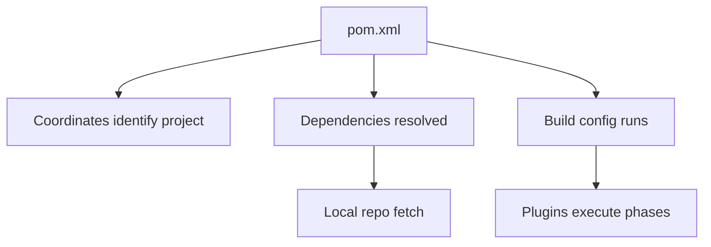

# POM XML

## 1. Introduction

The **`pom.xml`** (Project Object Model) is the heart of a Maven project. It declares coordinates, packaging, dependencies, plugins, properties, and build configuration in a single XML file.

---

## 2. Why This Topic Is Important

- The pom defines what your project IS and WHAT it needs.
- Interviewers ask about pom structure and key elements.
- Spring Boot projects are configured entirely through the pom.
- Debugging builds means reading the pom.

---

## 3. Real-World Analogy

The pom.xml is the **ID card + shopping list + instruction manual** of your project. The ID card identifies it (coordinates). The shopping list lists what it needs (dependencies). The manual tells builders how to construct it (build config).

---

## 4. Theory

### The Essential Elements
| Element | Purpose |
|---------|---------|
| `modelVersion` | POM version (4.0.0) |
| `groupId` | Organization (reverse domain) |
| `artifactId` | Project name |
| `version` | Release version |
| `packaging` | jar / war / pom |
| `name` / `description` | Human metadata |
| `properties` | Variables (e.g., versions) |
| `dependencies` | Libraries |
| `build` | Plugins and paths |
| `parent` | Inherit from a parent POM |
| `repositories` | Custom repos |

### Coordinates (Maven Coordinates)
```xml
<groupId>com.example</groupId>
<artifactId>my-app</artifactId>
<version>1.0.0</version>
```
These uniquely identify your artifact.

### Properties & Version Variables
```xml
<properties>
    <java.version>17</java.version>
    <junit.version>5.10.2</junit.version>
</properties>
```
Usage: `${java.version}`, `${junit.version}`.

---

## 5. Syntax

```xml
<project xmlns="http://maven.apache.org/POM/4.0.0">
    <modelVersion>4.0.0</modelVersion>
    <groupId>com.example</groupId>
    <artifactId>my-app</artifactId>
    <version>1.0.0</version>
    <packaging>jar</packaging>
    <properties>
        <java.version>17</java.version>
    </properties>
    <dependencies> ... </dependencies>
</project>
```

---

## 6. Flow Explanation



---

## 7. Memory Representation

The pom is parsed into an in-memory Project object; dependencies map to artifacts in the local repo.

---

## 8. Simple Example — Minimal pom

```xml
<project xmlns="http://maven.apache.org/POM/4.0.0">
    <modelVersion>4.0.0</modelVersion>

    <groupId>com.example</groupId>
    <artifactId>hello-app</artifactId>
    <version>1.0.0</version>
    <packaging>jar</packaging>
</project>
```

---

## 9. Intermediate Example — Properties + Dependency

```xml
<project xmlns="http://maven.apache.org/POM/4.0.0">
    <modelVersion>4.0.0</modelVersion>

    <groupId>com.example</groupId>
    <artifactId>shop-app</artifactId>
    <version>1.0.0</version>

    <properties>
        <maven.compiler.source>17</maven.compiler.source>
        <maven.compiler.target>17</maven.compiler.target>
        <project.build.sourceEncoding>UTF-8</project.build.sourceEncoding>
    </properties>

    <dependencies>
        <dependency>
            <groupId>com.h2database</groupId>
            <artifactId>h2</artifactId>
            <version>2.2.224</version>
            <scope>runtime</scope>
        </dependency>
        <dependency>
            <groupId>org.junit.jupiter</groupId>
            <artifactId>junit-jupiter</artifactId>
            <version>5.10.2</version>
            <scope>test</scope>
        </dependency>
    </dependencies>
</project>
```

---

## 10. Advanced Example — Parent POM (Spring Boot style)

`pom.xml` (child):
```xml
<project xmlns="http://maven.apache.org/POM/4.0.0">
    <modelVersion>4.0.0</modelVersion>

    <parent>
        <groupId>org.springframework.boot</groupId>
        <artifactId>spring-boot-starter-parent</artifactId>
        <version>3.2.0</version>
        <relativePath/>
    </parent>

    <groupId>com.example</groupId>
    <artifactId>web-app</artifactId>
    <version>0.0.1-SNAPSHOT</version>

    <properties>
        <java.version>17</java.version>
    </properties>

    <dependencies>
        <dependency>
            <groupId>org.springframework.boot</groupId>
            <artifactId>spring-boot-starter-web</artifactId>
        </dependency>
    </dependencies>
</project>
```
The parent supplies versions — the child just names dependencies.

---

## 11. Output

There's no runtime output for a pom itself. But `mvn help:effective-pom` prints the **effective POM** (parent + child merged) — great for debugging.

---

## 12. Common Mistakes

| Mistake | Correction |
|---------|------------|
| Missing modelVersion | Add `<modelVersion>4.0.0</modelVersion>` |
| Wrong groupId convention | Use reverse domain: com.example... |
| Version in wrong place | Coordinates: groupId/artifactId/version |
| Hard-coding versions inline | Use properties |
| Forgetting scope | Default is compile — choose test/runtime/provided |

---

## 13. Best Practices

- Define `<properties>` for versions and encoding.
- Use a parent POM for shared config.
- Choose scopes deliberately (compile/test/runtime/provided).
- Set compiler source/target explicitly.
- Keep the pom readable and minimal.

---

## 14. Interview Questions

**Q1. What is a POM?**
*The Project Object Model — the XML configuration for a Maven project.*

**Q2. What are Maven coordinates?**
*groupId, artifactId, version — uniquely identifying an artifact.*

**Q3. What does modelVersion do?**
*Identifies the POM specification version (4.0.0).*

**Q4. What is a parent POM?**
*A POM whose config is inherited (e.g., spring-boot-starter-parent).*

**Q5. What is the effective POM?**
*The merged result of parent + child POMs.*

---

## 15. Practice Exercises

1. Write a minimal pom from memory.
2. Add properties for Java version and encoding.
3. Add a dependency with a test scope.
4. Use `mvn help:effective-pom` and inspect it.

---

## 16. Coding Challenges

1. **Easy:** Create a pom for a hello project.
2. **Medium:** Add JUnit + H2 with correct scopes.
3. **Hard:** Set up a Spring Boot-style parent/child structure.

---

## 17. Summary

- pom.xml defines project identity and needs.
- Coordinates = groupId:artifactId:version.
- Properties centralize versions.
- Parent POMs enable inheritance.
- Scopes control when dependencies are available.

➡️ Continue to: [Directory Structure](Directory-Structure.md)