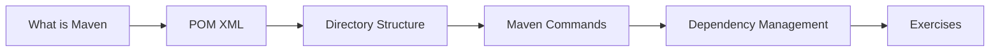

# 20 — Maven

> **Experience level: 🟣 Advanced (2 – 4 years)**

**Maven** is the most popular Java build tool: it compiles code, manages dependencies, runs tests, and packages JARs — all driven by a declarative `pom.xml`.

---

## 📂 Files in This Module

| File | What You'll Learn |
|------|-------------------|
| [What-is-Maven.md](What-is-Maven.md) | Build tooling, the build lifecycle |
| [POM-XML.md](POM-XML.md) | project object model, coordinates, dependencies |
| [Directory-Structure.md](Directory-Structure.md) | Standard project layout |
| [Maven-Commands.md](Maven-Commands.md) | compile, test, package, install |
| [Dependency-Management.md](Dependency-Management.md) | Managing libraries, scopes, transitives |
| [Exercises.md](Exercises.md) | Practice tasks for this module |

---

## 🎯 Learning Objectives

By the end of this module, you will be able to:

1. ✅ Explain what Maven does and its lifecycle.
2. ✅ Read and write a pom.xml.
3. ✅ Use the standard directory layout.
4. ✅ Run compile/test/package/install.
5. ✅ Manage dependencies and scopes.

---

## 🧭 Module Map



---

## 📌 Quick Preview

```bash
mvn clean compile     # compile your code
mvn test              # run tests
mvn package           # build the JAR
mvn install           # install into local repo
```

---

## Next Module

➡️ [21 — Gradle](../21-Gradle/README.md) — the modern alternative build tool.