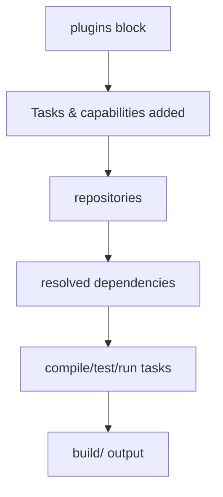

# Build Scripts

## 1. Introduction

The **`build.gradle`** file defines your Gradle project: which plugins apply, where dependencies come from, what dependencies you have, and custom tasks — all in Groovy (or Kotlin DSL) instead of XML.

---

## 2. Why This Topic Is Important

- The build script is Gradle's equivalent of pom.xml.
- Plugins bring in capabilities (java, application, spring-boot).
- Interviewers test build script basics.
- Real projects customize builds here.

---

## 3. Real-World Analogy

The build script is the **recipe card** for your project. The recipe lists the dish's equipment (plugins), the pantry to shop at (repositories), the ingredients (dependencies), and the steps (tasks). Change the recipe, change the dish.

---

## 4. Theory

### The Plugins Block
```groovy
plugins {
    id 'java'                 // core Java support
    id 'application'          // runnable app, mainClass
    id 'org.springframework.boot' version '3.2.0'  // framework
}
```

### Common Plugins
| Plugin | Provides |
|--------|----------|
| `java` | Compile, test, jar tasks |
| `application` | `run` task + mainClass config |
| `groovy` | Groovy support |
| `org.springframework.boot` | Boot tasks, fat JAR |

### Repositories
```groovy
repositories {
    mavenCentral()
}
```

### Configuring a Task
```groovy
test {
    useJUnitPlatform()       // JUnit 5
}
```

### Custom Tasks
```groovy
tasks.register('hello') {
    doLast { println 'Hello from a task!' }
}
```

### Variables & Properties
```groovy
ext {
    junitVersion = '5.10.2'
}
dependencies {
    testImplementation "org.junit.jupiter:junit-jupiter:$junitVersion"
}
```

---

## 5. Syntax

```groovy
plugins { id 'java' }
repositories { mavenCentral() }
dependencies { testImplementation '...' }
tasks.register('name') { doLast { ... } }
```

---

## 6. Flow Explanation



---

## 7. Memory Representation

Gradle parses the script into a project model with a task graph before executing.

---

## 8. Simple Example

`build.gradle`:
```groovy
plugins {
    id 'java'
}

repositories {
    mavenCentral()
}
```

---

## 9. Intermediate Example — Full Script

`build.gradle`:
```groovy
plugins {
    id 'java'
    id 'application'
}

repositories {
    mavenCentral()
}

ext {
    junitVersion = '5.10.2'
}

dependencies {
    testImplementation "org.junit.jupiter:junit-jupiter:$junitVersion"
}

application {
    mainClass = 'com.example.App'
}

test {
    useJUnitPlatform()
}
```

---

## 10. Advanced Example — Custom Task & Properties

`build.gradle`:
```groovy
plugins { id 'java' }

repositories { mavenCentral() }

tasks.register('printInfo') {
    group = 'custom'
    description = 'Prints project info'
    doLast {
        println "Project: ${project.name}, version: ${project.version}"
    }
}
```

Run: `gradle printInfo`

---

## 11. Output

For `gradle printInfo`:

```
> Task :printInfo
Project: demo, version: unspecified
```

For `gradle tasks` (lists available tasks):

```
Build tasks
-----------
build - Assembles and tests this project.
```

---

## 12. Common Mistakes

| Mistake | Correction |
|---------|------------|
| No `repositories` block | Dependencies fail to resolve |
| Forgetting `useJUnitPlatform()` | JUnit 5 tests silently skipped |
| Wrong DSL (Groovy vs Kotlin) | Keep to one |
| Task config without `doLast` | Execution happens at config time otherwise |
| Missing quotes on strings | Groovy strings need quotes |

---

## 13. Best Practices

- Start from plugin templates.
- Keep build scripts declarative and small.
- Use `ext` or `version catalogs` for versions.
- Register tasks lazily (`tasks.register`).
- Let plugins do the heavy lifting.

---

## 14. Interview Questions

**Q1. What's in a build.gradle?**
*Plugins, repositories, dependencies, task configuration.*

**Q2. What does the `java` plugin provide?**
*Compile, test, and jar tasks.*

**Q3. What is `application` plugin for?**
*Runnable apps with a `run` task and mainClass.*

**Q4. What is `doLast`?**
*Action run after the task's main work.*

**Q5. How do you define reusable versions?**
*`ext { ... }` or Gradle version catalogs.*

---

## 15. Practice Exercises

1. Write a minimal build.gradle.
2. Add the application plugin + mainClass.
3. Configure JUnit 5 testing.
4. Register a custom task with doLast.

---

## 16. Coding Challenges

1. **Easy:** hello-app runnable via gradle run.
2. **Medium:** A project with version property + test dependency.
3. **Hard:** A Spring Boot Gradle build (boot plugin) producing a runnable JAR.

---

## 17. Summary

- build.gradle = plugins + repos + deps + tasks.
- Plugins add capabilities; repos source deps.
- Groovy DSL with doLast for task actions.
- Keep scripts declarative.
- Version catalogs/ext centralize versions.

➡️ Continue to: [Gradle Wrapper](Gradle-Wrapper.md)