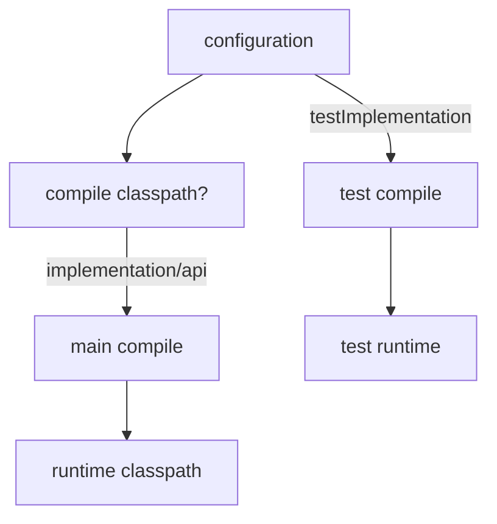

# Dependencies

## 1. Introduction

Gradle declares dependencies inside **configurations** — named scopes like `implementation`, `testImplementation`, and `runtimeOnly` that control availability and how they're shared.

---

## 2. Why This Topic Is Important

- Correct configurations keep runtime lean and avoid leaks.
- Interviewers test implementation vs api.
- Spring starters are dependency bundles.
- Version catalogs modernize version management.

---

## 3. Real-World Analogy

Think of **school supplies with permissions**:
- `implementation` = private notes (only you use them).
- `api` = textbook shared with your team (they rely on it).
- `testImplementation` = practice tests (only for exams).
- `runtimeOnly` = the fuel for the class projector (needed only when running).

---

## 4. Theory

### Common Configurations
| Configuration | Compile | Runtime | Exposed to consumers | Use For |
|---------------|---------|---------|----------------------|---------|
| `implementation` | ✅ | ✅ | ❌ | Internal deps |
| `api` | ✅ | ✅ | ✅ | Public API deps |
| `compileOnly` | ✅ | ❌ | — | Annotations (Lombok) |
| `runtimeOnly` | ❌ | ✅ | — | JDBC drivers |
| `testImplementation` | tests | tests | — | JUnit |
| `testRuntimeOnly` | — | tests | — | Test runners |

### Why implementation over api?
`implementation` keeps transitive deps **off the public API** — consumers don't see them, preventing leaks and conflicts.

### Declaring Dependencies
```groovy
dependencies {
    implementation 'org.springframework.boot:spring-boot-starter-web'
    testImplementation 'org.junit.jupiter:junit-jupiter:5.10.2'
    runtimeOnly 'com.h2database:h2:2.2.224'
    compileOnly 'org.projectlombok:lombok:1.18.30'
}
```

### Version Catalogs (modern)
`gradle/libs.versions.toml`:
```toml
[versions]
junit = "5.10.2"

[libraries]
junit = { module = "org.junit.jupiter:junit-jupiter", version.ref = "junit" }
```
Usage in build.gradle:
```groovy
dependencies {
    testImplementation libs.junit
}
```

---

## 5. Syntax

```groovy
dependencies {
    implementation 'group:artifact:version'
    testImplementation 'group:artifact:version'
}
```

---

## 6. Flow Explanation



---

## 7. Memory Representation

Resolved jars cache in `~/.gradle/caches`; configurations produce compile/runtime classpaths.

---

## 8. Simple Example

```groovy
repositories { mavenCentral() }

dependencies {
    implementation 'com.google.guava:guava:33.0.0-jre'
    testImplementation 'org.junit.jupiter:junit-jupiter:5.10.2'
}
```

---

## 9. Intermediate Example — The Right Configurations

```groovy
dependencies {
    implementation 'org.springframework.boot:spring-boot-starter-web'
    runtimeOnly 'com.mysql:mysql-connector-j'
    compileOnly 'org.projectlombok:lombok:1.18.30'
    annotationProcessor 'org.projectlombok:lombok:1.18.30'
    testImplementation 'org.springframework.boot:spring-boot-starter-test'
}
```

---

## 10. Advanced Example — Version Catalog

`gradle/libs.versions.toml`:
```toml
[versions]
spring-boot = "3.2.0"
junit = "5.10.2"

[libraries]
spring-boot-starter-web = { module = "org.springframework.boot:spring-boot-starter-web", version.ref = "spring-boot" }
junit = { module = "org.junit.jupiter:junit-jupiter", version.ref = "junit" }
```

`build.gradle`:
```groovy
dependencies {
    implementation libs.spring.boot.starter.web
    testImplementation libs.junit
}
```

---

## 11. Output

`./gradlew dependencies` prints the graph:
```
implementation - Implementation only
+--- org.springframework.boot:spring-boot-starter-web:3.2.0
\--- ...
```

---

## 12. Common Mistakes

| Mistake | Correction |
|---------|------------|
| Everything as implementation | Choose the right configuration |
| Exposing transitive deps with api | Only when consumers need them |
| Forgetting compileOnly/annotationProcessor | Lombok won't work |
| Drivers in implementation | runtimeOnly is usually right |
| Hard-coding versions everywhere | Version catalogs / ext |

---

## 13. Best Practices

- Default to `implementation`.
- Use `api` only for public-API dependencies.
- `compileOnly` for processors/annotations.
- `runtimeOnly` for drivers.
- Adopt version catalogs for versions.

---

## 14. Interview Questions

**Q1. What is a configuration?**
*A named classpath scope controlling dependency availability.*

**Q2. implementation vs api?**
*api exposes the dep to consumers; implementation hides it.*

**Q3. compileOnly vs runtimeOnly?**
*compileOnly: needed to compile, absent at runtime. runtimeOnly: needed only at runtime.*

**Q4. What is a version catalog?**
*A centralized TOML file for versions and libraries.*

**Q5. How do you view the dependency tree?**
*./gradlew dependencies.*

---

## 15. Practice Exercises

1. Add an implementation and test dependency.
2. Move a JDBC driver to runtimeOnly.
3. Add Lombok-style compileOnly + annotationProcessor.
4. Create a libs.versions.toml and use libs.x.

---

## 16. Coding Challenges

1. **Easy:** Guava + JUnit project.
2. **Medium:** Spring Boot starter with proper configurations.
3. **Hard:** Refactor a project's versions into a version catalog.

---

## 17. Summary

- Configurations = scoped classpaths.
- implementation hides; api exposes.
- compileOnly/runtimeOnly for special cases.
- Version catalogs centralize versions.
- `./gradlew dependencies` to inspect.

➡️ Continue to: [Gradle Commands](Gradle-Commands.md)