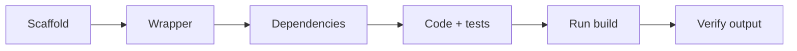

# Exercises — Gradle

## 1. Introduction

Practice creating a Gradle project, using the wrapper, declaring dependencies, and running tasks. Compare everything with what you learned in Module 20 (Maven).

---

## 2. Why This Topic Is Important

- Gradle is the default for Android and many Spring Boot apps.
- Interviewers ask Gradle vs Maven and the wrapper.
- CI pipelines run Gradle tasks.
- Reproducible builds matter in every team.

---

## 3. Real-World Analogy

Practice is like **learning a second workshop layout**: same tools (build tasks), different arrangement (DSL vs XML). Once you know both, you can work in any shop.

---

## 4. Theory — Core Tasks

```bash
./gradlew clean
./gradlew build
./gradlew test
./gradlew run
./gradlew tasks
./gradlew dependencies
```

---

## 5. Syntax Reminder

```groovy
plugins { id 'java'; id 'application' }
repositories { mavenCentral() }
dependencies { testImplementation 'org.junit.jupiter:junit-jupiter:5.10.2' }
application { mainClass = 'com.example.App' }
```

---

## 6. Practice Flow



---

## 7. Memory Representation

Skip — build mechanics.

---

## 8. Simple Exercises

**Ex 1 — Scaffold**
Create build.gradle with the java plugin and a Hello class.

**Ex 2 — Wrapper**
Generate the wrapper; inspect wrapper files.

**Ex 3 — Build**
`./gradlew build`; confirm `build/libs/` JAR.

---

## 9. Intermediate Exercises

**Ex 4 — Application Plugin**
Add `application`, set mainClass, run with `./gradlew run`.

**Ex 5 — Test Dependency**
Add JUnit; write a test; run `./gradlew test`.

**Ex 6 — Configurations**
Add H2 as runtimeOnly and Lombok-style compileOnly+annotationProcessor.

---

## 10. Advanced Exercises

**Ex 7 — Custom Task**
Register a `greet` task with doLast printing a message.

**Ex 8 — Version Catalog**
Create `gradle/libs.versions.toml`; reference `libs.junit`.

**Ex 9 — Filtered Tests**
Run only one test class with `--tests`.

**Ex 10 — Gradle vs Maven**
Build the same hello-app in Maven and Gradle; compare build scripts side by side.

---

## 11. Expected Output Samples

**Ex 5 (`./gradlew test`):**
```
> Task :test
BUILD SUCCESSFUL
```

**Ex 7 (`./gradlew greet`):**
```
> Task :greet
Hello from a custom task!
```

---

## 12. Common Mistakes

| Mistake | Fix |
|---------|-----|
| `gradle` instead of `./gradlew` | Use the wrapper |
| No repositories block | Add mavenCentral() |
| Forgetting useJUnitPlatform() | Add to test block |
| Mixing DSLs | Stick to Groovy or Kotlin |
| Missing mainClass | application block |

---

## 13. Best Practices

- Always use the wrapper.
- Keep scripts declarative.
- Default to implementation.
- Version catalogs for versions.
- Run clean build in CI.

---

## 14. Interview Practice Questions

**Q1.** Gradle vs Maven — main differences?
**Q2.** What is the wrapper and why?
**Q3.** implementation vs api?
**Q4.** What tasks does build run?
**Q5.** Where is Gradle output and cache?

---

## 15. Self-Check

- [ ] I can create a Gradle project from scratch.
- [ ] I can read/write build.gradle.
- [ ] I use the wrapper everywhere.
- [ ] I choose the right configurations.
- [ ] I can run build/test/run.
- [ ] I can compare Gradle to Maven.

---

## 16. Next Steps

- Move to [Module 22 — Design Patterns](../22-Design-Patterns/README.md).
- Spring Boot (Module 26) is usually built with Gradle or Maven.

---

## 17. Summary

- Gradle = DSL build tool, task-graph based.
- Wrapper = reproducibility.
- Configurations scope dependencies.
- Tasks: clean, build, test, run.
- Both Gradle and Maven are essential tools.

➡️ Module complete! Continue to [22 — Design Patterns](../22-Design-Patterns/README.md).