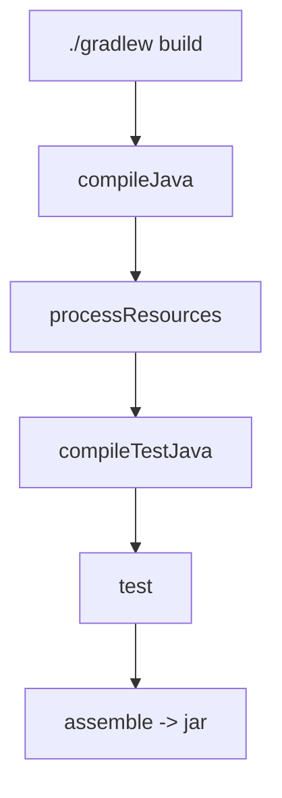

# Gradle Commands

## 1. Introduction

Gradle commands invoke **tasks**. The core set — `clean`, `build`, `test`, `run` — handles day-to-day work, and `gradle tasks` lists everything available.

---

## 2. Why This Topic Is Important

- Builds in CI run Gradle tasks.
- Knowing the task names prevents guesswork.
- Interviewers ask about build/test/clean.
- Daemon and caching behavior affects workflow.

---

## 3. Real-World Analogy

Tasks are like **app shortcuts on your phone**. You tap "build" (like "Open Camera") and it launches a chain: compile, test, package. `gradle tasks` is the app drawer showing every shortcut.

---

## 4. Theory

### Core Tasks
| Command | What It Does |
|---------|--------------|
| `./gradlew clean` | Delete `build/` |
| `./gradlew build` | Compile + test + assemble |
| `./gradlew test` | Run tests only |
| `./gradlew run` | Run the app (application plugin) |
| `./gradlew jar` | Build the JAR |
| `./gradlew tasks` | List available tasks |
| `./gradlew dependencies` | Show dependency graph |
| `./gradlew build --scan` | Share a build report |

### Task Options
| Option | Effect |
|--------|--------|
| `--info` | Detailed logging |
| `--stacktrace` | Stack traces on errors |
| `--continue` | Run remaining tasks after failures |
| `--tests X` | Run matching tests |
| `-x test` | Exclude a task |
| `--build-cache` | Use build cache |

### Gradle Daemon
- Gradle runs in a background daemon (fast startup).
- `./gradlew --stop` stops it.

---

## 5. Syntax

```bash
./gradlew <task> [options]
./gradlew clean build
./gradlew test --tests "com.example.*"
```

---

## 6. Flow Explanation



---

## 7. Memory Representation

Output lands in `build/`; the daemon caches task results in memory/disk.

---

## 8. Simple Example

```bash
./gradlew clean build
```
Output:
```
> Task :compileJava
> Task :test
> Task :jar
BUILD SUCCESSFUL in 2s
```

---

## 9. Intermediate Example — Running Tests by Name

```bash
./gradlew test --tests "com.example.AppTest.specificTest"
```
Output:
```
> Task :test
BUILD SUCCESSFUL
```

---

## 10. Advanced Example — CI-Friendly Build

```bash
./gradlew clean build --stacktrace --no-daemon
```
- `--stacktrace`: debug failures.
- `--no-daemon`: don't leave a daemon in CI.

---

## 11. Output

For `./gradlew build` with a failing test:

```
> Task :test FAILED
There were failing tests. See the report at:
build/reports/tests/test/index.html
BUILD FAILED
```

---

## 12. Common Mistakes

| Mistake | Correction |
|---------|------------|
| Using `gradle` not `./gradlew` | Wrapper pins the version |
| Forgetting `clean` | Stale artifacts linger |
| No `--stacktrace` on failure | Harder to debug |
| Running `build` when only tests need running | Use `test` |
| Ignoring test reports | Check build/reports/tests |

---

## 13. Best Practices

- Always use `./gradlew`.
- `clean build` for full verification.
- Use `--tests` to filter tests while developing.
- Check HTML test reports on failure.
- Use `--stacktrace` when debugging.

---

## 14. Interview Questions

**Q1. What does `./gradlew build` do?**
*Compiles, runs tests, and assembles the artifact.*

**Q2. clean vs build?**
*clean deletes build/; build compiles+tests+assembles.*

**Q3. How do you run one test?**
*`./gradlew test --tests "Class.method"`.*

**Q4. What is the Gradle daemon?**
*A background JVM speeding up builds.*

**Q5. Where are test reports?**
*build/reports/tests/test/index.html.*

---

## 15. Practice Exercises

1. Run `clean build` on a project.
2. Run `test` with a filtered test.
3. List tasks with `gradlew tasks`.
4. View dependencies with `gradlew dependencies`.

---

## 16. Coding Challenges

1. **Easy:** Reproduce a CI build locally.
2. **Medium:** Debug a failing test with --stacktrace.
3. **Hard:** Configure a custom task and wire it into `build`.

---

## 17. Summary

- Tasks: clean, build, test, run, jar.
- `./gradlew` always; use options for control.
- Daemon speeds things up.
- Test reports help debugging.
- CI runs these exact commands.

➡️ Continue to: [Exercises](Exercises.md)