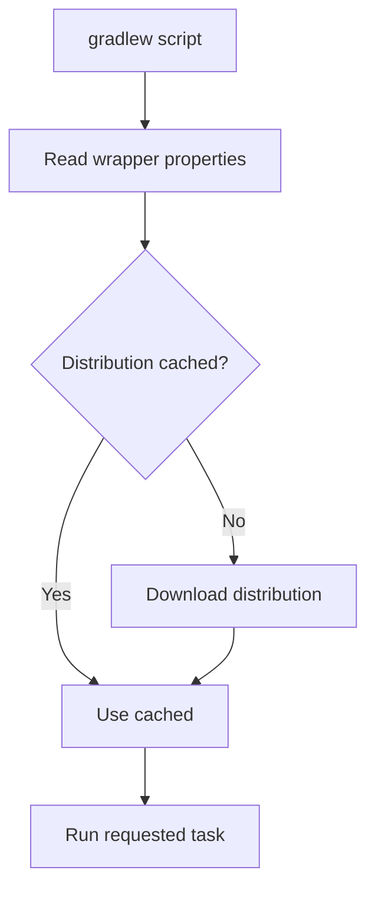

# Gradle Wrapper

## 1. Introduction

The **Gradle wrapper** pins a specific Gradle version per project. Instead of installing Gradle, anyone clones the repo and runs `./gradlew` — same version, every machine, reproducible builds.

---

## 2. Why This Topic Is Important

- Wrapper = **reproducibility** (CI and teammates match versions).
- Interviewers ask "what is the Gradle wrapper?"
- You don't need Gradle installed to build a wrapper project.
- Spring Boot and Android projects ship with it.

---

## 3. Real-World Analogy

The wrapper is like **bundling a specific cooking oil brand with a recipe**. Instead of hoping each kitchen has the right oil (Gradle installed), the recipe includes its own exact bottle — every kitchen produces the identical dish.

---

## 4. Theory

### Files Generated
| File | Purpose |
|------|---------|
| `gradlew` | Unix launcher script |
| `gradlew.bat` | Windows launcher |
| `gradle/wrapper/gradle-wrapper.jar` | Downloads the distribution |
| `gradle/wrapper/gradle-wrapper.properties` | Version + URL config |

### gradle-wrapper.properties
```properties
distributionBase=GRADLE_USER_HOME
distributionPath=wrapper/dists
distributionUrl=https\://services.gradle.org/distributions/gradle-8.5-bin.zip
```

### Generating the Wrapper
```bash
gradle wrapper --gradle-version 8.5
```

### Using It
```bash
./gradlew build        # Linux/macOS
gradlew.bat build      # Windows
```

---

## 5. Syntax

```bash
gradle wrapper --gradle-version <version>
./gradlew <task>
```

---

## 6. Flow Explanation



---

## 7. Memory Representation

The distribution downloads once to `~/.gradle/wrapper/dists` and is reused.

---

## 8. Simple Example — Generate

```bash
gradle wrapper --gradle-version 8.5
```
Produces:
```
gradlew
gradlew.bat
gradle/wrapper/gradle-wrapper.jar
gradle/wrapper/gradle-wrapper.properties
```

---

## 9. Intermediate Example — Version Upgrade

```bash
gradle wrapper --gradle-version 8.7
./gradlew --version
```
Output:
```
------------------------------------------------------------
Gradle 8.7
------------------------------------------------------------
```

---

## 10. Advanced Example — Reproducible CI

Commit the wrapper files. CI just runs:
```bash
./gradlew clean build
```
Every machine — including yours without a local Gradle install — uses the pinned version.

---

## 11. Output

First run of `./gradlew build` (downloads Gradle):

```
Downloading https://services.gradle.org/distributions/gradle-8.5-bin.zip
...
BUILD SUCCESSFUL
```

---

## 12. Common Mistakes

| Mistake | Correction |
|---------|------------|
| Not committing the wrapper | Team/CI versions drift |
| Running `gradle` instead of `./gradlew` | Wrapper pins the version |
| Editing the jar | Use `gradle wrapper` to regenerate |
| Wrapper jar mismatch with properties | Regenerate with `gradle wrapper` |
| Old distribution URL | Update via `--gradle-version` |

---

## 13. Best Practices

- Always use the wrapper in projects.
- Commit all wrapper files.
- Generate with `gradle wrapper --gradle-version X`.
- Upgrade deliberately (verify build after).
- Use wrapper in CI pipelines.

---

## 14. Interview Questions

**Q1. What is the Gradle wrapper?**
*Scripts + config pinning a Gradle version for reproducible builds.*

**Q2. Why use it?**
*No local install needed; consistent versions across machines and CI.*

**Q3. What files make it up?**
*gradlew, gradlew.bat, wrapper jar, wrapper properties.*

**Q4. How do you upgrade Gradle?**
*`gradle wrapper --gradle-version X`.*

**Q5. Where is the distribution cached?**
*~/.gradle/wrapper/dists.*

---

## 15. Practice Exercises

1. Generate the wrapper for a project.
2. Inspect gradle-wrapper.properties.
3. Run a task via ./gradlew.
4. Upgrade the version and verify.

---

## 16. Coding Challenges

1. **Easy:** Build a project using only the wrapper.
2. **Medium:** Reproduce a CI build locally via the wrapper.
3. **Hard:** Set up a wrapper-based project without a local Gradle install (download-free flow).

---

## 17. Summary

- Wrapper pins Gradle per project.
- gradlew/gradlew.bat + jar + properties.
- Reproducible for teams and CI.
- No manual install needed.
- Always commit and use it.

➡️ Continue to: [Dependencies](Dependencies.md)