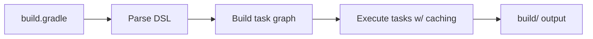

# Gradle vs Maven

## 1. Introduction

**Gradle** and **Maven** are both JVM build tools. Maven is XML-based and lifecycle-driven; Gradle is DSL-based, task-driven, and generally **faster** (incremental builds, caching). Gradle is the default for Android and increasingly for Spring Boot.

---

## 2. Why This Topic Is Important

- Interviewers ask "Maven vs Gradle?"
- You'll encounter both in real projects.
- Understanding the differences helps you pick/adapt.
- Gradle's flexibility matters for custom builds.

---

## 3. Real-World Analogy

Maven is like a **fixed bus route** — predictable, stops in order (lifecycle), simple. Gradle is like a **flexible rideshare** — you specify the destination (task) and it plans the fastest path, caching previous trips. Both get you there; one is more agile.

---

## 4. Theory

### Core Differences
| Aspect | Maven | Gradle |
|--------|-------|--------|
| Config | XML (pom.xml) | Groovy/Kotlin DSL (build.gradle) |
| Model | Lifecycle phases | Task graph |
| Speed | Slower (full rebuilds) | Faster (incremental + cache) |
| Flexibility | Rigid conventions | Highly scriptable |
| Dependency notation | group:artifact:version | `group:artifact:version` strings |
| Build cache | Limited | Built-in |
| Android | No | **Yes** (default) |

### Directory Layout (same)
```
src/main/java
src/main/resources
src/test/java
build/          (Gradle) vs target/  (Maven)
```

### Lifecycle vs Task Graph
- Maven: fixed phases (compile → test → package).
- Gradle: a **task graph** — `build`, `test`, `run` are tasks with dependencies.

---

## 5. Syntax (comparison)

Maven:
```xml
<dependency>
    <groupId>org.junit.jupiter</groupId>
    <artifactId>junit-jupiter</artifactId>
    <version>5.10.2</version>
    <scope>test</scope>
</dependency>
```

Gradle:
```groovy
dependencies {
    testImplementation 'org.junit.jupiter:junit-jupiter:5.10.2'
}
```

---

## 6. Flow Explanation



---

## 7. Memory Representation

Gradle runs a daemon JVM; compiled output goes to `build/`, cached artifacts to `~/.gradle`.

---

## 8. Simple Example — Minimal Gradle Project

`build.gradle`:
```groovy
plugins {
    id 'java'
}

repositories {
    mavenCentral()
}
```

`src/main/java/com/example/App.java`:
```java
package com.example;

public class App {
    public static void main(String[] args) {
        System.out.println("Hello, Gradle!");
    }
}
```

Run: `gradle build`

---

## 9. Intermediate Example — Application Plugin

`build.gradle`:
```groovy
plugins {
    id 'java'
    id 'application'
}

repositories {
    mavenCentral()
}

dependencies {
    testImplementation 'org.junit.jupiter:junit-jupiter:5.10.2'
}

application {
    mainClass = 'com.example.App'
}

test {
    useJUnitPlatform()
}
```

Run: `gradle run`

---

## 10. Advanced Example — Custom Task

`build.gradle`:
```groovy
tasks.register('greet') {
    doLast {
        println "Custom task running!"
    }
}
```

Run: `gradle greet`

---

## 11. Output

For `gradle build` (success):

```
BUILD SUCCESSFUL in 2s
```

For `gradle run`:

```
> Task :run
Hello, Gradle!
```

For `gradle greet`:

```
> Task :greet
Custom task running!
```

---

## 12. Common Mistakes

| Mistake | Correction |
|---------|------------|
| Using Maven layout for Gradle | Layout is the same; output is `build/` |
| Forgetting `repositories` | Dependencies can't resolve |
| Missing `useJUnitPlatform()` | JUnit 5 tests won't run |
| Running without the wrapper | Use `./gradlew` |
| Mixing Groovy/Kotlin DSL syntax | Pick one consistently |

---

## 13. Best Practices

- Always use the **Gradle wrapper**.
- Use plugins (`java`, `application`, `spring-boot`).
- Keep build scripts simple — don't over-script.
- Use `build` and `test` tasks in CI.
- Configure repos explicitly (mavenCentral).

---

## 14. Interview Questions

**Q1. Gradle vs Maven?**
*Gradle: DSL-based, task-graph, faster, more flexible. Maven: XML, lifecycle, conventions.*

**Q2. What is the Gradle wrapper?**
*`gradlew` scripts pinning a Gradle version for reproducible builds.*

**Q3. What is a task?**
*A unit of work in the Gradle task graph (compileJava, test, build).*

**Q4. Why is Gradle faster?**
*Incremental builds, build cache, and a daemon.*

**Q5. Where does Gradle output go?**
*`build/`.*

---

## 15. Practice Exercises

1. Scaffold a minimal Gradle project.
2. Add the application plugin and run it.
3. Add JUnit and run tests.
4. Register a custom task.

---

## 16. Coding Challenges

1. **Easy:** hello-app via `gradle run`.
2. **Medium:** Add a dependency and use it in a test.
3. **Hard:** A Spring Boot-style Gradle build with plugin `org.springframework.boot`.

---

## 17. Summary

- Gradle: fast, flexible, DSL-based.
- Task graph vs Maven's lifecycle.
- Same source layout; `build/` output.
- Wrapper = reproducible builds.
- Android + modern Spring use Gradle.

➡️ Continue to: [Build Scripts](Build-Scripts.md)