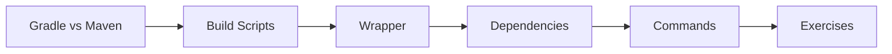

# 21 — Gradle

> **Experience level: 🟣 Advanced (2 – 4 years)**

**Gradle** is the modern JVM build tool — a flexible, fast alternative to Maven driven by **Groovy or Kotlin DSL** instead of XML. It powers Android and most Spring Boot projects.

---

## 📂 Files in This Module

| File | What You'll Learn |
|------|-------------------|
| [Gradle-vs-Maven.md](Gradle-vs-Maven.md) | How Gradle differs from Maven |
| [Build-Scripts.md](Build-Scripts.md) | build.gradle, plugins, tasks |
| [Gradle-Wrapper.md](Gradle-Wrapper.md) | Versioned, reproducible builds |
| [Dependencies.md](Dependencies.md) | Configurations and dependency DSL |
| [Gradle-Commands.md](Gradle-Commands.md) | build, test, run, clean |
| [Exercises.md](Exercises.md) | Practice tasks for this module |

---

## 🎯 Learning Objectives

By the end of this module, you will be able to:

1. ✅ Compare Gradle with Maven.
2. ✅ Read and write build.gradle.
3. ✅ Use the Gradle wrapper.
4. ✅ Declare dependencies and configurations.
5. ✅ Run core Gradle tasks.

---

## 🧭 Module Map



---

## 📌 Quick Preview

```groovy
plugins {
    id 'java'
    id 'application'
}

repositories { mavenCentral() }

dependencies {
    testImplementation 'org.junit.jupiter:junit-jupiter:5.10.2'
}

application { mainClass = 'com.example.App' }
```

---

## Next Module

➡️ [22 — Design Patterns](../22-Design-Patterns/README.md) — proven solutions to common problems.