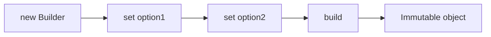

# Builder

## 1. Introduction

The **Builder pattern** constructs complex objects step-by-step. Instead of huge constructors with many parameters, a builder lets you set fields fluently and then `build()` the final object.

---

## 2. Why This Topic Is Important

- Objects with many optional fields need it.
- Lombok's `@Builder` and Java records use it.
- Interviewers ask "builder vs constructor?"
- Spring Boot configs and DTOs often use builders.

---

## 3. Real-World Analogy

Building a **custom computer**: you don't pick all parts at once in one line — you choose CPU, then RAM, then storage, each step at a time, then "assemble" (build). The builder lets you specify only what matters.

---

## 4. Theory

### The Classic Structure
```java
class Pizza {
    private final int size;
    private final boolean cheese;
    private final boolean pepperoni;

    private Pizza(Builder b) {
        this.size = b.size;
        this.cheese = b.cheese;
        this.pepperoni = b.pepperoni;
    }

    public static class Builder {
        private final int size;         // required
        private boolean cheese;
        private boolean pepperoni;

        public Builder(int size) { this.size = size; }   // required arg

        public Builder cheese() { this.cheese = true; return this; }
        public Builder pepperoni() { this.pepperoni = true; return this; }

        public Pizza build() { return new Pizza(this); }
    }
}
```

### Usage
```java
Pizza p = new Pizza.Builder(12).cheese().pepperoni().build();
```

### Why Builder Over Constructor?
| Aspect | Constructor | Builder |
|--------|-------------|---------|
| Many params | Unreadable, error-prone | Clear names |
| Optional fields | Needs overloads | Only set what you want |
| Immutability | Possible | Easy (final) |
| Fluency | — | Chained |

---

## 5. Syntax

```java
new ClassName.Builder(required).opt1(...).opt2(...).build()
```

---

## 6. Flow Explanation



---

## 7. Memory Representation

The builder is temporary; the final object is immutable with `final` fields.

---

## 8. Simple Example

```java
class Pizza {
    private final int size;
    private final boolean cheese;
    private final boolean pepperoni;
    private final boolean mushrooms;

    private Pizza(Builder b) {
        this.size = b.size;
        this.cheese = b.cheese;
        this.pepperoni = b.pepperoni;
        this.mushrooms = b.mushrooms;
    }

    @Override
    public String toString() {
        return "Pizza size=" + size + " cheese=" + cheese
                + " pepperoni=" + pepperoni + " mushrooms=" + mushrooms;
    }

    public static class Builder {
        private final int size;
        private boolean cheese, pepperoni, mushrooms;

        public Builder(int size) { this.size = size; }

        public Builder cheese() { cheese = true; return this; }
        public Builder pepperoni() { pepperoni = true; return this; }
        public Builder mushrooms() { mushrooms = true; return this; }

        public Pizza build() { return new Pizza(this); }
    }
}

public class BuilderDemo {
    public static void main(String[] args) {
        Pizza veggie = new Pizza.Builder(10).cheese().mushrooms().build();
        Pizza meatLover = new Pizza.Builder(14).cheese().pepperoni().build();

        System.out.println(veggie);
        System.out.println(meatLover);
    }
}
```

---

## 9. Intermediate Example — Validation in build()

```java
class User {
    private final String name;
    private final int age;

    private User(Builder b) {
        this.name = b.name;
        this.age = b.age;
    }

    @Override
    public String toString() { return name + " (" + age + ")"; }

    public static class Builder {
        private String name;
        private int age = 18;

        public Builder name(String n) { name = n; return this; }
        public Builder age(int a) { age = a; return this; }

        public User build() {
            if (name == null || name.isBlank()) {
                throw new IllegalStateException("Name is required");
            }
            return new User(this);
        }
    }
}

public class ValidationBuilder {
    public static void main(String[] args) {
        User u = new User.Builder().name("Ajay").age(25).build();
        System.out.println(u);

        try {
            new User.Builder().build();       // missing name
        } catch (IllegalStateException e) {
            System.out.println("Blocked: " + e.getMessage());
        }
    }
}
```

---

## 10. Advanced Example — Builder + Streams + Nested

```java
import java.util.List;

class Order {
    private final String customer;
    private final List<String> items;

    private Order(Builder b) {
        this.customer = b.customer;
        this.items = List.copyOf(b.items);
    }

    @Override
    public String toString() { return customer + ": " + items; }

    public static class Builder {
        private String customer;
        private final java.util.ArrayList<String> items = new java.util.ArrayList<>();

        public Builder customer(String c) { customer = c; return this; }

        public Builder addItem(String item) { items.add(item); return this; }

        public Order build() {
            if (customer == null) throw new IllegalStateException("Customer required");
            return new Order(this);
        }
    }
}

public class OrderBuilder {
    public static void main(String[] args) {
        Order order = new Order.Builder()
                .customer("Ajay")
                .addItem("Laptop")
                .addItem("Mouse")
                .build();
        System.out.println(order);
    }
}
```

---

## 11. Output

For the **Simple Example**:

```
Pizza size=10 cheese=true pepperoni=false mushrooms=true
Pizza size=14 cheese=true pepperoni=true mushrooms=false
```

For the **Intermediate Example**:

```
Ajay (25)
Blocked: Name is required
```

---

## 12. Common Mistakes

| Mistake | Correction |
|---------|------------|
| Forgetting to return `this` | Chain breaks |
| Forgetting `build()` | Object never created |
| No required-field handling | Validate in build() |
| Mutable builder state leaks | Copy collections in the target |
| Builder for simple objects | Constructors suffice |

---

## 13. Best Practices

- Use for objects with **3+ optional fields**.
- Validate in `build()` (fail fast).
- Return `this` from every setter.
- Copy collections defensively.
- Use Lombok `@Builder` to skip boilerplate.

---

## 14. Interview Questions

**Q1. What is the Builder pattern?**
*Constructing complex objects step-by-step via fluent setters and a build() method.*

**Q2. When would you use it?**
*Many optional fields or unreadable constructor calls.*

**Q3. Builder vs constructor?**
*Builder is clearer for many params and enforces validation at build()*

**Q4. How do you make the built object immutable?**
*private constructor + final fields.*

**Q5. How does Lombok help?**
*`@Builder` generates the builder automatically.*

---

## 15. Practice Exercises

1. Build a `Car` builder (brand, color, sunroof, seats).
2. Add validation for a required brand.
3. Build a `User` with optional fields and a default age.
4. Use Lombok's @Builder on a simple POJO.

---

## 16. Coding Challenges

1. **Easy:** A `Pizza` builder with toggles.
2. **Medium:** An `Order` builder with item list and validation.
3. **Hard:** A `Report` builder with headers, rows, and format options.

---

## 17. Summary

- Builder = fluent step-by-step construction.
- Return `this`; validate in build().
- Great for many/optional fields.
- Copy collections; keep targets immutable.
- Lombok `@Builder` removes boilerplate.

➡️ Continue to: [Observer](Observer.md)