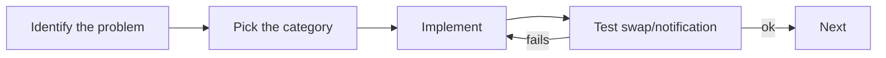

# Exercises — Design Patterns

## 1. Introduction

Practice implementing the core patterns — Singleton, Factory, Builder, Observer, Strategy — and learn to spot them in real code like Spring.

---

## 2. Why This Topic Is Important

- Patterns appear in every interview at 2+ years.
- Spring, Hibernate, and servlet containers use them.
- Knowing patterns = understanding framework code.
- Clean design is a senior-skill differentiator.

---

## 3. Real-World Analogy

Practice is like **learning standard chess openings**. You don't invent moves each game — you recognize situations and apply proven responses. Patterns are your chess openings for software.

---

## 4. Theory — Pattern Map

| Pattern | Category | Key Idea |
|---------|----------|----------|
| Singleton | Creational | One instance |
| Factory | Creational | Centralized creation |
| Builder | Creational | Step-by-step construction |
| Observer | Behavioral | Notify on change |
| Strategy | Behavioral | Swappable algorithms |

---

## 5. Syntax Reminder

```java
// Singleton
private static final X INSTANCE = new X();
static X getInstance() { return INSTANCE; }

// Builder
new X.Builder().optA().optB().build();

// Strategy
context.setStrategy(new StrategyA());
```

---

## 6. Practice Flow



---

## 7. Memory Representation

Skip — design-focused.

---

## 8. Simple Exercises

**Ex 1 — Singleton Logger**
Eager singleton with a `log()` method; prove one instance.

**Ex 2 — Shape Factory**
Factory returning Circle/Square behind a Shape interface.

**Ex 3 — Pizza Builder**
Builder with size (required) and cheese/pepperoni toggles.

---

## 9. Intermediate Exercises

**Ex 4 — Thread-Safe Singleton**
Double-checked locking version; test from 5 threads.

**Ex 5 — Payment Factory + Strategy**
Factory chooses Card/UPI; a Checkout uses the Payment strategy.

**Ex 6 — Stock Observer**
A stock notifies investors on price changes.

**Ex 7 — User Builder with Validation**
Builder rejecting missing names in build().

---

## 10. Advanced Exercises

**Ex 8 — Combined System**
Build an order system: Factory creates items, Builder builds orders, Strategy computes discounts, Observer logs events.

**Ex 9 — Lambda Strategies**
Implement a discount strategy set with lambdas.

**Ex 10 — Spring Pattern Hunt**
List which Spring Boot components use Singleton/Factory/Observer/Strategy and explain each.

---

## 11. Expected Output Samples

**Ex 4 (Thread-Safe Singleton):**
```
Creating instance (once)
com.example.DBConnection@...
com.example.DBConnection@...   (all identical)
```

**Ex 8 (Combined):**
```
Order for Ajay: [Laptop]
Discount applied: 10%
Event logged: Order placed
```

---

## 12. Common Mistakes

| Mistake | Fix |
|---------|-----|
| Patterns for simple problems | Use the simplest solution |
| Singleton global state abuse | Prefer DI |
| Not returning `this` in builders | Chain breaks |
| Observers never detached | Memory leaks |
| Strategy if/else inside | One strategy per algorithm |

---

## 13. Best Practices

- Recognize the problem before the pattern.
- Prefer interfaces for strategy/factory returns.
- Validate in build().
- Detach observers.
- Learn patterns from Spring's source.

---

## 14. Interview Practice Questions

**Q1.** Name the three pattern categories.
**Q2.** How do you make a Singleton thread-safe?
**Q3.** Factory vs Builder — when each?
**Q4.** Where does Spring use Observer?
**Q5.** Why is Strategy better than if/else?

---

## 15. Self-Check

- [ ] I can implement a thread-safe Singleton.
- [ ] I can build Factory and Builder patterns.
- [ ] I can wire Observer and Strategy.
- [ ] I can classify any pattern by category.
- [ ] I can spot patterns in Spring.
- [ ] I know when NOT to use a pattern.

---

## 16. Next Steps

- Move to [Module 23 — DSA in Java](../23-DSA-in-Java/README.md).
- Design patterns return in Spring (25+) and projects (36-37).

---

## 17. Summary

- Patterns = proven solutions, applied by category.
- Singleton, Factory, Builder, Observer, Strategy cover most needs.
- Recognize problems; pick the minimal solution.
- Spring demonstrates every pattern.
- Practice makes pattern-spotting automatic.

➡️ Module complete! Continue to [23 — DSA in Java](../23-DSA-in-Java/README.md).