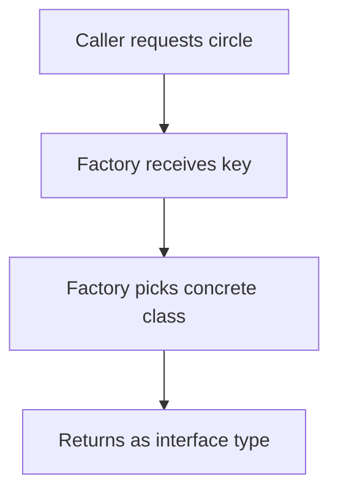

# Factory

## 1. Introduction

The **Factory pattern** centralizes object creation. Callers request an object by type/key, and the factory decides which concrete class to instantiate — decoupling the caller from concrete classes.

---

## 2. Why This Topic Is Important

- Spring's `BeanFactory`/`ApplicationContext` are factories.
- Interfaces + factories enable loose coupling.
- Interviews test factory method vs abstract factory.
- Adding new types means adding to the factory, not callers.

---

## 3. Real-World Analogy

Think of a **restaurant kitchen ordering system**. You (the caller) order "dessert" without deciding which dessert — the kitchen (factory) prepares the specific dish. You're decoupled from the cooking details; you just get the right thing.

---

## 4. Theory

### The Factory Method Pattern
```java
interface Shape { double area(); }

class ShapeFactory {
    static Shape create(String type, double param) {
        return switch (type) {
            case "circle" -> new Circle(param);
            case "square" -> new Square(param);
            default -> throw new IllegalArgumentException("Unknown: " + type);
        };
    }
}
```

### Benefits
| Benefit | Detail |
|---------|--------|
| Decoupling | Caller doesn't know concrete classes |
| Centralization | Creation logic in one place |
| Extensibility | Add types without touching callers |
| Testability | Swap implementations easily |

### Variations
| Variation | Meaning |
|-----------|---------|
| Simple Factory | Static method returning objects |
| Factory Method | Subclasses decide the object |
| Abstract Factory | Families of related objects |

---

## 5. Syntax

```java
interface Product { }
class Factory {
    static Product create(String type) { return switch ...; }
}
```

---

## 6. Flow Explanation



---

## 7. Memory Representation

The factory returns objects normally; the caller holds them through the interface reference.

---

## 8. Simple Example

```java
interface Shape { double area(); }

class Circle implements Shape {
    private final double r;
    Circle(double r) { this.r = r; }
    public double area() { return Math.PI * r * r; }
}

class Square implements Shape {
    private final double s;
    Square(double s) { this.s = s; }
    public double area() { return s * s; }
}

class ShapeFactory {
    static Shape create(String type, double param) {
        return switch (type) {
            case "circle" -> new Circle(param);
            case "square" -> new Square(param);
            default -> throw new IllegalArgumentException("Unknown shape");
        };
    }
}

public class FactoryDemo {
    public static void main(String[] args) {
        Shape c = ShapeFactory.create("circle", 2);
        Shape s = ShapeFactory.create("square", 4);

        System.out.println("Circle: " + c.area());
        System.out.println("Square: " + s.area());
    }
}
```

---

## 9. Intermediate Example — Payment Factory

```java
interface Payment {
    void pay(double amount);
}

class CardPayment implements Payment {
    @Override public void pay(double amount) {
        System.out.println("Card charged: " + amount);
    }
}

class UpiPayment implements Payment {
    @Override public void pay(double amount) {
        System.out.println("UPI paid: " + amount);
    }
}

class PaymentFactory {
    static Payment getPayment(String method) {
        return switch (method.toLowerCase()) {
            case "card" -> new CardPayment();
            case "upi" -> new UpiPayment();
            default -> throw new IllegalArgumentException("Unsupported: " + method);
        };
    }
}

public class PaymentDemo {
    public static void main(String[] args) {
        Payment p1 = PaymentFactory.getPayment("card");
        Payment p2 = PaymentFactory.getPayment("upi");

        p1.pay(500);
        p2.pay(300);
    }
}
```

---

## 10. Advanced Example — Factory with Registration

```java
import java.util.HashMap;
import java.util.Map;
import java.util.function.Supplier;

interface Notification { void send(String msg); }

class EmailNotification implements Notification {
    @Override public void send(String m) { System.out.println("Email: " + m); }
}

class SmsNotification implements Notification {
    @Override public void send(String m) { System.out.println("SMS: " + m); }
}

class NotificationFactory {
    private static final Map<String, Supplier<Notification>> REGISTRY = new HashMap<>();

    static {
        REGISTRY.put("email", EmailNotification::new);
        REGISTRY.put("sms", SmsNotification::new);
    }

    static Notification create(String type) {
        Supplier<Notification> supplier = REGISTRY.get(type);
        if (supplier == null) throw new IllegalArgumentException("Unknown: " + type);
        return supplier.get();
    }
}

public class RegistryFactory {
    public static void main(String[] args) {
        Notification email = NotificationFactory.create("email");
        Notification sms = NotificationFactory.create("sms");
        email.send("Welcome!");
        sms.send("OTP: 1234");
    }
}
```

---

## 11. Output

For the **Intermediate Example**:

```
Card charged: 500.0
UPI paid: 300.0
```

For the **Advanced Example**:

```
Email: Welcome!
SMS: OTP: 1234
```

---

## 12. Common Mistakes

| Mistake | Correction |
|---------|------------|
| Factory returning concrete types | Return the interface |
| Switch on String case mismatches | Normalize (toLowerCase) |
| Factory doing too much | Single responsibility: create |
| Ignoring unknown types | Throw a clear exception |
| Using new in callers anyway | Route creation through the factory |

---

## 13. Best Practices

- Return the **interface**, not the concrete class.
- Centralize creation logic.
- Handle unknown inputs with clear errors.
- Consider registration maps for many types.
- Combine with DI containers when using frameworks.

---

## 14. Interview Questions

**Q1. What problem does Factory solve?**
*Decoupling object creation from callers and centralizing it.*

**Q2. Factory method vs abstract factory?**
*Factory method: subclasses decide. Abstract factory: families of objects.*

**Q3. Why return the interface?**
*So callers depend on abstraction, not concrete classes.*

**Q4. Where does Spring use factories?**
*BeanFactory and ApplicationContext create beans.*

**Q5. How do you add a new type?**
*Add a class + register it in the factory — no caller changes.*

---

## 15. Practice Exercises

1. Build a simple shape factory.
2. Build a payment factory returning an interface.
3. Add a new shape without changing callers.
4. Use a registration map for factory types.

---

## 16. Coding Challenges

1. **Easy:** A vehicle factory (car/bike).
2. **Medium:** A notification factory with registry.
3. **Hard:** An abstract-factory style theme (light/dark UI components).

---

## 17. Summary

- Factory centralizes and decouples creation.
- Return interfaces; switch on keys.
- Extend by adding classes + factory entries.
- Spring's bean factory is the real-world example.
- Clean callers depend on abstractions.

➡️ Continue to: [Builder](Builder.md)