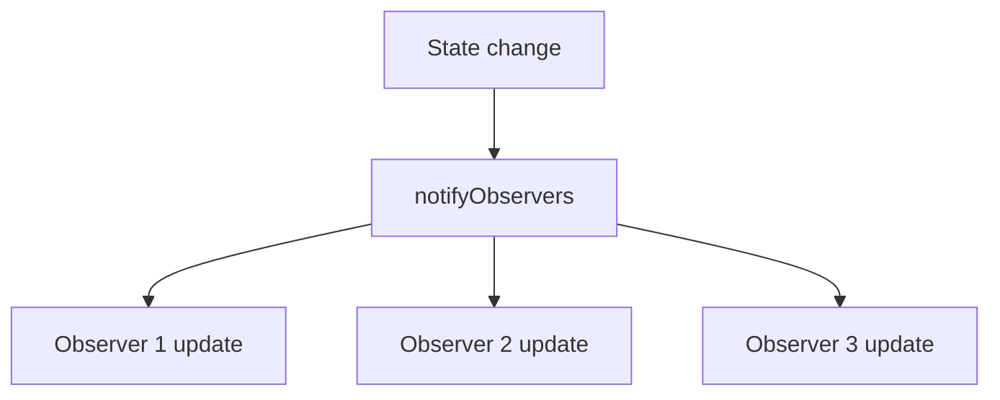

# Observer

## 1. Introduction

The **Observer pattern** lets an object (the **subject**) notify a set of dependents (the **observers**) when its state changes. It's the foundation of event-driven programming.

---

## 2. Why This Topic Is Important

- Event listeners, messaging, and UI updates all use it.
- Spring's `@EventListener` and application events are Observer.
- Interviews test the pattern's structure.
- It decouples producers from consumers.

---

## 3. Real-World Analogy

Think of a **news channel with subscribers**. You subscribe (register) to get updates. When news breaks (state change), the channel broadcasts to all subscribers at once. Subscribers don't poll the channel — they get notified. That's Observer.

---

## 4. Theory

### The Structure
```java
interface Observer {
    void update(String message);
}

interface Subject {
    void attach(Observer o);
    void detach(Observer o);
    void notifyObservers(String message);
}
```

### How It Works
1. Observers **attach** themselves to the subject.
2. On state change, the subject calls `notifyObservers`.
3. Each observer's `update` runs with the new state.

### Benefits
| Benefit | Detail |
|---------|--------|
| Loose coupling | Subject doesn't know observer details |
| Open/closed | Add observers without changing subject |
| Event-driven | React to changes, don't poll |

### In Spring
```java
@Component
class OrderService {
    @EventListener
    public void onOrderPlaced(OrderPlacedEvent event) { ... }
}
```

---

## 5. Syntax

```java
subject.attach(observer);
subject.notifyObservers("data");
```

---

## 6. Flow Explanation



---

## 7. Memory Representation

The subject holds a list of observer references; notifications call each observer's method.

---

## 8. Simple Example

```java
import java.util.ArrayList;
import java.util.List;

interface Observer {
    void update(String message);
}

class NewsChannel implements Observer {
    private final String name;

    NewsChannel(String name) { this.name = name; }

    @Override
    public void update(String message) {
        System.out.println(name + " received: " + message);
    }
}

class NewsAgency {
    private final List<Observer> observers = new ArrayList<>();

    void attach(Observer o) { observers.add(o); }
    void detach(Observer o) { observers.remove(o); }

    void publish(String news) {
        for (Observer o : observers) {
            o.update(news);
        }
    }
}

public class ObserverDemo {
    public static void main(String[] args) {
        NewsAgency agency = new NewsAgency();

        NewsChannel cnn = new NewsChannel("CNN");
        NewsChannel bbc = new NewsChannel("BBC");

        agency.attach(cnn);
        agency.attach(bbc);

        agency.publish("Java 25 released!");
        agency.detach(bbc);
        agency.publish("Only CNN gets this.");
    }
}
```

---

## 9. Intermediate Example — State-Based Notification

```java
import java.util.ArrayList;
import java.util.List;

interface StockListener {
    void priceChanged(String symbol, double price);
}

class Stock {
    private final String symbol;
    private double price;
    private final List<StockListener> listeners = new ArrayList<>();

    Stock(String symbol, double price) {
        this.symbol = symbol;
        this.price = price;
    }

    void addListener(StockListener l) { listeners.add(l); }

    void setPrice(double newPrice) {
        this.price = newPrice;
        for (StockListener l : listeners) {
            l.priceChanged(symbol, price);
        }
    }
}

class Investor implements StockListener {
    private final String name;
    Investor(String name) { this.name = name; }

    @Override
    public void priceChanged(String symbol, double price) {
        System.out.println(name + " notified: " + symbol + " = " + price);
    }
}

public class StockDemo {
    public static void main(String[] args) {
        Stock tesla = new Stock("TSLA", 250.0);

        tesla.addListener(new Investor("Ajay"));
        tesla.addListener(new Investor("Priya"));

        tesla.setPrice(260.0);
        tesla.setPrice(275.5);
    }
}
```

---

## 10. Advanced Example — Observer with Lambda & Java 8

```java
import java.util.ArrayList;
import java.util.List;
import java.util.function.Consumer;

class EventPublisher {
    private final List<Consumer<String>> listeners = new ArrayList<>();

    void subscribe(Consumer<String> listener) { listeners.add(listener); }

    void publish(String event) {
        listeners.forEach(l -> l.accept(event));
    }
}

public class LambdaObserver {
    public static void main(String[] args) {
        EventPublisher publisher = new EventPublisher();

        publisher.subscribe(e -> System.out.println("Logger: " + e));
        publisher.subscribe(e -> System.out.println("Auditor: " + e.toUpperCase()));

        publisher.publish("Order placed");
    }
}
```

---

## 11. Output

For the **Simple Example**:

```
CNN received: Java 25 released!
BBC received: Java 25 released!
CNN received: Only CNN gets this.
```

For the **Intermediate Example**:

```
Ajay notified: TSLA = 260.0
Priya notified: TSLA = 260.0
Ajay notified: TSLA = 275.5
Priya notified: TSLA = 275.5
```

---

## 12. Common Mistakes

| Mistake | Correction |
|---------|------------|
| Subject holding observer concrete types | Depend on the Observer interface |
| Notifying during iteration + detach | Copy the list before iterating |
| Forgetting to detach | Memory leaks (listeners linger) |
| Tight coupling subject→observer internals | Keep update() simple |
| Polling instead of observing | Use the pattern to avoid polling |

---

## 13. Best Practices

- Depend on the Observer interface.
- Copy the listener list when notifying.
- Detach observers that no longer need updates.
- Keep update() lightweight (avoid long work).
- In Spring, use `@EventListener` + events.

---

## 14. Interview Questions

**Q1. What is the Observer pattern?**
*Objects (observers) register with a subject and get notified on state changes.*

**Q2. Why decouple via interfaces?**
*The subject doesn't know observer implementations.*

**Q3. What's the downside?**
*Memory leaks if observers aren't detached; notification order issues.*

**Q4. How does Spring use it?**
*Application events + @EventListener.*

**Q5. Observer vs polling?**
*Observer is push-based; polling is pull-based (inefficient).*

---

## 15. Practice Exercises

1. Build a news agency with attach/publish/detach.
2. Add and remove listeners; verify behavior.
3. Build a stock price notifier.
4. Rewrite with Java 8 lambdas.

---

## 16. Coding Challenges

1. **Easy:** A doorbell notifying residents.
2. **Medium:** A stock tracker with multiple investors.
3. **Hard:** A Spring-style event bus (publish/subscribe) using the pattern.

---

## 17. Summary

- Observer = subject + registered observers.
- Notify on change; decouple via interfaces.
- Detach to avoid leaks.
- Event-driven code bases use it everywhere.
- Spring events + @EventListener = Observer.

➡️ Continue to: [Strategy](Strategy.md)