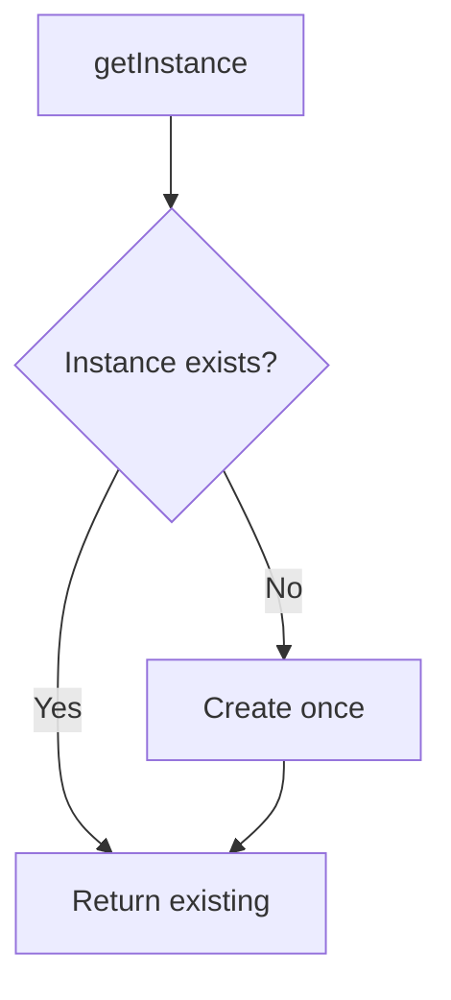

# Singleton

## 1. Introduction

**Singleton** ensures a class has **exactly one instance**, accessible globally. The constructor is private; access goes through a static factory method.

---

## 2. Why This Topic Is Important

- Spring beans are Singletons by default.
- Config, logging, DB pools need a single shared instance.
- Interviews test thread-safe implementations.
- Misused singletons are hard to test — know the trade-offs.

---

## 3. Real-World Analogy

A Singleton is the **only air traffic controller** at an airport. You can't have two controllers (two instances) managing the same sky — that causes chaos. Everyone (all code) talks to that one controller.

---

## 4. Theory

### The Classic Structure
```java
class Config {
    private static final Config INSTANCE = new Config();
    private Config() {}
    public static Config getInstance() { return INSTANCE; }
}
```

### Requirements
| Requirement | Detail |
|-------------|--------|
| Private constructor | Prevents `new` |
| Static field | Holds the single instance |
| Static accessor | Global point of access |

### Thread-Safety (the interview part)
| Approach | Thread-safe? | Notes |
|----------|--------------|-------|
| Eager (static final) | ✅ | Simple, created at load |
| Lazy `getInstance()` with `synchronized` | ✅ | Slower (locks every call) |
| Double-checked locking + `volatile` | ✅ | Fast + safe |
| **Enum singleton** | ✅ | Best — serialization safe, bulletproof |

### Enum Singleton
```java
enum Config {
    INSTANCE;
    void load() { ... }
}
```

---

## 5. Syntax

```java
class X {
    private static final X INSTANCE = new X();
    private X() {}
    public static X getInstance() { return INSTANCE; }
}
```

---

## 6. Flow Explanation



---

## 7. Memory Representation

One object on the heap, referenced by a static field in the method area.

---

## 8. Simple Example

```java
class Logger {
    private static final Logger INSTANCE = new Logger();

    private Logger() {}

    public static Logger getInstance() { return INSTANCE; }

    void log(String message) {
        System.out.println("[LOG] " + message);
    }
}

public class SingletonDemo {
    public static void main(String[] args) {
        Logger l1 = Logger.getInstance();
        Logger l2 = Logger.getInstance();

        System.out.println("Same instance? " + (l1 == l2));
        l1.log("Application started");
    }
}
```

---

## 9. Intermediate Example — Lazy Thread-Safe

```java
class DBConnection {
    private static volatile DBConnection instance;

    private DBConnection() {
        System.out.println("DB connection established");
    }

    // Double-checked locking
    public static DBConnection getInstance() {
        if (instance == null) {
            synchronized (DBConnection.class) {
                if (instance == null) {
                    instance = new DBConnection();
                }
            }
        }
        return instance;
    }
}

public class LazySingleton {
    public static void main(String[] args) {
        // called from multiple threads - still one instance
        for (int i = 0; i < 3; i++) {
            new Thread(() -> System.out.println(DBConnection.getInstance()))
                .start();
        }
    }
}
```

---

## 10. Advanced Example — Enum Singleton

```java
enum AppConfig {
    INSTANCE;

    private String dbUrl = "jdbc:h2:mem:config";

    public String getDbUrl() { return dbUrl; }

    public void show() {
        System.out.println("Config URL: " + dbUrl);
    }
}

public class EnumSingleton {
    public static void main(String[] args) {
        AppConfig c1 = AppConfig.INSTANCE;
        AppConfig c2 = AppConfig.INSTANCE;

        System.out.println("Same? " + (c1 == c2));
        c1.show();
    }
}
```

---

## 11. Output

For the **Simple Example**:

```
Same instance? true
[LOG] Application started
```

For the **Intermediate Example** (constructed once):

```
DB connection established
com.example.DBConnection@...
com.example.DBConnection@...
com.example.DBConnection@...
```

---

## 12. Common Mistakes

| Mistake | Correction |
|---------|------------|
| Public constructor | Make it private |
| Non-thread-safe lazy init | Synchronize / enum |
| Singleton for stateful services | Prefer dependency injection |
| Testing singletons directly | Hard to mock — abstract the access |
| Reflection breaking singletons | Enum singleton is the strongest guard |

---

## 13. Best Practices

- Use **eager** static-final for simple cases.
- Use **enum** for bulletproof singletons.
- Use double-checked locking only when lazy + performance matter.
- Prefer DI containers (Spring) over hand-rolled singletons.
- Keep singleton state immutable where possible.

---

## 14. Interview Questions

**Q1. What is a Singleton?**
*A class with exactly one instance and global access.*

**Q2. How do you make it thread-safe?**
*Eager init, synchronized accessor, double-checked locking, or enum.*

**Q3. Why enum singleton?**
*Inherently thread-safe, serialization-safe, reflection-safe.*

**Q4. What's the downside of Singletons?**
*Global state, hard to test/mock.*

**Q5. How does Spring handle singletons?**
*Beans default to singleton scope, managed by the container.*

---

## 15. Practice Exercises

1. Implement an eager singleton.
2. Implement a lazy thread-safe one.
3. Implement the enum singleton.
4. Prove two getInstance() calls are identical.

---

## 16. Coding Challenges

1. **Easy:** A singleton logger.
2. **Medium:** A thread-safe config holder used by many threads.
3. **Hard:** Compare enum vs eager implementations and explain the trade-offs in comments.

---

## 17. Summary

- Singleton = one instance + global access.
- Private constructor + static accessor.
- Eager, lazy-synchronized, double-checked, enum.
- Enum is the safest.
- Spring manages singletons via DI.

➡️ Continue to: [Factory](Factory.md)