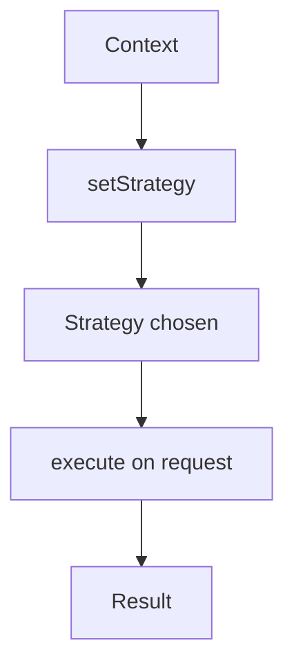

# Strategy

## 1. Introduction

The **Strategy pattern** defines a family of interchangeable algorithms and lets you swap them at runtime. Instead of `if/else` chains, each algorithm lives in its own class behind a common interface.

---

## 2. Why This Topic Is Important

- Open/closed principle in action — extend without modifying.
- Interviewers test strategy vs if/else.
- Lambdas make strategies trivial in Java 8+.
- Payment, sorting, pricing, and auth all use it.

---

## 3. Real-World Analogy

Think of **navigation apps**: you can switch between "fastest," "shortest," and "avoid tolls" — same trip, different routing algorithm. The app (context) uses whichever strategy you choose, without rewriting the whole app.

---

## 4. Theory

### The Structure
```java
interface Strategy {
    int execute(int a, int b);
}

class Add implements Strategy {
    @Override public int execute(int a, int b) { return a + b; }
}

class Multiply implements Strategy {
    @Override public int execute(int a, int b) { return a * b; }
}

class Calculator {
    private Strategy strategy;
    void setStrategy(Strategy s) { this.strategy = s; }
    int calculate(int a, int b) { return strategy.execute(a, b); }
}
```

### Benefits
| Benefit | Detail |
|---------|--------|
| Open/closed | Add strategies without editing context |
| Runtime swapping | Change behavior dynamically |
| Readability | No giant if/else chains |
| Testability | Each strategy tested in isolation |

### Strategy vs If/Else
| If/Else | Strategy |
|---------|----------|
| Hard to extend | Add a class |
| Centralized complexity | Distributed |
| Violates OCP | Complies |

---

## 5. Syntax

```java
context.setStrategy(new ConcreteStrategy());
context.doSomething();
```

---

## 6. Flow Explanation



---

## 7. Memory Representation

The context holds a reference to the current strategy; swapping replaces the reference.

---

## 8. Simple Example

```java
interface Strategy {
    int execute(int a, int b);
}

class Add implements Strategy {
    public int execute(int a, int b) { return a + b; }
}

class Subtract implements Strategy {
    public int execute(int a, int b) { return a - b; }
}

class Multiply implements Strategy {
    public int execute(int a, int b) { return a * b; }
}

class Calculator {
    private Strategy strategy;

    void setStrategy(Strategy s) { this.strategy = s; }

    int calculate(int a, int b) { return strategy.execute(a, b); }
}

public class StrategyDemo {
    public static void main(String[] args) {
        Calculator calc = new Calculator();

        calc.setStrategy(new Add());
        System.out.println("10 + 5 = " + calc.calculate(10, 5));

        calc.setStrategy(new Subtract());
        System.out.println("10 - 5 = " + calc.calculate(10, 5));

        calc.setStrategy(new Multiply());
        System.out.println("10 * 5 = " + calc.calculate(10, 5));
    }
}
```

---

## 9. Intermediate Example — Payment Strategies

```java
interface PaymentStrategy {
    void pay(double amount);
}

class CardPayment implements PaymentStrategy {
    @Override public void pay(double amount) {
        System.out.println("Paid " + amount + " by card");
    }
}

class CashPayment implements PaymentStrategy {
    @Override public void pay(double amount) {
        System.out.println("Paid " + amount + " in cash");
    }
}

class Checkout {
    private PaymentStrategy strategy;

    void setStrategy(PaymentStrategy s) { strategy = s; }

    void checkout(double amount) { strategy.pay(amount); }
}

public class PaymentStrategyDemo {
    public static void main(String[] args) {
        Checkout checkout = new Checkout();

        checkout.setStrategy(new CardPayment());
        checkout.checkout(500);

        checkout.setStrategy(new CashPayment());
        checkout.checkout(300);
    }
}
```

---

## 10. Advanced Example — Lambdas as Strategies

```java
import java.util.List;
import java.util.Comparator;
import java.util.function.Function;

public class LambdaStrategy {
    public static void main(String[] args) {
        List<String> names = new java.util.ArrayList<>(
                List.of("Priya", "Ajay", "Ravi"));

        // strategy as a lambda (Comparator)
        Function<List<String>, List<String>> byLength = list -> {
            list.sort(Comparator.comparingInt(String::length));
            return list;
        };
        Function<List<String>, List<String>> byAlpha = list -> {
            list.sort(String::compareTo);
            return list;
        };

        System.out.println("By length: " + byLength.apply(new java.util.ArrayList<>(names)));
        System.out.println("By alpha : " + byAlpha.apply(new java.util.ArrayList<>(names)));
    }
}
```

---

## 11. Output

For the **Simple Example**:

```
10 + 5 = 15
10 - 5 = 5
10 * 5 = 50
```

For the **Intermediate Example**:

```
Paid 500.0 by card
Paid 300.0 in cash
```

---

## 12. Common Mistakes

| Mistake | Correction |
|---------|------------|
| Context choosing the strategy | Caller sets it (injection) |
| Strategies with shared state | Keep strategies stateless |
| if/else inside a strategy | One strategy = one algorithm |
| Not using an interface | Swap requires a common type |
| Over-using strategies | Simple lambdas may suffice |

---

## 13. Best Practices

- Define a clear strategy interface.
- Keep strategies stateless and small.
- Inject/set the strategy at runtime.
- Prefer lambdas for one-method strategies.
- Combine with Factory to pick strategies.

---

## 14. Interview Questions

**Q1. What is the Strategy pattern?**
*Encapsulating interchangeable algorithms behind one interface, swappable at runtime.*

**Q2. Strategy vs if/else?**
*Strategy complies with Open/Closed and is more testable/extensible.*

**Q3. How do lambdas help?**
*One-method interfaces become one-liners.*

**Q4. What does the context hold?**
*A reference to the current strategy.*

**Q5. Give a Spring example.**
*AuthenticationManager, DataSource routing, converters.*

---

## 15. Practice Exercises

1. Build the calculator with add/subtract/multiply.
2. Build a payment strategy system.
3. Swap strategies at runtime.
4. Rewrite a strategy with a lambda.

---

## 16. Coding Challenges

1. **Easy:** A discount strategy system (10%/20%/festive).
2. **Medium:** A sorting context with multiple sort strategies.
3. **Hard:** A shipping-cost calculator with strategies (standard/express/international).

---

## 17. Summary

- Strategy = interchangeable algorithms behind an interface.
- Swap at runtime; extend without modifying.
- Open/closed and testable.
- Lambdas make it trivial.
- Payment, sorting, and auth all use it.

➡️ Continue to: [Exercises](Exercises.md)