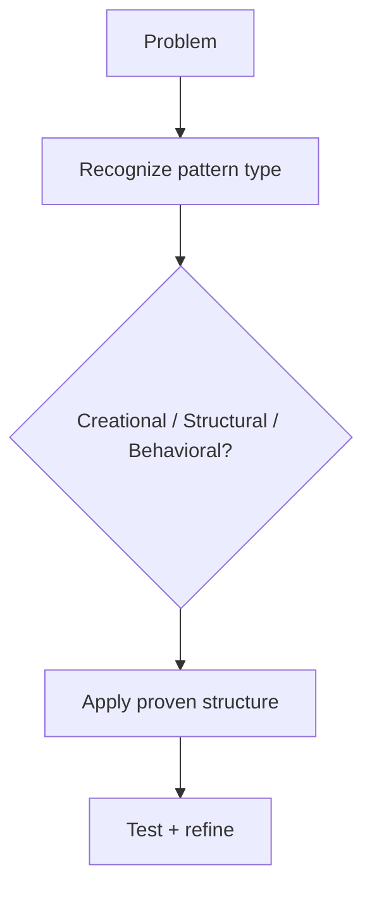

# What are Design Patterns

## 1. Introduction

**Design patterns** are battle-tested, reusable solutions to recurring software design problems. They're not code you copy — they're **approaches** you apply. Spring and every serious codebase use them constantly.

---

## 2. Why This Topic Is Important

- Interviewers at 2+ years test pattern knowledge.
- Spring Boot *is* built on patterns (Singleton, Factory, Proxy...).
- Patterns give teams a shared vocabulary.
- They produce maintainable, extensible designs.

---

## 3. Real-World Analogy

Patterns are like **standard house blueprints**. No two homes are identical, but everyone uses the same proven layouts — the kitchen workflow, the hallway plan, the window placement. You don't reinvent them; you apply the proven template.

---

## 4. Theory

### The Three Categories
| Category | Question | Examples |
|----------|----------|----------|
| **Creational** | How are objects created? | Singleton, Factory, Builder |
| **Structural** | How are classes composed? | Adapter, Decorator, Proxy |
| **Behavioral** | How do objects interact? | Observer, Strategy, Template |

### Why Use Them
| Benefit | Meaning |
|---------|---------|
| Proven | Solutions from decades of real projects |
| Vocabulary | "Factory" instantly communicates intent |
| Maintainability | Loose coupling, testability |
| Extensibility | Add behavior without breaking |

### Pattern Quick-View
| Pattern | Category | Problem Solved |
|---------|----------|----------------|
| Singleton | Creational | One shared instance |
| Factory | Creational | Create without coupling to classes |
| Builder | Creational | Complex step-by-step construction |
| Observer | Behavioral | Notify listeners of events |
| Strategy | Behavioral | Swap algorithms at runtime |

### In Spring (preview)
| Spring Feature | Pattern |
|----------------|---------|
| Beans | Singleton (default scope) |
| BeanFactory/ApplicationContext | Factory |
| DataSource proxies | Proxy |
| @EventListener | Observer |
| AuthenticationManager | Strategy |

---

## 5. Syntax

There's no single syntax — each pattern has its own structure. The pattern name in a method/class makes intent clear:

```java
Config.getInstance();       // Singleton
ShapeFactory.create("circle"); // Factory
new Pizza.Builder().size(12).build(); // Builder
```

---

## 6. Flow Explanation



---

## 7. Memory Representation

Patterns affect object graphs and lifetimes (Singleton = one object; Factory = creation logic). No special memory rules beyond design.

---

## 8. Simple Example — Recognizing the Category

```java
// Creational: Singleton - one instance
class Logger {
    private static final Logger INSTANCE = new Logger();
    private Logger() {}
    public static Logger getInstance() { return INSTANCE; }
    void log(String m) { System.out.println(m); }
}

public class PatternDemo {
    public static void main(String[] args) {
        Logger a = Logger.getInstance();
        Logger b = Logger.getInstance();
        System.out.println("Same instance? " + (a == b));
        a.log("hello");
    }
}
```

---

## 9. Intermediate Example — Choosing a Pattern

Problem: create shapes without hard-coding `new` in the caller.
Solution: **Factory**.

```java
interface Shape { double area(); }

class Circle implements Shape {
    private final double r;
    Circle(double r) { this.r = r; }
    public double area() { return Math.PI * r * r; }
}

class Square implements Shape {
    private final double s;
    Square(double s) { this.s = s; }
    public double area() { return s * s; }
}

class ShapeFactory {
    static Shape create(String type, double param) {
        return switch (type) {
            case "circle" -> new Circle(param);
            case "square" -> new Square(param);
            default -> throw new IllegalArgumentException("Unknown shape");
        };
    }
}

public class FactoryUse {
    public static void main(String[] args) {
        Shape c = ShapeFactory.create("circle", 2);
        Shape sq = ShapeFactory.create("square", 3);
        System.out.println("Circle area: " + c.area());
        System.out.println("Square area: " + sq.area());
    }
}
```

---

## 10. Advanced Example — Patterns in Combination

```java
// Singleton Logger + Factory + Strategy-like sorting
import java.util.List;
import java.util.Arrays;

enum SortType { ASC, DESC }

class Sorter {
    // Strategy via lambdas
    static List<Integer> sort(List<Integer> list, SortType type) {
        List<Integer> copy = new java.util.ArrayList<>(list);
        if (type == SortType.ASC) copy.sort(Integer::compareTo);
        else copy.sort((a, b) -> b - a);
        return copy;
    }
}

public class Combined {
    public static void main(String[] args) {
        List<Integer> nums = Arrays.asList(5, 2, 9, 1);
        System.out.println("ASC : " + Sorter.sort(nums, SortType.ASC));
        System.out.println("DESC: " + Sorter.sort(nums, SortType.DESC));
    }
}
```

---

## 11. Output

For the **Simple Example**:

```
Same instance? true
hello
```

For the **Intermediate Example**:

```
Circle area: 12.566370614359172
Square area: 9.0
```

---

## 12. Common Mistakes

| Mistake | Correction |
|---------|------------|
| Copy-pasting patterns blindly | Apply the *idea*, adapt to context |
| Over-engineering | A simple class may be better than a pattern |
| Singleton everywhere | Singletons are hard to test — use sparingly |
| Forgetting pattern trade-offs | Patterns add structure and some complexity |
| Naming without intent | Name classes/methods to signal the pattern |

---

## 13. Best Practices

- Learn patterns *as vocabulary*, not templates.
- Prefer the simplest solution that fits.
- Use patterns to express intent clearly.
- Watch Spring use patterns — learn from it.
- Review: creational/structural/behavioral mental model.

---

## 14. Interview Questions

**Q1. What is a design pattern?**
*A proven, reusable solution to a common design problem.*

**Q2. Name the three categories.**
*Creational, structural, behavioral.*

**Q3. Give a creational pattern example.**
*Singleton, Factory, or Builder.*

**Q4. Which pattern does Spring use for beans?**
*Singleton (default scope) and Factory (bean factory).*

**Q5. Why learn patterns?**
*Shared vocabulary, proven solutions, maintainable design.*

---

## 15. Practice Exercises

1. Classify five patterns into their categories.
2. Identify patterns used in Spring Boot (research).
3. Spot a pattern in your own past code.
4. Explain a pattern to someone in one sentence.

---

## 16. Coding Challenges

1. **Easy:** A Singleton logger.
2. **Medium:** A shape factory.
3. **Hard:** Combine Singleton + Factory + Strategy in a small notification system.

---

## 17. Summary

- Patterns = proven solutions, applied by category.
- Creational (objects), structural (composition), behavioral (interaction).
- Spring is built on them.
- Shared vocabulary improves design.
- Use them to express intent, not to over-engineer.

➡️ Continue to: [Singleton](Singleton.md)