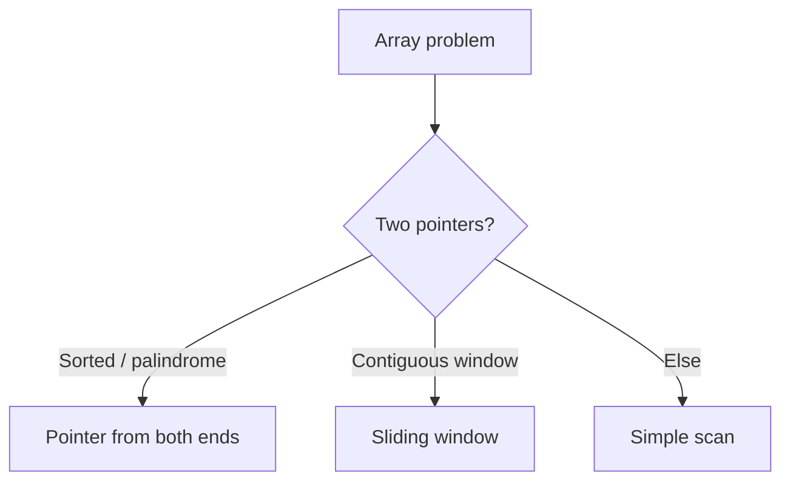

# Arrays & Strings in DSA

## 1. Introduction

Arrays and Strings are the **most common interview data structures**. Many problems reduce to scanning, two-pointer traversal, or sliding windows over an array.

---

## 2. Why This Topic Is Important

- Most coding interview problems start with arrays/strings.
- O(1) random access makes them fast.
- Two-pointer and sliding-window techniques are interview staples.
- Mastery here transfers to everything else.

---

## 3. Real-World Analogy

Arrays are like **numbered storage lockers**: instant access by number, but inserting in the middle means shifting everything. Strings are like **arrays of letters** with extra conveniences — compare, join, search built in.

---

## 4. Theory

### Array Facts
| Fact | Detail |
|------|--------|
| Fixed size | Created once, length immutable |
| Random access | O(1) via index |
| Insert/delete middle | O(n) shifting |
| Memory | Contiguous block |

### Key Techniques
| Technique | Pattern |
|-----------|---------|
| Two pointers | One at start, one at end (palindromes, sorted pairs) |
| Sliding window | Expand/shrink a window (max subarray, substring) |
| Prefix sums | Cumulative array for range sums in O(1) |

### String Facts
| Fact | Detail |
|------|--------|
| Immutable | Each change creates a new object |
| charAt(i) | O(1) access |
| toCharArray() | Convert for mutation |
| StringBuilder | For heavy concatenation |

---

## 5. Syntax

```java
int[] arr = new int[10];
int[] nums = {3, 1, 4, 1, 5};
String s = "hello";
char first = s.charAt(0);
```

---

## 6. Flow Explanation



---

## 7. Memory Representation

Arrays: contiguous memory, O(1) index. Strings: char array + immutable wrapper.

---

## 8. Simple Example — Array Scan

```java
public class ArrayScan {
    static int sum(int[] nums) {
        int total = 0;
        for (int n : nums) total += n;
        return total;
    }

    public static void main(String[] args) {
        int[] nums = {3, 1, 4, 1, 5};
        System.out.println("Sum: " + sum(nums));
    }
}
```

---

## 9. Intermediate Example — Two Pointers (Palindrome)

```java
public class TwoPointers {
    static boolean isPalindrome(String s) {
        int left = 0, right = s.length() - 1;
        while (left < right) {
            if (s.charAt(left) != s.charAt(right)) {
                return false;
            }
            left++;
            right--;
        }
        return true;
    }

    public static void main(String[] args) {
        System.out.println("racecar: " + isPalindrome("racecar"));
        System.out.println("hello  : " + isPalindrome("hello"));
    }
}
```

---

## 10. Advanced Example — Sliding Window (Max Sum of k)

```java
public class SlidingWindow {
    // max sum of any contiguous subarray of size k
    static int maxSum(int[] nums, int k) {
        int window = 0;
        for (int i = 0; i < k; i++) window += nums[i];
        int max = window;

        for (int i = k; i < nums.length; i++) {
            window += nums[i] - nums[i - k];   // slide
            max = Math.max(max, window);
        }
        return max;
    }

    public static void main(String[] args) {
        int[] nums = {2, 1, 5, 1, 3, 2};
        System.out.println("Max sum of size 3: " + maxSum(nums, 3));
    }
}
```

---

## 11. Output

For the **Intermediate Example**:

```
racecar: true
hello  : false
```

For the **Advanced Example**:

```
Max sum of size 3: 9
```

---

## 12. Common Mistakes

| Mistake | Correction |
|---------|------------|
| Array out of bounds | Check indices in loops |
| Modifying strings in place | Strings are immutable |
| O(n²) when two pointers work | Recognize the pattern |
| Forgetting sliding window cost | O(1) per step, not O(n) |
| Off-by-one in window boundaries | Dry-run on small arrays |

---

## 13. Best Practices

- Check bounds before accessing indices.
- Prefer StringBuilder for string building.
- Spot two-pointer / sliding-window patterns.
- Test with empty, single, and edge cases.
- Annotate your technique in comments.

---

## 14. Interview Questions

**Q1. How do you reverse a string in Java?**
*`new StringBuilder(s).reverse().toString()` or two pointers on char[].*

**Q2. What is the two-pointer technique?**
*Moving two indices (often ends) toward each other for O(n).*

**Q3. What is a sliding window?**
*A subarray kept optimal by expanding/shrinking one pointer in O(n).*

**Q4. Why are strings immutable?**
*Security, caching, thread safety — but mutation needs StringBuilder.*

**Q5. How do you find duplicates in an array?**
*HashSet (O(n)) or sorting (O(n log n)).*

---

## 15. Practice Exercises

1. Reverse an array in place.
2. Check if two strings are anagrams (sort or count).
3. Find the max subarray (Kadane's or window).
4. Two-sum with a HashSet.

---

## 16. Coding Challenges

1. **Easy:** Find the largest element in an array.
2. **Medium:** Longest substring without repeating characters.
3. **Hard:** Max subarray sum (Kadane's algorithm).

---

## 17. Summary

- Arrays = O(1) access, O(n) shifts.
- Two pointers and sliding windows solve many problems in O(n).
- Strings immutable → StringBuilder.
- Test edge cases; dry-run loops.
- These foundations feed all other DSA.

➡️ Continue to: [Linked Lists](Linked-Lists.md)