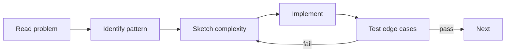

# Exercises — DSA in Java

## 1. Introduction

Practice the core structures and algorithms: arrays/strings, linked lists, stacks/queues, trees, sorting, searching, and complexity analysis.

---

## 2. Why This Topic Is Important

- DSA is the interview gatekeeper.
- Patterns (two-pointer, sliding window, binary search) transfer everywhere.
- Implementing by hand builds deep understanding.

---

## 3. Real-World Analogy

Like **weight training**: you don't build strength by watching — you practice the same lifts repeatedly with increasing difficulty. These exercises are your reps.

---

## 4. Theory — Pattern Map

| Pattern | Best For |
|---------|----------|
| Two pointers | Sorted arrays, palindromes |
| Sliding window | Contiguous subarrays/substrings |
| Stack | Parentheses, reversal, monotonic problems |
| Queue | BFS, level order |
| Binary search | Sorted data, boundaries |
| Divide & conquer | Merge/quick sort |

---

## 5. Syntax Reminder

```java
// Two pointers
while (left < right) { ... left++; right--; }

// Sliding window
window += a[i] - a[i - k];

// Binary search
int mid = lo + (hi - lo) / 2;
```

---

## 6. Practice Flow



---

## 7. Memory Representation

Skip — this module is algorithmic.

---

## 8. Simple Exercises

**Ex 1 — Array:** Find the largest element and its index.

**Ex 2 — String:** Reverse a string with two pointers.

**Ex 3 — Stack:** Reverse a string with a stack.

**Ex 4 — List:** Build a linked list and count its nodes.

**Ex 5 — Sort:** Implement insertion sort.

---

## 9. Intermediate Exercises

**Ex 6 — Sliding Window:** Max sum of any size-k subarray.

**Ex 7 — Linked List:** Reverse a list iteratively.

**Ex 8 — Tree:** In-order traversal of a BST (sorted output).

**Ex 9 — Binary Search:** Find a target; return -1 if absent.

**Ex 10 — Merge Sort:** Implement and test on 8 elements.

---

## 10. Advanced Exercises

**Ex 11 — Two Pointers:** Two-sum on a sorted array.

**Ex 12 — Cycle Detection:** Detect a loop in a linked list (Floyd's).

**Ex 13 — Tree Height:** Compute the height of a binary tree.

**Ex 14 — Quick Sort:** Implement with last-element pivot.

**Ex 15 — Boundary Search:** Find first and last occurrence of a target.

---

## 11. Expected Output Samples

**Ex 6:**
```
Max sum of size 3: 9
```

**Ex 15:**
```
First 2 at index: 1
Last 2 at index: 3
```

---

## 12. Common Mistakes

| Mistake | Fix |
|---------|-----|
| Forgetting edge cases (empty/single) | Always test them |
| Binary search on unsorted data | Sort first |
| `(lo+hi)/2` overflow | `lo + (hi-lo)/2` |
| Not saving `next` when reversing | Save before mutating |
| Stack/queue confusion | push/pop = LIFO; offer/poll = FIFO |

---

## 13. Best Practices

- State the complexity before coding.
- Dry-run loops on small inputs.
- Test edge cases first.
- Prefer Java's built-ins in production.
- Practice the pattern, not the memorized answer.

---

## 14. Interview Practice Questions

**Q1.** When do you use two pointers?
**Q2.** How do you detect a cycle in a linked list?
**Q3.** What's the complexity of binary search?
**Q4.** Merge vs quick sort — when each?
**Q5.** How do you get sorted order from a BST?

---

## 15. Self-Check

- [ ] I can implement a linked list.
- [ ] I can reverse a linked list.
- [ ] I can do all tree traversals.
- [ ] I can implement binary search.
- [ ] I can implement merge and quick sort.
- [ ] I can analyze Big-O of my code.

---

## 16. Next Steps

- DSA power-ups return in [Module 34 — Testing](../34-Testing/README.md) and projects (36-37).
- Move to [25 — Spring Core](../25-Spring-Core/README.md) next.

---

## 17. Summary

- Two pointers, sliding window, stack/queue, binary search cover most problems.
- Implement by hand; dry-run; test edges.
- Know complexities before coding.
- Practice patterns — they transfer.
- DSA + frameworks = complete engineer.

➡️ Module complete! Continue to [25 — Spring Core](../25-Spring-Core/README.md).