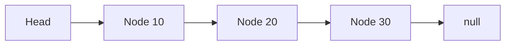

# Linked Lists

## 1. Introduction

A **linked list** is a chain of **nodes**, each holding data and a pointer to the next node. Unlike arrays, nodes are scattered in memory — no shifting on insert/delete.

---

## 2. Why This Topic Is Important

- Interviewers love linked list manipulation (reverse, cycle).
- Insert/delete at ends is O(1).
- Java's `LinkedList` and `HashMap` buckets use nodes.
- It teaches pointer/reference thinking.

---

## 3. Real-World Analogy

A linked list is like a **treasure hunt**: each clue (node) tells you where the next clue is (next pointer). To find clue 5, you follow clues 1→2→3→4→5. You can't jump ahead (no random access), but adding a new clue is easy.

---

## 4. Theory

### Node Structure
```java
class Node {
    int data;
    Node next;
    Node(int data) { this.data = data; }
}
```

### Operations & Complexity
| Operation | Complexity |
|-----------|------------|
| Access head | O(1) |
| Access index i | O(n) — must walk |
| Insert at head | O(1) |
| Insert at end | O(n) (with tail pointer: O(1)) |
| Delete | O(n) to find, O(1) to unlink |
| Traversal | O(n) |

### Array vs Linked List
| Aspect | Array | Linked List |
|--------|-------|-------------|
| Access | O(1) random | O(n) walk |
| Insert middle | O(n) shift | O(1) once found |
| Memory | Contiguous | Scattered + pointer overhead |
| Size | Fixed | Dynamic |

---

## 5. Syntax

```java
class Node {
    int data;
    Node next;
    Node(int d) { data = d; }
}
```

---

## 6. Flow Explanation



---

## 7. Memory Representation

Each node is a separate heap object with a reference to the next; traversal follows references.

---

## 8. Simple Example — Build & Traverse

```java
class Node {
    int data;
    Node next;
    Node(int data) { this.data = data; }
}

class LinkedList {
    Node head;

    void add(int data) {
        Node node = new Node(data);
        if (head == null) {
            head = node;
        } else {
            Node current = head;
            while (current.next != null) current = current.next;
            current.next = node;
        }
    }

    void print() {
        Node current = head;
        while (current != null) {
            System.out.print(current.data + " -> ");
            current = current.next;
        }
        System.out.println("null");
    }
}

public class LinkedListDemo {
    public static void main(String[] args) {
        LinkedList list = new LinkedList();
        list.add(10);
        list.add(20);
        list.add(30);
        list.print();
    }
}
```

---

## 9. Intermediate Example — Reverse

```java
class Reverser {
    static Node reverse(Node head) {
        Node prev = null;
        Node current = head;
        while (current != null) {
            Node next = current.next;
            current.next = prev;    // flip pointer
            prev = current;
            current = next;
        }
        return prev;                // new head
    }
}

public class ReverseDemo {
    public static void main(String[] args) {
        Node head = new Node(1);
        head.next = new Node(2);
        head.next.next = new Node(3);
        head.next.next.next = new Node(4);

        System.out.print("Original: ");
        printList(head);

        head = Reverser.reverse(head);
        System.out.print("Reversed: ");
        printList(head);
    }

    static void printList(Node n) {
        while (n != null) {
            System.out.print(n.data + " -> ");
            n = n.next;
        }
        System.out.println("null");
    }
}
```

---

## 10. Advanced Example — Cycle Detection (Floyd's)

```java
class CycleDetector {
    static boolean hasCycle(Node head) {
        Node slow = head, fast = head;
        while (fast != null && fast.next != null) {
            slow = slow.next;
            fast = fast.next.next;
            if (slow == fast) return true;   // met -> cycle
        }
        return false;
    }
}

public class CycleDemo {
    public static void main(String[] args) {
        Node a = new Node(1);
        Node b = new Node(2);
        Node c = new Node(3);
        a.next = b;
        b.next = c;
        c.next = b;                          // cycle!

        System.out.println("Has cycle: " + CycleDetector.hasCycle(a));
    }
}
```

---

## 11. Output

For the **Simple Example**:

```
10 -> 20 -> 30 -> null
```

For the **Intermediate Example**:

```
Original: 1 -> 2 -> 3 -> 4 -> null
Reversed: 4 -> 3 -> 2 -> 1 -> null
```

---

## 12. Common Mistakes

| Mistake | Correction |
|---------|------------|
| Forgetting the tail node check | `current.next == null` ends traversal |
| Reversing without saving `next` | You lose the rest of the list |
| Null dereference on empty list | Check head == null |
| Infinite loops with cycles | Use Floyd's or visited set |
| Off-by-one in pointers | Dry-run with a small list |

---

## 13. Best Practices

- Draw the list before coding.
- Use `null` checks liberally.
- Save `next` before mutating pointers.
- Test with empty, single-node, and cyclic lists.
- Prefer Java's `LinkedList` in app code; implement yourself to learn.

---

## 14. Interview Questions

**Q1. Linked list vs array?**
*Array: O(1) random access. Linked list: O(1) insert/delete at ends, no shifting.*

**Q2. How do you reverse a linked list?**
*Iterative: flip each node's next to the previous, saving next first.*

**Q3. How do you detect a cycle?**
*Floyd's tortoise-and-hare: slow/fast pointers meet if a cycle exists.*

**Q4. What's the time to find the middle?**
*O(n) — walk with slow/fast pointers to get O(n) total.*

**Q5. What is a doubly linked list?**
*Nodes have prev and next pointers — reverse traversal is O(1).*

---

## 15. Practice Exercises

1. Build a linked list with add and print.
2. Reverse it iteratively.
3. Find the middle node (slow/fast).
4. Detect a cycle with Floyd's.

---

## 16. Coding Challenges

1. **Easy:** Insert at head and print.
2. **Medium:** Remove duplicates from a sorted list.
3. **Hard:** Merge two sorted lists into one sorted list.

---

## 17. Summary

- Linked lists = node chains; O(1) end ops, O(n) index.
- Reverse, cycle-detect, and merge are classic problems.
- Save `next` before mutating pointers.
- Draw before coding; test edge cases.
- Java's LinkedList handles it in app code.

➡️ Continue to: [Stacks & Queues](Stacks-and-Queues.md)