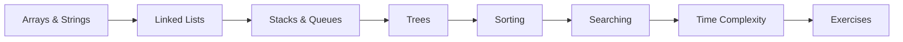

# 23 — DSA in Java

> **Experience level: 🟣 Advanced (2 – 4 years)**

**Data Structures & Algorithms** power interviews and performance. This module teaches the essential structures and algorithms **implemented in Java** — arrays, linked lists, stacks, queues, trees, sorting, and searching.

---

## 📂 Files in This Module

| File | What You'll Learn |
|------|-------------------|
| [Arrays-and-Strings.md](Arrays-and-Strings.md) | DSA foundations, two pointers |
| [Linked-Lists.md](Linked-Lists.md) | Nodes, traversal, reversal |
| [Stacks-and-Queues.md](Stacks-and-Queues.md) | LIFO/FIFO implementations |
| [Trees.md](Trees.md) | Binary trees, BST, traversal |
| [Sorting.md](Sorting.md) | Bubble, selection, merge, quick |
| [Searching.md](Searching.md) | Linear and binary search |
| [Time-Complexity.md](Time-Complexity.md) | Big-O analysis |
| [Exercises.md](Exercises.md) | Practice tasks for this module |

---

## 🎯 Learning Objectives

By the end of this module, you will be able to:

1. ✅ Implement linked lists, stacks, and queues.
2. ✅ Build and traverse binary trees / BSTs.
3. ✅ Sort with merge and quick sort.
4. ✅ Search with binary search.
5. ✅ Analyze complexity with Big-O.

---

## 🧭 Module Map



---

## 📌 Quick Preview

```java
public class BinarySearch {
    static int search(int[] a, int key) {
        int lo = 0, hi = a.length - 1;
        while (lo <= hi) {
            int mid = (lo + hi) / 2;
            if (a[mid] == key) return mid;
            if (a[mid] < key) lo = mid + 1;
            else hi = mid - 1;
        }
        return -1;
    }
}
```

---

## Next Module

➡️ [25 — Spring Core](../25-Spring-Core/README.md) — the framework that powers Java enterprise apps.