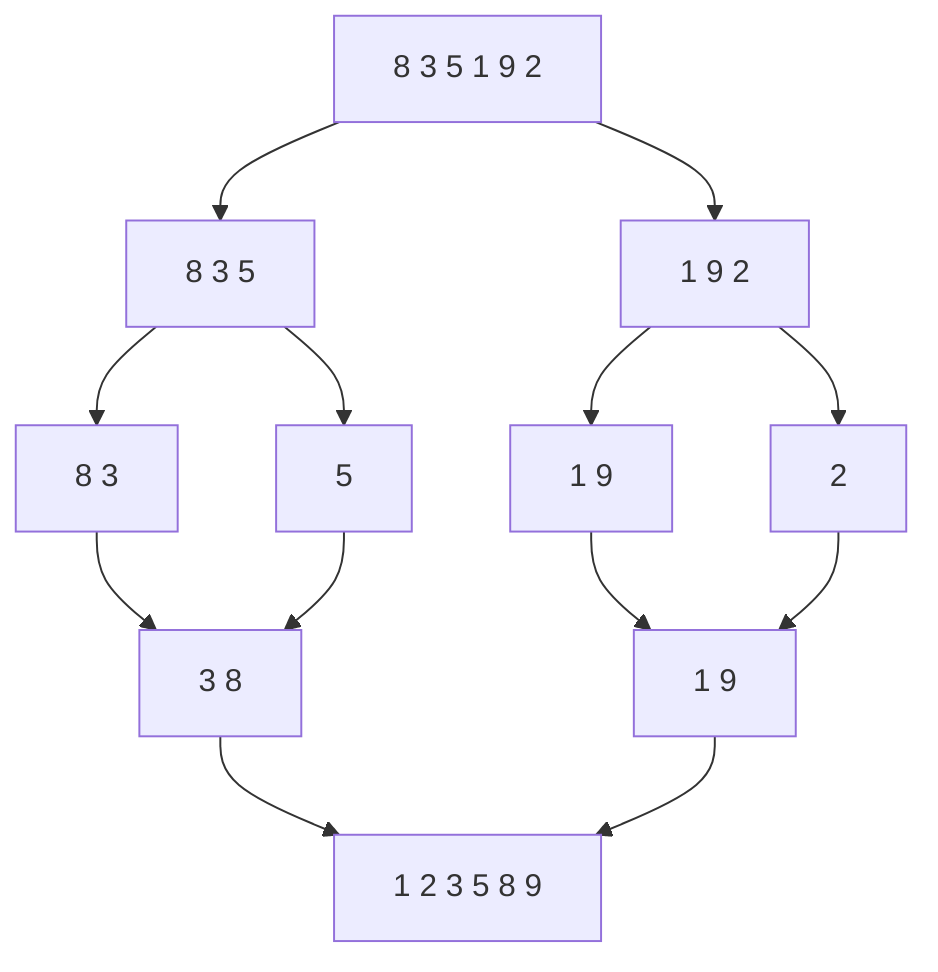

# Sorting

## 1. Introduction

**Sorting** arranges data in order (numeric or lexical). It's foundational — binary search, merging, and many algorithms require sorted input.

---

## 2. Why This Topic Is Important

- Sorting is in every interview (naming and implementing).
- Java provides `Collections.sort()` / `Arrays.sort()` (TimSort).
- Choosing the right sort matters for performance.
- Understanding complexity separates juniors from seniors.

---

## 3. Real-World Analogy

Imagine **arranging a deck of cards**:
- **Selection sort**: pick the smallest card, place it first, repeat.
- **Insertion sort**: take one card at a time, insert into the sorted hand.
- **Merge sort**: split the deck in halves, sort each, merge — like tournament brackets.
- **Quick sort**: pick a pivot card, put smaller left / larger right, repeat.

---

## 4. Theory

### Complexity Table
| Sort | Best | Avg | Worst | Space |
|------|------|-----|-------|-------|
| Bubble | O(n) | O(n²) | O(n²) | O(1) |
| Selection | O(n²) | O(n²) | O(n²) | O(1) |
| Insertion | O(n) | O(n²) | O(n²) | O(1) |
| Merge | O(n log n) | O(n log n) | O(n log n) | O(n) |
| Quick | O(n log n) | O(n log n) | O(n²) | O(log n) |

### When to Use What
| Situation | Choice |
|-----------|--------|
| Small or nearly sorted | Insertion sort |
| Simple to explain | Selection sort |
| Guaranteed n log n | Merge sort |
| In-place average fast | Quick sort |
| Production Java | `Arrays.sort()` (dual-pivot/TimSort) |

### Stability
| Sort | Stable? |
|------|---------|
| Bubble, Insertion, Merge | Yes |
| Selection, Quick | No |

---

## 5. Syntax

```java
Arrays.sort(arr);                       // primitives
Arrays.sort(arr, Comparator.reverseOrder());  // objects
Collections.sort(list);
```

---

## 6. Flow Explanation (Merge Sort)



---

## 7. Memory Representation

Merge sort allocates a temp array (O(n) space); quick/selection/in-place sorts use O(1) extra space.

---

## 8. Simple Example — Selection Sort

```java
public class SelectionSort {
    static void sort(int[] a) {
        for (int i = 0; i < a.length - 1; i++) {
            int min = i;
            for (int j = i + 1; j < a.length; j++) {
                if (a[j] < a[min]) min = j;
            }
            int temp = a[i];
            a[i] = a[min];
            a[min] = temp;
        }
    }

    public static void main(String[] args) {
        int[] a = {64, 25, 12, 22, 11};
        sort(a);
        System.out.println(java.util.Arrays.toString(a));
    }
}
```

---

## 9. Intermediate Example — Merge Sort

```java
public class MergeSort {
    static void sort(int[] a, int lo, int hi) {
        if (lo >= hi) return;
        int mid = (lo + hi) / 2;
        sort(a, lo, mid);
        sort(a, mid + 1, hi);
        merge(a, lo, mid, hi);
    }

    static void merge(int[] a, int lo, int mid, int hi) {
        int[] temp = new int[hi - lo + 1];
        int i = lo, j = mid + 1, k = 0;

        while (i <= mid && j <= hi) {
            if (a[i] <= a[j]) temp[k++] = a[i++];
            else temp[k++] = a[j++];
        }
        while (i <= mid) temp[k++] = a[i++];
        while (j <= hi)  temp[k++] = a[j++];

        System.arraycopy(temp, 0, a, lo, temp.length);
    }

    public static void main(String[] args) {
        int[] a = {38, 27, 43, 3, 9, 82, 10};
        sort(a, 0, a.length - 1);
        System.out.println(java.util.Arrays.toString(a));
    }
}
```

---

## 10. Advanced Example — Quick Sort

```java
public class QuickSort {
    static void sort(int[] a, int lo, int hi) {
        if (lo >= hi) return;
        int p = partition(a, lo, hi);
        sort(a, lo, p - 1);
        sort(a, p + 1, hi);
    }

    static int partition(int[] a, int lo, int hi) {
        int pivot = a[hi];
        int i = lo - 1;
        for (int j = lo; j < hi; j++) {
            if (a[j] <= pivot) {
                i++;
                swap(a, i, j);
            }
        }
        swap(a, i + 1, hi);
        return i + 1;
    }

    static void swap(int[] a, int x, int y) {
        int t = a[x]; a[x] = a[y]; a[y] = t;
    }

    public static void main(String[] args) {
        int[] a = {10, 80, 30, 90, 40, 50, 70};
        sort(a, 0, a.length - 1);
        System.out.println(java.util.Arrays.toString(a));
    }
}
```

---

## 11. Output

For **Selection Sort**:

```
[11, 12, 22, 25, 64]
```

For **Merge Sort**:

```
[3, 9, 10, 27, 38, 43, 82]
```

For **Quick Sort**:

```
[10, 30, 40, 50, 70, 80, 90]
```

---

## 12. Common Mistakes

| Mistake | Correction |
|---------|------------|
| Off-by-one in merge indices | Dry-run with 2 elements |
| Pivot chosen badly (sorted data) | Random or median-of-three pivot |
| O(n²) forgetting | Know which sorts degrade |
| Not stable when needed | Use merge/insertion |
| Reinventing when Java has it | `Arrays.sort()` is production-grade |

---

## 13. Best Practices

- Use Java's built-in sorts in production.
- Know the complexity table by heart.
- Merge: stable but O(n) space; Quick: in-place, unstable.
- Recognize nearly-sorted input (insertion shines).
- Test edge cases: empty, one, duplicates, sorted, reversed.

---

## 14. Interview Questions

**Q1. Best sort in Java?**
*`Arrays.sort()` — dual-pivot quicksort for primitives, TimSort for objects.*

**Q2. Merge vs quick?**
*Merge: stable, guaranteed O(n log n), O(n) space. Quick: in-place, average O(n log n), worst O(n²), unstable.*

**Q3. What does "stable" mean?**
*Equal elements keep their original relative order.*

**Q4. When is insertion sort better?**
*Small or nearly-sorted arrays — O(n) best case.*

**Q5. Why is quick sort worst-case O(n²)?**
*Poor pivot splits (e.g., sorted input with last-element pivot).*

---

## 15. Practice Exercises

1. Implement selection sort by hand.
2. Implement merge sort with a temp array.
3. Implement quick sort with last-element pivot.
4. Sort strings with `Collections.sort()`.

---

## 16. Coding Challenges

1. **Easy:** Sort a small array with insertion sort.
2. **Medium:** Merge two sorted arrays in place.
3. **Hard:** Implement quicksort with a median-of-three pivot and compare to built-in.

---

## 17. Summary

- Sorting is everywhere; complexity matters.
- Selection O(n²) simple; merge O(n log n) stable; quick fast in-place.
- Production: use `Arrays.sort()` / `Collections.sort()`.
- Know stability and worst cases.
- Test edge cases before claiming done.

➡️ Continue to: [Searching](Searching.md)