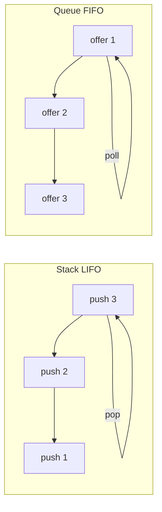

# Stacks & Queues

## 1. Introduction

**Stacks** are LIFO (last-in, first-out) and **queues** are FIFO (first-in, first-out). They're the fundamental ordering structures powering recursion, parsing, BFS, and scheduling.

---

## 2. Why This Topic Is Important

- Expression evaluation, undo, and browser back = stacks.
- Task scheduling and BFS = queues.
- Interviewers test both classic implementations.
- Java ships `ArrayDeque` for both.

---

## 3. Real-World Analogy

- **Stack**: a stack of plates — you take the top one first (LIFO).
- **Queue**: a line at a checkout — the first in line is served first (FIFO).

---

## 4. Theory

### Stack (LIFO)
| Operation | Behavior | Complexity |
|-----------|----------|------------|
| `push(x)` | Add on top | O(1) |
| `pop()` | Remove top | O(1) |
| `peek()` | Look at top | O(1) |
| `isEmpty()` | Check empty | O(1) |

### Queue (FIFO)
| Operation | Behavior | Complexity |
|-----------|----------|------------|
| `offer(x)` | Add at tail | O(1) |
| `poll()` | Remove head | O(1) |
| `peek()` | Look at head | O(1) |
| `isEmpty()` | Check empty | O(1) |

### Java Implementations
| Need | Class |
|------|-------|
| Stack (LIFO) | `ArrayDeque` (push/pop/peek) |
| Queue (FIFO) | `ArrayDeque` or `LinkedList` |
| Priority queue | `PriorityQueue` |

### Applications
| Structure | Uses |
|-----------|------|
| Stack | Balanced parentheses, undo, reverse polish notation, DFS |
| Queue | BFS, scheduling, buffering, level-order traversal |

---

## 5. Syntax

```java
// Stack
ArrayDeque<Integer> stack = new ArrayDeque<>();
stack.push(1); stack.pop();

// Queue
Queue<Integer> queue = new ArrayDeque<>();
queue.offer(1); queue.poll();
```

---

## 6. Flow Explanation



---

## 7. Memory Representation

ArrayDeque uses a resizable circular array; elements added/removed at ends only.

---

## 8. Simple Example — Stack

```java
import java.util.ArrayDeque;

public class StackDemo {
    public static void main(String[] args) {
        ArrayDeque<String> stack = new ArrayDeque<>();
        stack.push("a");
        stack.push("b");
        stack.push("c");

        System.out.println("Top (peek): " + stack.peek());
        System.out.println("Pop: " + stack.pop());
        System.out.println("Pop: " + stack.pop());
        System.out.println("Remaining: " + stack.size());
    }
}
```

---

## 9. Intermediate Example — Balanced Parentheses

```java
import java.util.ArrayDeque;

public class Balanced {
    static boolean isBalanced(String s) {
        ArrayDeque<Character> stack = new ArrayDeque<>();

        for (char c : s.toCharArray()) {
            if (c == '(' || c == '[' || c == '{') {
                stack.push(c);
            } else {
                if (stack.isEmpty()) return false;
                char open = stack.pop();
                if (!matches(open, c)) return false;
            }
        }
        return stack.isEmpty();
    }

    static boolean matches(char open, char close) {
        return (open == '(' && close == ')')
            || (open == '[' && close == ']')
            || (open == '{' && close == '}');
    }

    public static void main(String[] args) {
        System.out.println("(){}[] : " + isBalanced("(){}[]"));
        System.out.println("([)]   : " + isBalanced("([)]"));
        System.out.println("(]     : " + isBalanced("(]"));
        System.out.println("{[()]} : " + isBalanced("{[()]}"));
    }
}
```

---

## 10. Advanced Example — Queue BFS (Level Order on a Tree)

```java
import java.util.ArrayDeque;
import java.util.Queue;

class TreeNode {
    int val;
    TreeNode left, right;
    TreeNode(int v) { val = v; }
}

public class BFS {
    static void levelOrder(TreeNode root) {
        if (root == null) return;
        Queue<TreeNode> queue = new ArrayDeque<>();
        queue.offer(root);

        while (!queue.isEmpty()) {
            TreeNode node = queue.poll();
            System.out.print(node.val + " ");

            if (node.left != null) queue.offer(node.left);
            if (node.right != null) queue.offer(node.right);
        }
        System.out.println();
    }

    public static void main(String[] args) {
        TreeNode root = new TreeNode(1);
        root.left = new TreeNode(2);
        root.right = new TreeNode(3);
        root.left.left = new TreeNode(4);
        root.left.right = new TreeNode(5);

        System.out.print("Level order: ");
        levelOrder(root);
    }
}
```

---

## 11. Output

For the **Simple Example**:

```
Top (peek): c
Pop: c
Pop: b
Remaining: 1
```

For the **Intermediate Example**:

```
(){}[] : true
([)]   : false
(]     : false
{[()]} : true
```

For the **Advanced Example**:

```
Level order: 1 2 3 4 5
```

---

## 12. Common Mistakes

| Mistake | Correction |
|---------|------------|
| Using pop on an empty stack | Check isEmpty() first |
| Polling a queue without checking | May return null |
| LIFO vs FIFO confusion | push/pop = stack; offer/poll = queue |
| Using java.util.Stack | Deprecated-style; prefer ArrayDeque |
| BFS without null checks | Guard children before offering |

---

## 13. Best Practices

- Use `ArrayDeque` for both stack and queue.
- Check `isEmpty()` before pop/poll.
- Guard BFS children with null checks.
- Use `PriorityQueue` for ordering requirements.
- Know the classic problems (balanced parens, BFS).

---

## 14. Interview Questions

**Q1. Stack vs queue?**
*Stack = LIFO; queue = FIFO.*

**Q2. How do you implement a queue using stacks?**
*Two stacks: push into one, transfer on pop.*

**Q3. Where are stacks used?**
*Parsing, undo, recursion, expression evaluation.*

**Q4. Where are queues used?**
*BFS, scheduling, buffering, async processing.*

**Q5. ArrayDeque vs LinkedList?**
*ArrayDeque: array-backed, faster, no nulls. LinkedList: node-backed, also a list.*

---

## 15. Practice Exercises

1. Implement a stack and a queue with ArrayDeque.
2. Check balanced parentheses.
3. Reverse a string using a stack.
4. Level-order traverse a tree with a queue.

---

## 16. Coding Challenges

1. **Easy:** Valid parentheses.
2. **Medium:** Implement a queue using two stacks.
3. **Hard:** Evaluate a reverse-polish (postfix) expression with a stack.

---

## 17. Summary

- Stack = LIFO (push/pop); queue = FIFO (offer/poll).
- ArrayDeque covers both.
- Stacks: parsing/parens/reverse. Queues: BFS/scheduling.
- Check emptiness before popping.
- Classic problems build interview muscle.

➡️ Continue to: [Trees](Trees.md)