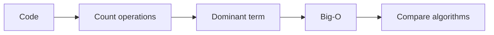

# Time Complexity (Big-O)

## 1. Introduction

**Big-O notation** describes how runtime (or memory) grows with input size `n`. It's how engineers compare algorithms independent of hardware.

---

## 2. Why This Topic Is Important

- Interviewers always ask "what's the complexity?"
- It decides whether code scales from 1k to 1M items.
- Choosing algorithms = choosing complexity.
- Understanding Big-O is a hiring checkpoint.

---

## 3. Real-World Analogy

Compare **reading a 10-page book** vs a **1000-page book**:
- Linear growth (O(n)): reading page by page — 100× longer.
- Logarithmic (O(log n)): a table of contents with binary search — barely longer.
- Quadratic (O(n²)): comparing every page to every other page — explodes.

---

## 4. Theory

### Common Growth Orders
| Order | Name | Example |
|-------|------|---------|
| O(1) | Constant | Array index access |
| O(log n) | Logarithmic | Binary search |
| O(n) | Linear | Simple scan |
| O(n log n) | Linearithmic | Merge/quick sort |
| O(n²) | Quadratic | Nested loops |
| O(2ⁿ) | Exponential | Subset enumeration |
| O(n!) | Factorial | Permutations |

### Rules of Thumb
| Rule | Meaning |
|------|---------|
| Drop constants | O(2n) → O(n) |
| Drop lower terms | O(n² + n) → O(n²) |
| Loops multiply | Nested loop = n² |
| Loops add | Sequential = keep largest |
| Log for halving | Divide by 2 each step → log n |

### Space Complexity
Extra memory used beyond input — e.g., merge sort uses O(n) temp space.

---

## 5. Syntax

No syntax — it's a mathematical analysis, written as:

```
T(n) = O(n log n)
```

---

## 6. Flow Explanation



---

## 7. Memory Representation

Complexity is abstract; space complexity counts extra memory used.

---

## 8. Simple Example — O(1) vs O(n)

```java
public class ComplexityBasic {
    // O(1) - constant
    static int firstElement(int[] a) {
        return a[0];
    }

    // O(n) - linear
    static int sum(int[] a) {
        int total = 0;
        for (int x : a) total += x;
        return total;
    }

    public static void main(String[] args) {
        int[] a = {3, 1, 4, 1, 5, 9, 2};
        System.out.println("First: " + firstElement(a));
        System.out.println("Sum: " + sum(a));
    }
}
```

---

## 9. Intermediate Example — O(n²) Nested Loops

```java
public class ComplexityNested {
    // O(n²) - pair comparisons
    static int countPairs(int[] a) {
        int count = 0;
        for (int i = 0; i < a.length; i++) {
            for (int j = i + 1; j < a.length; j++) {
                count++;
            }
        }
        return count;
    }

    public static void main(String[] args) {
        int[] a = {1, 2, 3, 4, 5};
        System.out.println("Pairs for n=5: " + countPairs(a));
    }
}
```

---

## 10. Advanced Example — Comparing Growth

```java
public class GrowthDemo {
    public static void main(String[] args) {
        int n = 1_000_000;
        System.out.println("n = " + n);
        System.out.println("O(1)        : ~1 op");
        System.out.println("O(log n)    : ~" + (int)(Math.log(n) / Math.log(2)) + " ops");
        System.out.println("O(n)        : ~" + n + " ops");
        System.out.println("O(n log n)  : ~" + (long)(n * (Math.log(n) / Math.log(2))) + " ops");
        System.out.println("O(n^2)      : ~" + ((long) n * n) + " ops");
    }
}
```

---

## 11. Output

For the **Simple Example**:

```
First: 3
Sum: 25
```

For the **Intermediate Example**:

```
Pairs for n=5: 10
```

For the **Advanced Example**:

```
n = 1000000
O(1)        : ~1 op
O(log n)    : ~19 ops
O(n)        : ~1000000 ops
O(n log n)  : ~19931568 ops
O(n^2)      : ~1000000000000 ops
```

---

## 12. Common Mistakes

| Mistake | Correction |
|---------|------------|
| Saying "the loop runs n times so O(n)" for nested | Count nesting: outer×inner |
| Keeping constants/lower terms | Drop them |
| Confusing best vs average vs worst | State which you mean |
| Ignoring space complexity | Merge sort uses O(n) temp |
| Assuming n is fixed | Complexity describes growth |

---

## 13. Best Practices

- Always state complexity in interviews.
- Nested loops multiply; sequential loops add.
- Halving per step usually means O(log n).
- Mention space complexity too.
- Compare before optimizing — don't guess.

---

## 14. Interview Questions

**Q1. What is Big-O?**
*Asymptotic growth of runtime/memory with input size n.*

**Q2. Why drop constants?**
*We compare growth, not exact timings.*

**Q3. What's O(log n)?**
*Halving per step — binary search, balanced tree ops.*

**Q4. Nested vs sequential loops?**
*Nested multiply (n²); sequential keep the largest.*

**Q5. Worst vs average?**
*Worst = maximum steps; average = expected over inputs.*

---

## 15. Practice Exercises

1. Identify the Big-O of a sum loop.
2. Identify the Big-O of a nested pair loop.
3. Classify binary search and merge sort.
4. Compute space complexity of merge sort.

---

## 16. Coding Challenges

1. **Easy:** Classify: `for(i){ for(j) {...} }`.
2. **Medium:** Prove a single-loop is O(n), not O(n²).
3. **Hard:** Given an O(n log n) vs O(n²) sort, estimate n where n² becomes unusable.

---

## 17. Summary

- Big-O = growth of runtime/memory.
- O(1) < O(log n) < O(n) < O(n log n) < O(n²) < O(2ⁿ).
- Drop constants/lower terms; loops multiply.
- Mention space complexity.
- State worst/average clearly in interviews.

➡️ Continue to: [Exercises](Exercises.md)