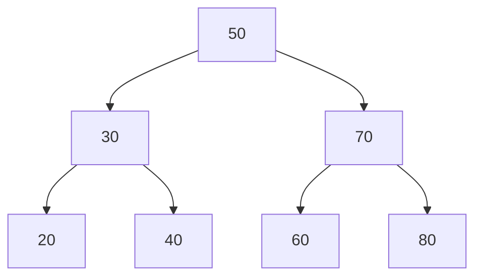

# Trees

## 1. Introduction

A **tree** is a hierarchical structure: a **root** node with **children**, each child being the root of a smaller subtree. A **binary search tree (BST)** keeps ordering for fast search.

---

## 2. Why This Topic Is Important

- Trees organize hierarchical data (files, org charts, DOM).
- BSTs give O(log n) search/insert/delete.
- Trees appear in every interview (traversals, depth, balance).
- Databases (B-trees) and compilers (ASTs) use them.

---

## 3. Real-World Analogy

Think of a **family tree**: one ancestor at the top (root), branching down to children and grandchildren (nodes). A **filesystem** is the same — folders nested inside folders, ending in files (leaves).

---

## 4. Theory

### Binary Tree Terminology
| Term | Meaning |
|------|---------|
| Root | Top node |
| Leaf | Node with no children |
| Parent / child | Direct relationship |
| Subtree | Tree hanging off a node |
| Height | Longest path root→leaf |
| Depth | Path root→node |

### BST Rule
For every node: **left < node < right**.

### Traversal Orders
| Order | Visit pattern | Use |
|-------|---------------|-----|
| In-order | left → node → right | Sorted output |
| Pre-order | node → left → right | Copying |
| Post-order | left → right → node | Deletion |
| Level-order | Breadth-first (BFS) | Shortest path |

### Complexity
| Operation | Balanced BST |
|-----------|--------------|
| Search | O(log n) |
| Insert | O(log n) |
| Delete | O(log n) |
| Traversal | O(n) |

---

## 5. Syntax

```java
class TreeNode {
    int val;
    TreeNode left, right;
    TreeNode(int val) { this.val = val; }
}
```

---

## 6. Flow Explanation



---

## 7. Memory Representation

Each node is a heap object with left/right references; the tree is a network of references, not contiguous memory.

---

## 8. Simple Example — Insert & In-order

```java
class BST {
    TreeNode root;

    void insert(int val) { root = insert(root, val); }

    TreeNode insert(TreeNode node, int val) {
        if (node == null) return new TreeNode(val);
        if (val < node.val) node.left = insert(node.left, val);
        else if (val > node.val) node.right = insert(node.right, val);
        return node;
    }

    void inOrder(TreeNode node) {
        if (node == null) return;
        inOrder(node.left);
        System.out.print(node.val + " ");
        inOrder(node.right);
    }

    public static void main(String[] args) {
        BST tree = new BST();
        int[] values = {50, 30, 70, 20, 40, 60, 80};
        for (int v : values) tree.insert(v);

        System.out.print("In-order: ");
        tree.inOrder(tree.root);
        System.out.println();
    }
}
```

---

## 9. Intermediate Example — Search

```java
class Searcher {
    static boolean contains(TreeNode node, int target) {
        if (node == null) return false;
        if (node.val == target) return true;
        if (target < node.val) return contains(node.left, target);
        return contains(node.right, target);
    }
}

public class SearchTreeDemo {
    public static void main(String[] args) {
        TreeNode root = new TreeNode(50);
        root.left = new TreeNode(30);
        root.right = new TreeNode(70);
        root.left.left = new TreeNode(20);

        System.out.println("Contains 30: " + Searcher.contains(root, 30));
        System.out.println("Contains 99: " + Searcher.contains(root, 99));
    }
}
```

---

## 10. Advanced Example — Tree Height

```java
class HeightCalculator {
    static int height(TreeNode node) {
        if (node == null) return 0;
        return 1 + Math.max(height(node.left), height(node.right));
    }
}

public class HeightDemo {
    public static void main(String[] args) {
        TreeNode root = new TreeNode(1);
        root.left = new TreeNode(2);
        root.right = new TreeNode(3);
        root.left.left = new TreeNode(4);

        System.out.println("Height: " + HeightCalculator.height(root));
    }
}
```

---

## 11. Output

For the **Simple Example**:

```
In-order: 20 30 40 50 60 70 80
```

For the **Intermediate Example**:

```
Contains 30: true
Contains 99: false
```

For the **Advanced Example**:

```
Height: 3
```

---

## 12. Common Mistakes

| Mistake | Correction |
|---------|------------|
| Ignoring BST ordering rules | left < node < right always |
| Null children not guarded | Base case `node == null` |
| Unbalanced tree = O(n) | Use AVL/Red-Black in practice |
| Wrong traversal for the goal | In-order = sorted |
| Level-order with stack | BFS needs a queue |

---

## 13. Best Practices

- Always write the null base case.
- Know all four traversals.
- In-order on a BST gives sorted output.
- Check balance (AVL/Red-Black) when inserts are heavy.
- Draw trees for tricky recursions.

---

## 14. Interview Questions

**Q1. What is a BST?**
*A binary tree where left < node < right at every node.*

**Q2. Traversal to get sorted order?**
*In-order.*

**Q3. How do you find the height?**
*Recursive: 1 + max(left, right) with null = 0.*

**Q4. What's the worst-case BST?**
*A sorted insert chain → O(n) (skewed); balancing fixes it.*

**Q5. BFS vs DFS?**
*BFS uses a queue (level order); DFS uses recursion/stack.*

---

## 15. Practice Exercises

1. Insert values into a BST and print in-order.
2. Search for values present/absent.
3. Compute the tree height.
4. Do pre-order and post-order traversals.

---

## 16. Coding Challenges

1. **Easy:** Count the nodes in a tree.
2. **Medium:** Check if a tree is balanced.
3. **Hard:** Validate a BST (in-order check) and find the lowest common ancestor.

---

## 17. Summary

- Trees = hierarchical; BST keeps order.
- left < node < right at every node.
- Four traversals; in-order = sorted.
- Null base case is essential.
- Balanced trees keep ops at O(log n).

➡️ Continue to: [Sorting](Sorting.md)