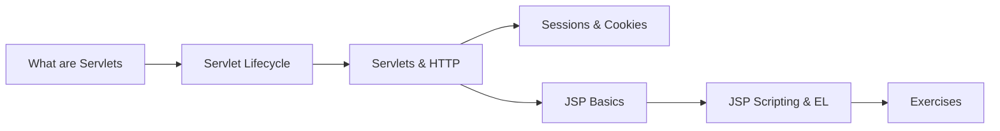

# 24 — Servlets & JSP

> **Experience level: 🔴 Expert (3 – 5 years)**

Before Spring MVC took over, **Servlets** and **JSP** were the way Java built web applications. Every Spring Boot application is still a servlet under the hood (DispatcherServlet), so understanding the request/response model, the **session**, and how HTTP maps to Java is essential backend knowledge.

---

## 📂 Files in This Module

| File | What You'll Learn |
|------|-------------------|
| [What-are-Servlets.md](What-are-Servlets.md) | The HTTP request/response model in Java |
| [Servlet-Lifecycle.md](Servlet-Lifecycle.md) | init, service, destroy and thread-safety |
| [Servlets-and-HTTP.md](Servlets-and-HTTP.md) | Request/response, methods, forwarding |
| [Sessions-and-Cookies.md](Sessions-and-Cookies.md) | Login state, HttpSession, cookies |
| [JSP-Basics.md](JSP-Basics.md) | Dynamic pages with scriptlets and tags |
| [JSP-Scripting-and-EL.md](JSP-Scripting-and-EL.md) | JSTL, Expression Language, MVC in JSP |
| [Exercises.md](Exercises.md) | Practice tasks for this module |

---

## 🎯 Learning Objectives

By the end of this module, you will be able to:

1. ✅ Explain the servlet request/response lifecycle.
2. ✅ Write a servlet that handles GET and POST.
3. ✅ Manage **sessions** for login and cart state.
4. ✅ Build JSP pages with scriptlets, EL, and JSTL.
5. ✅ Describe how Spring's DispatcherServlet builds on this model.

---

## 🧭 Module Map



---

## 📌 Quick Preview

```java
@WebServlet("/hello")
public class HelloServlet extends HttpServlet {

    @Override
    protected void doGet(HttpServletRequest req, HttpServletResponse resp)
            throws IOException {
        HttpSession session = req.getSession();
        Integer count = (Integer) session.getAttribute("count");
        count = (count == null ? 0 : count) + 1;
        session.setAttribute("count", count);

        resp.setContentType("text/html");
        resp.getWriter().println("<h1>Visits: " + count + "</h1>");
    }
}
```

---

## Next Module

➡️ [25 — Spring Core](../25-Spring-Core/README.md) — IoC and dependency injection.