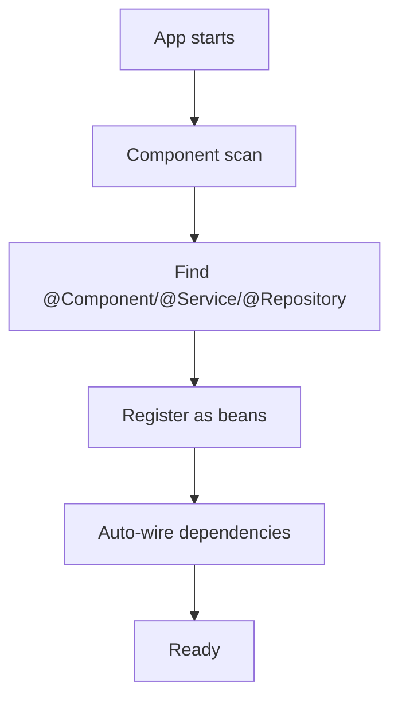

# Annotations

## 1. Introduction

**Annotations** are the modern Spring way to declare beans, wire dependencies, and configure behavior — replacing verbose XML. They're the vocabulary of every Spring app.

---

## 2. Why This Topic Is Important

- Component scanning + annotations = minimal config.
- @Component/@Service/@Repository are interview staples.
- @Autowired resolves dependencies automatically.
- Annotations power Spring Boot entirely.

---

## 3. Real-World Analogy

Annotations are like **name badges** at a conference:
- `@Service` badge: "I'm a business logic worker."
- `@Repository` badge: "I talk to the database."
- `@Autowired` badge: "I need what's in my hands."
- Staff (container) sees the badges and places everyone correctly.

---

## 4. Theory

### Stereo-Type Annotations (Bean Declarations)
| Annotation | Layer | Meaning |
|------------|-------|---------|
| `@Component` | Any | Generic bean |
| `@Service` | Service | Business logic |
| `@Repository` | Persistence | Data access (+ exception translation) |
| `@Controller` | Web | MVC controller |
| `@RestController` | Web | REST API controller |

### Wiring & Config
| Annotation | Purpose |
|------------|---------|
| `@Autowired` | Inject dependency (often optional now) |
| `@Qualifier` | Pick a specific bean |
| `@Primary` | Default when ambiguous |
| `@Value` | Inject property value |
| `@Configuration` | Marks config class |
| `@Bean` | Declares a bean in config |
| `@ComponentScan` | Where to find beans |
| `@Scope` | Bean scope |
| `@PostConstruct` / `@PreDestroy` | Lifecycle hooks |

### Rules
- Stereo annotations + `@ComponentScan` = auto bean registration.
- Single constructor → Spring auto-injects (no @Autowired needed).
- Scanning starts from the package of the config class.

---

## 5. Syntax

```java
@Service
class OrderService { }

@Repository
interface OrderRepository extends JpaRepository<Order, Long> { }

@RestController
class OrderController { }
```

---

## 6. Flow Explanation



---

## 7. Memory Representation

Annotations create bean definitions; the container instantiates and wires them at startup.

---

## 8. Simple Example — Component Scanning

```java
import org.springframework.context.ApplicationContext;
import org.springframework.context.annotation.*;

@Service
class GreetingService {
    public String hello() { return "Hello from @Service!"; }
}

@Configuration
@ComponentScan("com.example")
class AppConfig { }

public class AnnotationDemo {
    public static void main(String[] args) {
        // In a real app: SpringApplication.run(...)
        AnnotationConfigApplicationContext ctx =
                new AnnotationConfigApplicationContext(AppConfig.class);

        GreetingService service = ctx.getBean(GreetingService.class);
        System.out.println(service.hello());
        ctx.close();
    }
}
```

---

## 9. Intermediate Example — @Autowired & @Value

```java
import org.springframework.beans.factory.annotation.Value;
import org.springframework.context.annotation.*;

@Component
class AppInfo {
    @Value("${app.name:MyApp}")
    private String name;

    @Value("${app.version:1.0}")
    private String version;

    public String info() { return name + " v" + version; }
}

@Configuration
@ComponentScan("com.example")
class AppConfig { }

public class ValueDemo {
    public static void main(String[] args) {
        AnnotationConfigApplicationContext ctx =
                new AnnotationConfigApplicationContext(AppConfig.class);

        System.out.println(ctx.getBean(AppInfo.class).info());
        ctx.close();
    }
}
```

---

## 10. Advanced Example — @Configuration + @Bean

```java
import org.springframework.context.annotation.*;

class DataSource {
    private final String url;
    DataSource(String url) { this.url = url; }
    public String url() { return url; }
}

@Configuration
class DatabaseConfig {
    @Bean
    DataSource dataSource() {
        return new DataSource("jdbc:h2:mem:test");
    }

    @Bean
    @Scope("prototype")
    org.springframework.jdbc.core.JdbcTemplate jdbcTemplate(DataSource ds) {
        return new org.springframework.jdbc.core.JdbcTemplate();
    }
}

public class BeanConfigDemo {
    public static void main(String[] args) {
        AnnotationConfigApplicationContext ctx =
                new AnnotationConfigApplicationContext(DatabaseConfig.class);

        System.out.println("DataSource: " + ctx.getBean(DataSource.class).url());
        ctx.close();
    }
}
```

---

## 11. Output

For the **Simple Example**:

```
Hello from @Service!
```

For the **Intermediate Example**:

```
MyApp v1.0
```

For the **Advanced Example**:

```
DataSource: jdbc:h2:mem:test
```

---

## 12. Common Mistakes

| Mistake | Correction |
|---------|------------|
| Forgetting @ComponentScan | Beans never found |
| Two beans of the same type | Use @Qualifier / @Primary |
| Using @Component on interfaces | Annotate implementations |
| @Value without a property/default | Provide a default `:value` |
| Scanning the wrong package | Start scan at the app package |

---

## 13. Best Practices

- Use @Service/@Repository/@RestController by layer.
- Let single-constructor auto-injection work.
- Set defaults in @Value.
- Put @SpringBootApplication at the root package.
- Keep config classes small and focused.

---

## 14. Interview Questions

**Q1. @Component vs @Service vs @Repository?**
*Same bean registration; @Repository adds exception translation. @Service is semantic for the service layer.*

**Q2. Is @Autowired required?**
*No — a single constructor is auto-injected.*

**Q3. How does component scanning work?**
*Scans a package for stereo annotations and registers beans.*

**Q4. @Configuration vs @Component?**
*@Configuration + @Bean declares beans in code; @Component marks classes.*

**Q5. What is @RestController?**
*@Controller + @ResponseBody — returns JSON directly.*

---

## 15. Practice Exercises

1. Mark a class @Service and retrieve it.
2. Use @Value with defaults.
3. Wire two beans; resolve with @Qualifier.
4. Build a @Configuration with @Bean methods.

---

## 16. Coding Challenges

1. **Easy:** Component-scanned @Service bean.
2. **Medium:** @Value configuration with defaults.
3. **Hard:** A config class defining multiple related beans with correct wiring.

---

## 17. Summary

- Annotations replace XML: @Component/@Service/@Repository.
- Single-constructor injection is automatic.
- @Value reads properties; @Qualifier resolves ambiguity.
- @Configuration + @Bean for explicit config.
- Component scan from the root package.

➡️ Continue to: [Java Configuration](Java-Configuration.md)