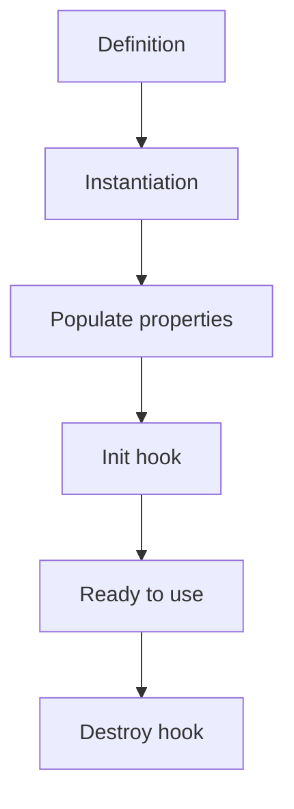
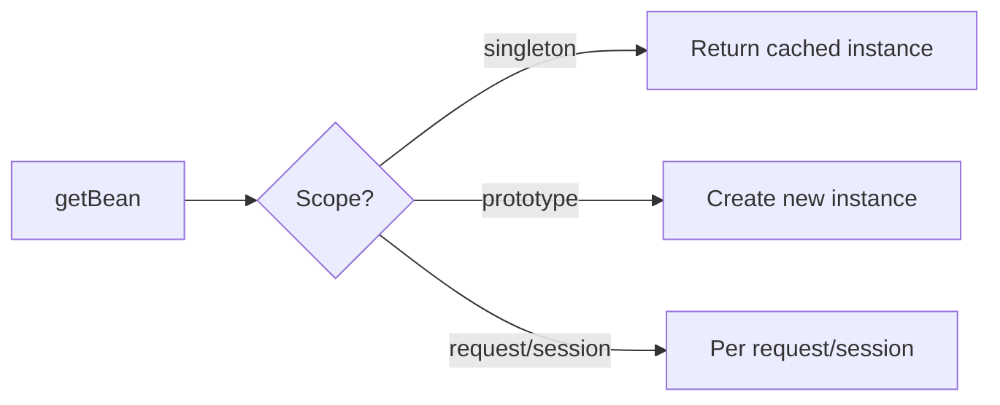

# Beans & Bean Scope

## 1. Introduction

A **bean** is any object managed by the Spring container. **Scope** defines how many instances exist and for how long. This module covers bean definitions, lifecycle, and scopes.

---

## 2. Why This Topic Is Important

- Scopes affect statefulness and memory (singleton vs prototype).
- Bean lifecycle hooks (init/destroy) matter for cleanup.
- Interviewers probe scope understanding.
- Getting scope wrong causes subtle bugs.

---

## 3. Real-World Analogy

Think of a **coffee shop**:
- **Singleton scope**: one master barista for the whole shop — every customer gets served by the same person (shared).
- **Prototype scope**: every customer gets their own barista — fresh each time (new instance).
- **Request scope**: each customer's visit gets a dedicated server, discarded after the visit.

---

## 4. Theory

### Bean Scopes
| Scope | Instances | Lifetime | Typical Use |
|-------|-----------|----------|-------------|
| `singleton` | One per container | Whole app | Stateless services, repos |
| `prototype` | New per request | Until released | Stateful objects |
| `request` | Per HTTP request | Request ends | Web app request data |
| `session` | Per HTTP session | Session ends | User session state |
| `application` | Per ServletContext | App lifecycle | App-wide shared state |
| `websocket` | Per WebSocket | Socket ends | WebSocket state |

### Singleton Default
Spring beans are **singleton by default** — one instance shared across all injections.

### Bean Lifecycle


### Lifecycle Hooks
| Hook | How |
|------|-----|
| Init | `@PostConstruct` or `@Bean(initMethod="...")` |
| Destroy | `@PreDestroy` or `@Bean(destroyMethod="...")` |

---

## 5. Syntax

```java
@Bean
@Scope("prototype")
PrototypeBean proto() { return new PrototypeBean(); }
```

```java
@Component
@Scope(value = ConfigurableBeanFactory.SCOPE_SINGLETON)
class Service { }
```

---

## 6. Flow Explanation



---

## 7. Memory Representation

Singleton beans live in the container for the app's lifetime; prototypes are eligible for GC after release.

---

## 8. Simple Example — Singleton vs Prototype

```java
import org.springframework.context.ApplicationContext;
import org.springframework.context.annotation.*;

class Task {
    private final int id = (int)(Math.random() * 1000);
    public String info() { return "Task #" + id; }
}

@Configuration
class Config {
    @Bean
    Task shared() { return new Task(); }

    @Bean
    @Scope("prototype")
    Task fresh() { return new Task(); }
}

public class ScopeDemo {
    public static void main(String[] args) {
        ApplicationContext ctx =
                new AnnotationConfigApplicationContext(Config.class);

        System.out.println("Singleton bean (same instance):");
        System.out.println(ctx.getBean("shared", Task.class).info());
        System.out.println(ctx.getBean("shared", Task.class).info());

        System.out.println("Prototype bean (new instance):");
        System.out.println(ctx.getBean("fresh", Task.class).info());
        System.out.println(ctx.getBean("fresh", Task.class).info());
    }
}
```

---

## 9. Intermediate Example — Lifecycle Hooks

```java
import org.springframework.context.annotation.*;
import jakarta.annotation.PostConstruct;
import jakarta.annotation.PreDestroy;

class Database {
    @PostConstruct
    void init() { System.out.println("Connecting to database..."); }

    public void query() { System.out.println("Querying..."); }

    @PreDestroy
    void cleanup() { System.out.println("Closing connection."); }
}

@Configuration
class Config {
    @Bean(destroyMethod = "cleanup")
    Database database() { return new Database(); }
}

public class LifecycleDemo {
    public static void main(String[] args) {
        AnnotationConfigApplicationContext ctx =
                new AnnotationConfigApplicationContext(Config.class);

        Database db = ctx.getBean(Database.class);
        db.query();

        ctx.close();
    }
}
```

---

## 10. Advanced Example — Scoped Proxy (Singleton → Prototype)

```java
import org.springframework.context.ApplicationContext;
import org.springframework.context.annotation.*;

class Counter {
    private int count = 0;
    public int next() { return ++count; }
}

@Configuration
class Config {
    @Bean
    @Scope(value = "prototype", proxyMode = org.springframework.context.annotation.ScopedProxyMode.TARGET_CLASS)
    Counter counter() { return new Counter(); }
}

class AppService {
    private final Counter counter;
    AppService(Counter counter) { this.counter = counter; }
    public int next() { return counter.next(); }
}

public class ProxyDemo {
    public static void main(String[] args) {
        ApplicationContext ctx =
                new AnnotationConfigApplicationContext(Config.class);

        AppService service = new AppService(ctx.getBean(Counter.class));

        System.out.println("Call 1: " + service.next());
        System.out.println("Call 2: " + service.next());
    }
}
```

---

## 11. Output

For the **Simple Example** (ids vary):

```
Singleton bean (same instance):
Task #123
Task #123
Prototype bean (new instance):
Task #456
Task #789
```

For the **Intermediate Example**:

```
Connecting to database...
Querying...
Closing connection.
```

---

## 12. Common Mistakes

| Mistake | Correction |
|---------|------------|
| Assuming all beans are singletons | Check @Scope |
| Mutable state in singletons | Keep singletons stateless |
| Forgetting destroy hooks | Connections/threads leak |
| Prototype injected into singleton | Same prototype reused (use proxy) |
| Request/session scopes outside web | Not available without web context |

---

## 13. Best Practices

- Keep singletons stateless.
- Use prototype for stateful objects.
- Add init/destroy for resource management.
- Use scoped proxy when injecting prototypes into singletons.
- Prefer constructor injection.

---

## 14. Interview Questions

**Q1. What is a Spring bean?**
*An object created, wired, and managed by the container.*

**Q2. Default scope?**
*Singleton — one instance per container.*

**Q3. Singleton vs prototype?**
*Singleton shared; prototype new per request.*

**Q4. How do you manage bean cleanup?**
*@PreDestroy or destroyMethod.*

**Q5. Prototype into singleton problem?**
*The prototype is created once; use a scoped proxy to fix.*

---

## 15. Practice Exercises

1. Create singleton and prototype beans; prove instance counts.
2. Add init/destroy hooks and observe the order.
3. Try @PostConstruct / @PreDestroy.
4. Use a scoped proxy to get fresh prototypes.

---

## 16. Coding Challenges

1. **Easy:** Two beans of different scopes.
2. **Medium:** Lifecycle hook ordering demo.
3. **Hard:** Singleton service using a prototype counter via proxy.

---

## 17. Summary

- Bean = container-managed object.
- Singleton default; prototype/request/session for other needs.
- Init/destroy hooks manage resources.
- Scoped proxies fix prototype-in-singleton.
- Choose scope by statefulness.

➡️ Continue to: [Dependency Injection](Dependency-Injection.md)