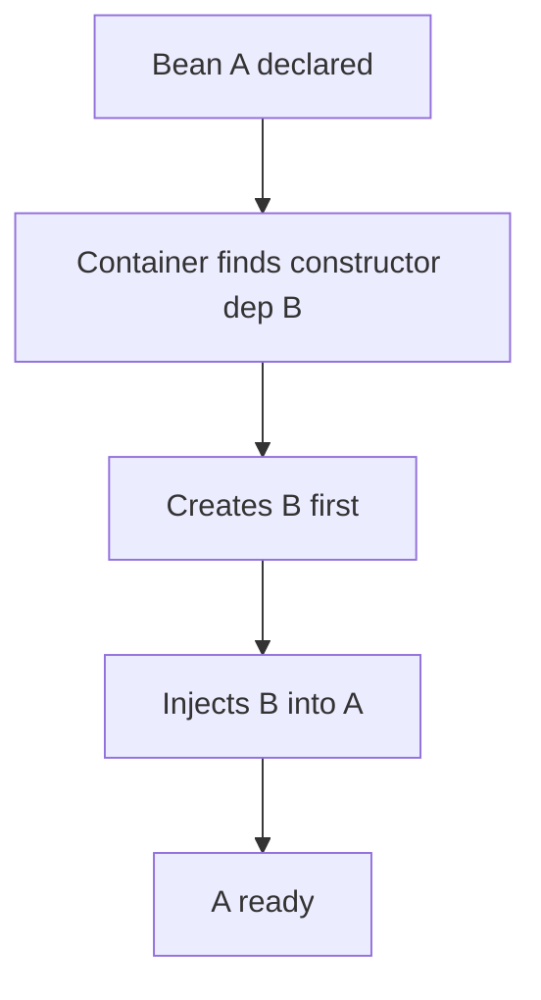

# Dependency Injection

## 1. Introduction

**Dependency Injection (DI)** is Spring's way of giving objects their dependencies instead of letting them construct them. Constructor injection is the recommended style.

---

## 2. Why This Topic Is Important

- DI is the core of Spring — interview #1 question.
- Constructor injection enables unit testing with mocks.
- It enforces decoupling and immutability.
- Bad DI = rigid, untestable code.

---

## 3. Real-World Analogy

A **car needs an engine**. Two approaches:
- **Tight coupling**: the car builds its own engine — hard to swap or test.
- **DI**: the factory (container) provides the engine; the car just receives it. Swap the engine without touching the car. That's DI.

---

## 4. Theory

### Three Injection Styles
| Style | How | Pros | Cons |
|-------|-----|------|------|
| **Constructor** | Dependencies via constructor | Immutable, required, testable | Verbose with many deps |
| **Setter** | Dependencies via setters | Optional deps, reconfigurable | Mutable, partial state |
| **Field** | @Autowired on fields | Shortest code | Hidden deps, hard to test |

### Constructor Injection (Recommended)
```java
@Service
class OrderService {
    private final OrderRepository repository;

    OrderService(OrderRepository repository) {   // injected
        this.repository = repository;
    }
}
```

### How Spring Chooses
1. Spring sees the constructor with parameters.
2. It looks up matching beans.
3. It creates the dependency and passes it in.

---

## 5. Syntax

```java
// Constructor
@Service
class A {
    private final B b;
    A(B b) { this.b = b; }        // one constructor -> auto-injected
}

// @Autowired optional on field
@Autowired
private B b;
```

---

## 6. Flow Explanation



---

## 7. Memory Representation

Dependencies are references passed during construction; `final` fields keep them immutable.

---

## 8. Simple Example — Constructor DI

```java
import org.springframework.context.ApplicationContext;
import org.springframework.context.annotation.*;

class Greeter {
    public String greet() { return "Hello"; }
}

class MessageService {
    private final Greeter greeter;

    MessageService(Greeter greeter) { this.greeter = greeter; }

    public void send() {
        System.out.println(greeter.greet() + " via DI!");
    }
}

@Configuration
class Config {
    @Bean Greeter greeter() { return new Greeter(); }

    @Bean MessageService messageService(Greeter greeter) {
        return new MessageService(greeter);
    }
}

public class ConstructorDI {
    public static void main(String[] args) {
        ApplicationContext ctx =
                new AnnotationConfigApplicationContext(Config.class);
        ctx.getBean(MessageService.class).send();
    }
}
```

---

## 9. Intermediate Example — Component Scanning + Constructor

```java
import org.springframework.context.annotation.*;

@Service
class UserRepository {
    public String find(int id) { return "user-" + id; }
}

@Service
class UserService {
    private final UserRepository repo;

    UserService(UserRepository repo) { this.repo = repo; }

    public String get(int id) { return repo.find(id); }
}

@Configuration
@ComponentScan("com.example")
class AppConfig { }

public class ComponentScanDemo {
    public static void main(String[] args) {
        System.setProperty("spring.main.allow-bean-definition-overriding", "false");
        // In a real app, package would match. Here we scan the demo package.
        AnnotationConfigApplicationContext ctx =
                new AnnotationConfigApplicationContext();
        ctx.scan("com.example");          // adjust to your package
        ctx.refresh();

        UserService service = ctx.getBean(UserService.class);
        System.out.println(service.get(7));
        ctx.close();
    }
}
```

---

## 10. Advanced Example — Qualifier for Multiple Beans

```java
import org.springframework.context.ApplicationContext;
import org.springframework.context.annotation.*;

interface Notifier {
    void notify(String msg);
}

class EmailNotifier implements Notifier {
    public void notify(String m) { System.out.println("Email: " + m); }
}

class SmsNotifier implements Notifier {
    public void notify(String m) { System.out.println("SMS: " + m); }
}

class AlertService {
    private final Notifier notifier;

    @org.springframework.beans.factory.annotation.Autowired
    AlertService(
            @org.springframework.beans.factory.annotation.Qualifier("sms")
            Notifier notifier) {
        this.notifier = notifier;
    }

    public void send() { notifier.notify("Server down!"); }
}

@Configuration
class Config {
    @Bean @org.springframework.context.annotation.Primary
    Notifier email() { return new EmailNotifier(); }

    @Bean
    @org.springframework.context.annotation.Qualifier("sms")
    Notifier sms() { return new SmsNotifier(); }
}

public class QualifierDemo {
    public static void main(String[] args) {
        ApplicationContext ctx =
                new AnnotationConfigApplicationContext(Config.class);
        ctx.getBean(AlertService.class).send();
    }
}
```

---

## 11. Output

For the **Simple Example**:

```
Hello via DI!
```

For the **Intermediate Example**:

```
user-7
```

For the **Advanced Example**:

```
SMS: Server down!
```

---

## 12. Common Mistakes

| Mistake | Correction |
|---------|------------|
| Field injection everywhere | Use constructor injection |
| Circular dependencies | Refactor design |
| Many constructors | Single required constructor |
| Forgetting @Qualifier | Ambiguity errors |
| Mutable injected fields | Make them final |

---

## 13. Best Practices

- Prefer **constructor injection**.
- Use `final` fields for immutability.
- Use @Qualifier/@Primary to resolve multiple beans.
- Keep dependencies on interfaces.
- Unit test by passing mocks to the constructor.

---

## 14. Interview Questions

**Q1. What is DI?**
*Dependencies are provided by the container rather than constructed inside.*

**Q2. Constructor vs field injection?**
*Constructor: immutable, required, testable. Field: hidden, harder to test.*

**Q3. Why final fields?**
*Guarantees no reassignment; encourages immutable design.*

**Q4. Circular dependency?**
*A↔B both needing each other — refactor; constructor injection fails loudly.*

**Q5. How to choose between multiple beans?**
*@Primary or @Qualifier.*

---

## 15. Practice Exercises

1. Wire Service→Repository with constructor injection.
2. Add a third dependency and keep injection clean.
3. Use @Qualifier to pick a specific bean.
4. Unit test a service with a mock constructor argument.

---

## 16. Coding Challenges

1. **Easy:** Constructor DI with one dependency.
2. **Medium:** Multi-level DI chain (Controller→Service→Repo).
3. **Hard:** Two implementations of one interface selected via @Primary.

---

## 17. Summary

- DI = container provides dependencies.
- Constructor injection is the recommended style.
- final fields keep objects immutable.
- @Primary/@Qualifier resolve ambiguity.
- DI enables clean unit testing.

➡️ Continue to: [AOP](AOP.md)