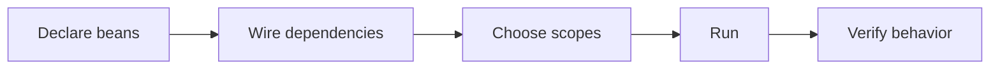

# Exercises — Spring Core

## 1. Introduction

Practice Spring Core end-to-end: the container, beans, DI, AOP, annotations, and Java config — the foundation for Spring Boot.

---

## 2. Why This Topic Is Important

- Spring Core is the base for every Spring framework.
- DI/container questions dominate Spring interviews.
- Hands-on practice makes concepts stick.

---

## 3. Real-World Analogy

Like **learning to drive a car before racing**: mastering the container and DI is the core skill; Spring Boot (module 26) is the turbo. Skipping this makes everything later harder.

---

## 4. Theory — Concept Map

| Concept | Core Question |
|---------|---------------|
| Container | Who creates objects? |
| Bean | What is managed? |
| Scope | How many instances? |
| DI | How are dependencies provided? |
| AOP | How are concerns applied? |
| Annotation | How do we declare things? |
| Java config | How do we wire in code? |

---

## 5. Syntax Reminder

```java
@Configuration
class Config {
    @Bean Service service(Repo repo) { return new Service(repo); }
}
```

```java
@Service
class S { private final R r; S(R r) { this.r = r; } }
```

---

## 6. Practice Flow



---

## 7. Memory Representation

Skip — framework practice.

---

## 8. Simple Exercises

**Ex 1 — Bean:** Create a context with one @Bean and fetch it.

**Ex 2 — Scope:** Singleton vs prototype; print instance ids.

**Ex 3 — Annotation:** @Service bean discovered by scanning.

**Ex 4 — DI:** Constructor-inject a Greeting into a MessageService.

---

## 9. Intermediate Exercises

**Ex 5 — Lifecycle:** Add @PostConstruct/@PreDestroy and observe order.

**Ex 6 — AOP:** @Before aspect logging every service method.

**Ex 7 — @Value:** Inject config values with defaults.

**Ex 8 — Qualifier:** Two beans of one interface; select with @Qualifier.

**Ex 9 — Around:** Time a method with @Around.

---

## 10. Advanced Exercises

**Ex 10 — Profiles:** dev/prod datasources switched by profile.

**Ex 11 — Custom Annotation + AOP:** @Timed annotation with an aspect.

**Ex 12 — Scoped Proxy:** Singleton service using a fresh prototype counter.

**Ex 13 — Import Config:** Split configs and @Import them together.

**Ex 14 — Full Mini-App:** Container → Service → Repository with logging aspect and profile switching.

---

## 11. Expected Output Samples

**Ex 5:**
```
Connecting to database...
Querying...
Closing connection.
```

**Ex 6:**
```
>> Calling placeOrder
Order placed
```

---

## 12. Common Mistakes

| Mistake | Fix |
|---------|-----|
| Beans not found | Check @ComponentScan package |
| Ambiguous beans | Add @Qualifier/@Primary |
| Mutable singleton state | Keep singletons stateless |
| Self-invocation bypasses AOP | Split into a separate bean |
| AOP not active | spring-boot-starter-aop / @EnableAspectJAutoProxy |

---

## 13. Best Practices

- Constructor injection + final fields.
- Keep singletons stateless.
- Use @Service/@Repository/@RestController by layer.
- Aspect per concern; prefer @Around when needed.
- Profile for environments.

---

## 14. Interview Practice Questions

**Q1.** What is IOC and the container?
**Q2.** Singleton vs prototype scope?
**Q3.** Constructor vs field injection?
**Q4.** How does AOP work? Advice types?
**Q5.** @Configuration vs @Component?

---

## 15. Self-Check

- [ ] I can create beans with annotations and @Bean.
- [ ] I can wire DI with constructor injection.
- [ ] I understand scopes and lifecycle hooks.
- [ ] I can write AOP advice.
- [ ] I can configure everything with Java.
- [ ] I can switch beans by profile.

---

## 16. Next Steps

- Apply Spring Core knowledge in [26 — Spring Boot](../26-Spring-Boot/README.md).
- Spring Boot auto-configures the container for you.

---

## 17. Summary

- Container, beans, scopes, DI, AOP, annotations, config = Spring Core.
- Constructor injection and stateless singletons.
- AOP handles cross-cutting concerns.
- Java config is the modern default.
- Core mastery unlocks Boot, Security, Data, and Cloud.

➡️ Module complete! Continue to [26 — Spring Boot](../26-Spring-Boot/README.md).