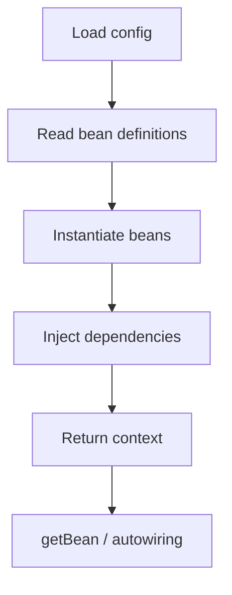

# IOC Container

## 1. Introduction

The **IOC (Inversion of Control) container** is the heart of Spring. It instantiates, configures, and assembles your objects — the developer only declares what exists.

---

## 2. Why This Topic Is Important

- Everything in Spring flows through the container.
- IOC is the most-asked Spring interview concept.
- Understanding it demystifies autowiring and scopes.
- It's the foundation of testable, decoupled code.

---

## 3. Real-World Analogy

Imagine a **restaurant kitchen**:
- You (developer) provide the **recipe** (configuration).
- The **kitchen manager** (container) stocks the pantry, prepares dishes, and delivers plates.
- Chefs (beans) never shop for ingredients themselves — they receive what they need. Control is **inverted**: you don't build, the kitchen does.

---

## 4. Theory

### What the Container Does
| Responsibility | Detail |
|----------------|--------|
| Instantiate | Create beans from config/annotations |
| Configure | Set properties and wiring |
| Assemble | Inject dependencies |
| Manage | Lifecycle, scopes, cleanup |

### Container Types
| Type | Description |
|------|-------------|
| `BeanFactory` | Minimal container (lazy) |
| `ApplicationContext` | Full-featured (used everywhere) |
| `AnnotationConfigApplicationContext` | Java-config based |
| `ClassPathXmlApplicationContext` | XML based (legacy) |

### IOC vs DI
| Term | Meaning |
|------|---------|
| IOC | Design principle: container owns the object lifecycle |
| DI | Technique: dependencies injected, not constructed |
| Relationship | DI is how IOC is achieved in Spring |

---

## 5. Syntax

```java
ApplicationContext ctx =
        new AnnotationConfigApplicationContext(MyConfig.class);

Bean b = ctx.getBean(Bean.class);
```

---

## 6. Flow Explanation



---

## 7. Memory Representation

The container is one object holding a map of bean name → singleton instance (or prototype factory).

---

## 8. Simple Example — Container Basics

```java
import org.springframework.context.ApplicationContext;
import org.springframework.context.annotation.*;

class Engine {
    public String type() { return "V8"; }
}

@Configuration
class AppConfig {
    @Bean
    Engine engine() { return new Engine(); }
}

public class ContainerDemo {
    public static void main(String[] args) {
        ApplicationContext ctx =
                new AnnotationConfigApplicationContext(AppConfig.class);

        Engine engine = ctx.getBean(Engine.class);
        System.out.println("Engine: " + engine.type());

        System.out.println("Bean names: "
                + java.util.Arrays.toString(ctx.getBeanDefinitionNames()));
    }
}
```

---

## 9. Intermediate Example — Lazy Beans

```java
import org.springframework.context.ApplicationContext;
import org.springframework.context.annotation.*;

class ExpensiveBean {
    ExpensiveBean() {
        System.out.println("ExpensiveBean created");
    }
}

@Configuration
class Config {
    @Bean
    @Lazy
    ExpensiveBean expensive() { return new ExpensiveBean(); }
}

public class LazyDemo {
    public static void main(String[] args) {
        System.out.println("Creating context...");
        ApplicationContext ctx =
                new AnnotationConfigApplicationContext(Config.class);
        System.out.println("Context ready.");

        System.out.println("Requesting bean...");
        ctx.getBean(ExpensiveBean.class);   // created now
    }
}
```

---

## 10. Advanced Example — Conditional Bean

```java
import org.springframework.context.ApplicationContext;
import org.springframework.context.annotation.*;

class Cache {
    public String mode() { return "memory"; }
}

@Configuration
class Config {
    @Bean
    @ConditionalOnProperty(name = "cache.enabled", havingValue = "true")
    Cache cache() {
        return new Cache();
    }
}

class CacheEnabledCondition
        implements org.springframework.context.annotation.Condition {
    public boolean matches(
            org.springframework.context.annotation.ConditionContext ctx,
            org.springframework.core.type.AnnotatedTypeMetadata m) {
        return Boolean.parseBoolean(
                System.getProperty("cache.enabled", "false"));
    }
}
```

---

## 11. Output

For the **Simple Example**:

```
Engine: V8
Bean names: [appConfig, engine]
```

For the **Intermediate Example**:

```
Creating context...
Context ready.
Requesting bean...
ExpensiveBean created
```

---

## 12. Common Mistakes

| Mistake | Correction |
|---------|------------|
| Calling `new` for beans | Let the container create them |
| Expecting beans before context | Get beans from the context |
| Eager beans that are heavy | Mark @Lazy |
| Multiple contexts | Confusion and duplicate beans |
| Forgetting config is loaded | Context needs a config class |

---

## 13. Best Practices

- Use `ApplicationContext`, not bare `BeanFactory`.
- Prefer Java config (`@Configuration`) over XML.
- Mark expensive beans `@Lazy`.
- Access beans via injection, not `getBean` in app code.
- Keep configs focused and cohesive.

---

## 14. Interview Questions

**Q1. What is the Spring container?**
*The object that creates, wires, and manages beans.*

**Q2. BeanFactory vs ApplicationContext?**
*ApplicationContext adds features (events, messages, AOP) on top of BeanFactory.*

**Q3. What is IOC?**
*Object lifecycle ownership inverted to the container.*

**Q4. What is DI?**
*Dependencies are injected by the container, not constructed internally.*

**Q5. When is a bean created?**
*Eagerly at context startup by default; @Lazy defers to first use.*

---

## 15. Practice Exercises

1. Build a context with one bean and get it.
2. List all bean definition names.
3. Create a lazy bean and observe creation timing.
4. Wire two beans where one depends on the other.

---

## 16. Coding Challenges

1. **Easy:** Context with a simple bean.
2. **Medium:** Lazy vs eager bean timing demo.
3. **Hard:** A conditionally created bean based on a system property.

---

## 17. Summary

- IOC container owns bean lifecycle.
- ApplicationContext = the real container.
- Instantiate → configure → inject → manage.
- Lazy beans defer creation.
- Everything in Spring depends on the container.

➡️ Continue to: [Beans & Bean Scope](Beans-and-BeanScope.md)